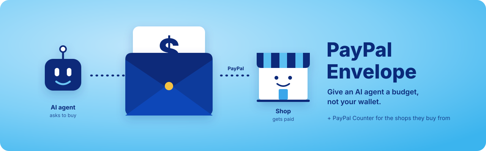
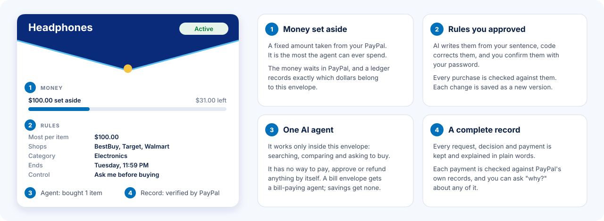
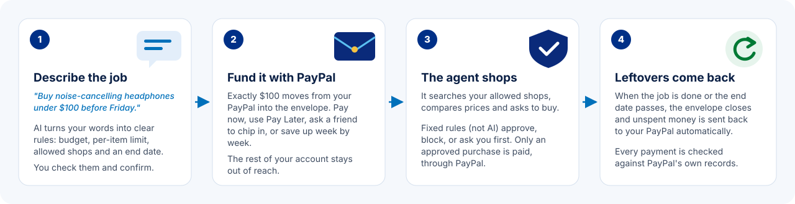
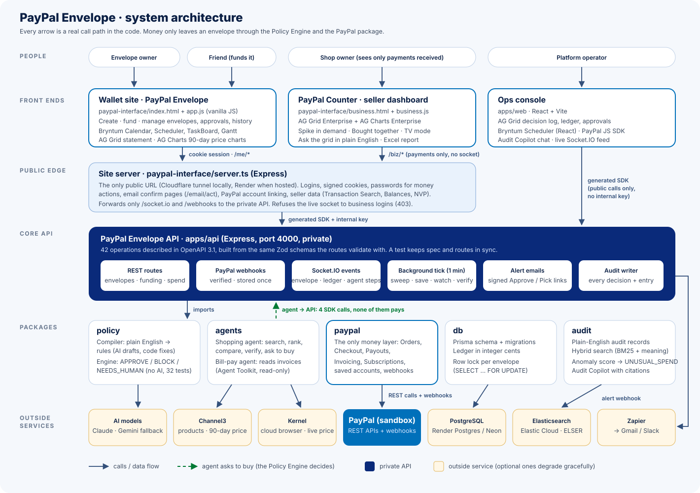
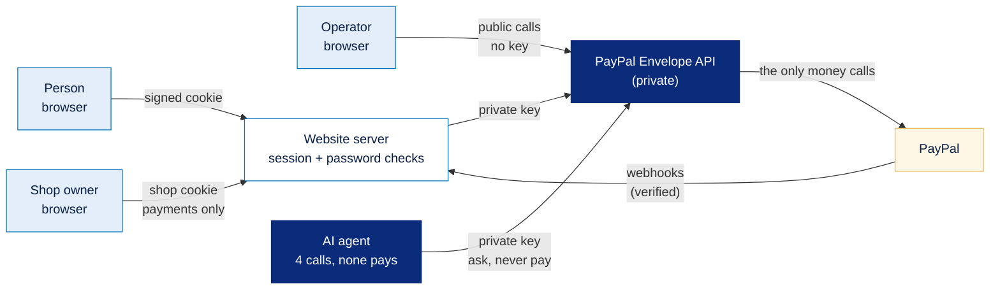
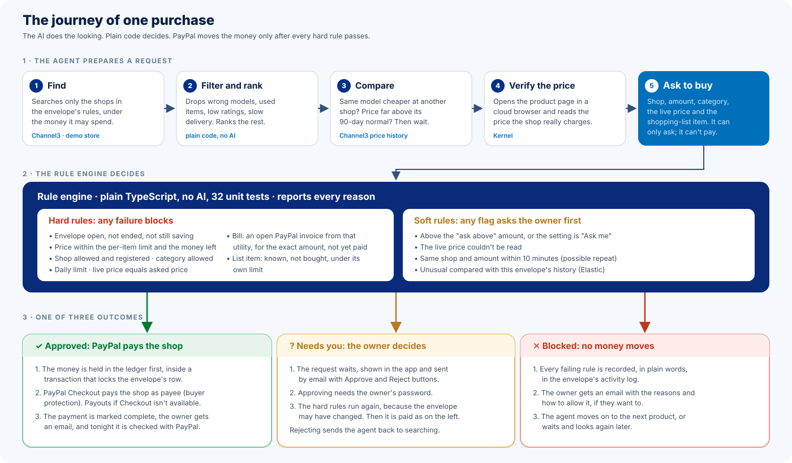
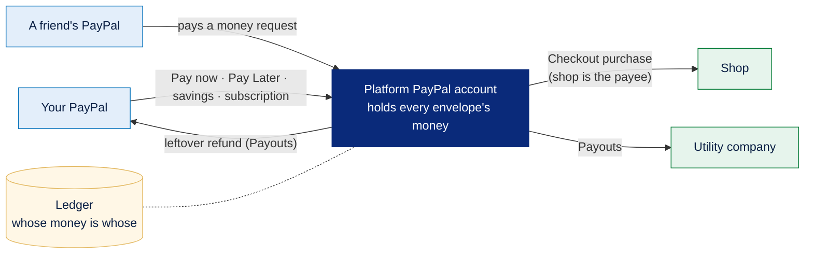
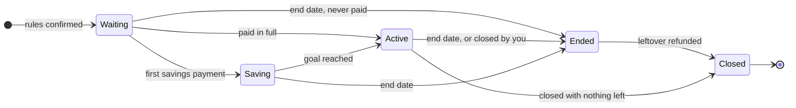
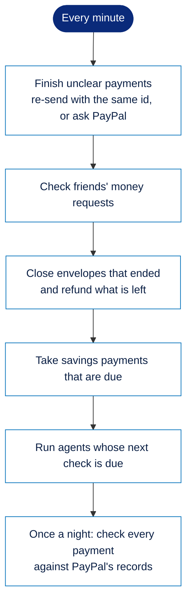
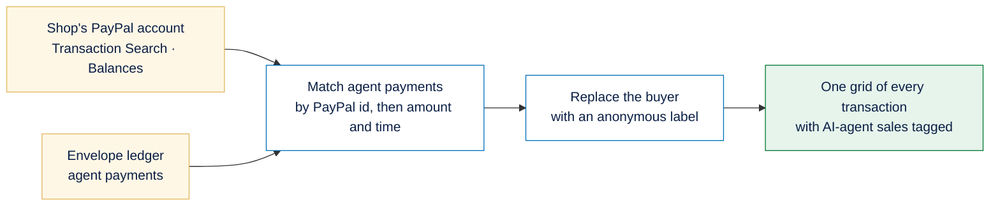

<div align="center">



# PayPal Envelope

**Let an AI agent shop and pay bills for you, without ever handing it your PayPal account.**


[What it is](#what-is-paypal-envelope) ·
[How it works](#how-it-works) ·
[Features](#features) ·
[Run it yourself](#-run-it-yourself) ·
[Sign up](#sign-up-and-get-alerts-in-your-own-inbox) ·
[Architecture](#architecture) ·
[Built with](#built-with) ·
[What's next](#whats-next-on-render)

</div>

---

## What is PayPal Envelope?

PayPal Envelope gives an AI agent **its own small pot of money for one job**, instead of access to your whole PayPal account.

You create an envelope by saying what you want done, for example *"buy noise-cancelling headphones under $100 before Friday"*. PayPal Envelope sets aside exactly $100 from your PayPal, writes down the rules for the job, and hands the job to an AI agent. The agent searches shops, compares prices and asks to buy. Every request is checked against your rules by plain code before PayPal moves a single cent, and anything left over goes back to your PayPal when the envelope closes.



An envelope is different from giving an agent your card in three ways:

- **It has a ceiling.** The agent can never spend more than what you put in, and never more than your per-item limit.
- **It has rules that code enforces.** Shops, categories, a daily limit, an end date and how much the agent may decide alone. The AI helps write them; it never decides whether a payment goes through.
- **It ends.** Every envelope has an end date. When it closes, unspent money returns to your PayPal automatically.

There are three kinds of envelope:

| Kind | Example | Who does the work |
| :--- | :--- | :--- |
| **Shopping** | *"A laptop under $600, a bag under $50 and headphones under $40 for school"* | A shopping agent, item by item |
| **Bill pay** | *"Pay the City Utility electricity bill this month"* | A bill-paying agent that reads PayPal invoices |
| **Savings** | *"Save $50 a week for a $500 emergency fund"* | No agent: PayPal takes the payments on schedule |

PayPal Envelope also has a second side. Every agent purchase lands at a shop, so we built **PayPal Counter**, a section of PayPal Business that shows shops which sales came from AI agents, warns them when agents buy unusually fast, and never reveals anything private about the buyer.

---

## Why we built it

AI agents are getting good at shopping, but paying is still the hard part. Today there are two options, and neither works well:

- **Give the agent your card or PayPal login.** It can then spend anything, anywhere, and one mistake or one bad prompt can cost you a lot.
- **Approve every step yourself.** That is safe, but the agent saves you almost no time.

An envelope sits in between. The agent gets **real spending power with a hard ceiling**: a budget, a list of shops, a per-item limit and an end date. The decision to pay is never made by the AI.

Shops face a new problem too. Agents buy at machine speed, so a price typed wrong can sell out in minutes, and an agent sale looks like any other payment. PayPal Counter gives shops a clear view of this new kind of customer.

---

## How it works



1. **Describe the job.** Type what you want in plain English, or paste a product link. AI turns it into rules: the budget, the most it may pay for one item, the shops it may use, the categories and the end date. You review them and confirm with your password.
2. **Fund it with PayPal.** Exactly that amount moves from your PayPal into the envelope. You can pay at once, use PayPal Pay Later, ask a friend to fund it with a PayPal money request, or pay in a little at a time until you reach a goal.
3. **The agent shops.** It searches your allowed shops, compares the same product across stores, checks the price against its 90-day history and reads the live price on the shop's page. Then it asks to buy. A rule engine approves the purchase, blocks it with every reason, or asks you first. Only an approved purchase is paid, through PayPal.
4. **Leftovers come back.** When the job is done or the end date passes, the envelope closes and unspent money returns to your PayPal. Every payment along the way is checked against PayPal's own records.

### An example, start to finish

> Kajla writes: *"Buy me a pair of headphones within $100, before next Tuesday."*
>
> The rules come back as: budget $100, at most $100 per item, shops BestBuy, Target and Walmart, category Electronics, ending Tuesday at midnight. She picks **Pay now**, enters her password, and $100 moves from her PayPal into the envelope.
>
> The agent finds premium headphones for $112 at Target and asks to buy them. The rule engine blocks the request because the price is above the per-item limit and above what the envelope holds. No money moves, and the reason shows up in her activity log.
>
> Next it finds studio headphones for $69 at BestBuy. The same model costs more at the other two shops, the price is normal for the last 90 days, and the live price on BestBuy's page matches. Every rule passes, and PayPal pays BestBuy $69.
>
> On Tuesday the envelope closes and the remaining $31 goes back to Kajla's PayPal. At BestBuy's end, PayPal Counter shows a $69 sale tagged *AI agent*, from an anonymous customer label.

---

## Features

### PayPal Envelope (for people)

#### You decide how much the agent does alone

| Setting | Behaviour |
| :--- | :--- |
| **Ask me** (default) | The agent shortlists its **top 3 options**, with photos, pros and cons, prices at other stores and a 90-day price chart. Nothing is bought until you pick one. |
| **Ask above an amount** | The agent buys on its own up to an amount you choose, and asks you above it. |
| **Autopilot** | The agent buys on its own, always inside the rules. |

Whatever the setting, you are always asked when the live price couldn't be checked, when the same purchase seems to repeat within a few minutes, or when a purchase looks unusual for that envelope.

#### Creating an envelope

- **Plain English in, rules out.** AI drafts the rules, then code corrects the draft: US dollars only, up to $10,000, a per-item limit no higher than the budget, only registered shops, and an end date 7 days out by default (at most 90 days, or 2 years for savings). Every correction is shown as a note before you confirm.
- **Start from a product link.** Paste a Best Buy, Walmart or Target link and the product, its price at other stores and its 90-day price history fill in. Set a lower amount and the agent waits for the price to drop to it.
- **Shopping lists.** Several items in one envelope, each with its own limit. Money one item didn't need can go to the items still to buy.
- **Created once.** A double click, or a retry after an error, can never create the same envelope twice.

#### Funding, PayPal only

| Option | How it works |
| :--- | :--- |
| **Pay now** | Your PayPal account is linked once. After that, money moves without a popup, after your password. |
| **Pay Later** | PayPal Pay in 4: the envelope gets the full amount now and you repay PayPal in four parts. |
| **Ask a friend** | A real PayPal money request goes to your friend. Their payment lands straight in the envelope. |
| **Save over time** | Payments on a schedule, which you can pause, resume, pay early or move. Three declined payments in a row pause the plan. |
| **Monthly top-up** | Bill envelopes only, through a PayPal subscription. |

#### Staying in control

- **Live activity log** for each envelope: what the agent searched, compared and asked for. Green for bought, amber for waiting on you, red for blocked.
- **Change your mind.** Describe new rules or a new amount. A lower amount sends the difference back to your PayPal right away; a higher one takes the extra from it. Purchases waiting under the old rules are cancelled.
- **Your password for anything that moves money:** paying, approving, picking an option, changing rules or moving dates.
- **Answer from your inbox.** Alert emails carry Approve / Reject or Pick 1 / 2 / 3 / None buttons. They work once, expire after 24 hours, and open a confirm page that asks for your password.
- **Close any time.** Closing an envelope sends what's left straight back to your PayPal.

#### Seeing the whole picture

- **Calendar** of every envelope, with a heatmap of money moved in the year view. Drag the end date or the next savings payment, and see what that changes before you drop it.
- **Timeline** of one envelope in four lanes (envelope, money, agent, you), with a **Replay** button that plays its history back step by step.
- **Board** with one card per item, moving from *Searching* to *Options ready* to *Needs you* to *Bought* as the agent works.
- **Plan** that shows a savings plan as linked payments leading to the goal.
- **All activity**: one statement across every envelope.

#### Trust

- **Verified by PayPal.** Each payment is checked, read-only, against PayPal's own records and marked *Verified*, *Waiting*, *Mismatch* or *Not checkable*, with PayPal's transaction id.
- **Ask why.** An audit assistant answers *"Why was my first purchase blocked?"* using only the records it finds, and cites them.
- **Unusual-spend check.** A purchase far above what the envelope usually spends, or at a new shop or in a new category, waits for you.

### PayPal Counter (for shops)

- **Privacy first.** A shop sees what any PayPal payment tells it: the amount, the item, refunds, fees, and an **anonymous buyer label** such as *Customer 7F2A9C*. Labels can't be linked across shops, and a shop never sees a customer's rules, budget or what the agent decided not to buy.
- **Every transaction in one grid.** Sales, invoices, payouts received, refunds, fees and withdrawals, with AI-agent payments recognised and tagged. Group, pivot, filter, edit your own *Reconciled / Tag / Note* columns, save views and export to Excel.
- **Charts that follow the grid**, a **morning briefing**, and **questions in plain English** such as *"refunds over $40 this week"*.
- **Spike in demand.** An alert when a product is suddenly bought by many different customers, or far below its usual price, so the owner can check for a pricing mistake.
- **Bought together.** Product pairs bought by the same customer, shown only when at least two different customers bought both.
- **Accountant report** as an Excel workbook or CSV, and a full-screen **TV mode** for a wall display.

---

## 🚀 Run it yourself

**Prerequisites:** Node.js 20+, PostgreSQL, a PayPal Developer account with sandbox accounts, and an Anthropic and/or Google Gemini API key. Channel3, Kernel, Elastic, Zapier, AG Grid and Bryntum keys are optional.

```bash
npm install
cp .env.example .env            # fill it in (see .env.example for every variable)
npm run db:deploy               # apply the Prisma migrations
npm run db:seed                 # demo user + the merchant registry

# One-time PayPal setup
npm run setup:plan -w packages/paypal              # monthly top-up plan  → PAYPAL_UTILITY_PLAN_ID
npm run setup:checkout -w apps/api                 # save the platform's PayPal for Checkout purchases
npm run setup:webhooks -w packages/paypal -- https://<public-url>   # → PAYPAL_WEBHOOK_ID, UTILITY_WEBHOOK_ID

# Run
npm run up                # API + site + Cloudflare link (macOS / Linux)
npm run api:dev           # or part by part: API      http://localhost:4000
npm run site:dev          #                  site     http://localhost:3000  (Counter: /business)
npm run web:dev           #                  console  http://localhost:5173
```

| Side | Username | Password |
| :--- | :--- | :--- |
| 👤 PayPal Envelope | `kajla@personal.example.com` · `jugal@personal.example.com` | `1234` |
| 🏪 PayPal Counter | `audio-store@business.examle.com` | `12345678` |

> On Windows, run the parts separately (`npm run up` uses POSIX process groups) and set `CHROME_PATH` for the hidden browser that reads a personal sandbox balance, or set `KERNEL_API_KEY` to use Kernel's cloud browser instead.

---

## Sign up and get alerts in your own inbox

Anyone can try PayPal Envelope with their own name, password and email, with no PayPal sandbox account of their own. A new sign-up opens the shared demo customer (the same PayPal sandbox account as `kajla`), greets them by their own name, and sends **every alert email for the envelopes they create to their own inbox**.

### Steps

1. **Open the site** and press **Sign Up** on the login screen.
2. **Choose the account type.** Pick **Personal account** to create envelopes and receive emails. (*Business account* opens the demo shop's PayPal Counter instead.)
3. **Fill in the form** and press **Create Account**:

   | Field | What to enter |
   | :--- | :--- |
   | Full name | 2 to 60 characters. Emails and the site greet you by this name. |
   | Email | **The inbox where you want the alerts.** You also log in with it. |
   | Create password | At least 6 characters. This is the password you'll use to confirm payments. |
   | Confirm password | The same password again |

   You are logged in straight away.
4. **Create an envelope** and confirm it with **your own password**. The envelope remembers your email, so all of its alerts go to you, even if someone else signs up or logs in afterwards.
5. **Check your inbox.** The first email, *"Your envelope is live"*, arrives as soon as the money is in. Every subject starts with the envelope's name and a short id, for example *[Headphones · #H7K2P]*. After that you get an email for each purchase, approval, set of options, block, refund and the closing summary.
6. **Answer from the email.** *Approve*, *Reject* and *Pick 1 / 2 / 3* open a confirm page. Approve and Pick ask for **your sign-up password**.

Next time, log in with **your email and password**.

### Good to know

- **It's a shared demo account.** Everyone who signs up uses the same demo customer, so you see the same envelopes and the same PayPal sandbox balance as `kajla`.
- **Your envelopes email you.** Emails for envelopes created before you signed up go to the person who logged in most recently.
- **One account per email.** Signing up with an email that is already registered shows *"An account with this email already exists. Log in instead."*
- **Where sign-ups are stored.** They are saved on the website server in `paypal-interface/data/signups.json`, with passwords stored as salted scrypt hashes, never as plain text. On a host whose disk resets on every deploy (such as Render's free tier), sign-ups need to be created again after a deploy.
- **Which demo accounts sign-ups open.** `SIGNUP_BASE_ACCOUNT` (default `kajla`) sets the personal account and `SIGNUP_BUSINESS_ACCOUNT` (default `audiostore`) sets the shop.

---

## Architecture



PayPal Envelope is a TypeScript monorepo of five running parts and five core packages.

| Part | Folder | Responsibility |
| :--- | :--- | :--- |
| **Website** | `paypal-interface/` | The PayPal-style site for people and PayPal Counter for shops. Its Express server signs people in with signed cookies, checks the password for every action that moves money, serves the email confirm pages, links PayPal accounts, and reads shops' PayPal reports. It is the **only public address**. |
| **PayPal Envelope API** | `apps/api/` | The private core. About 40 routes for envelopes, funding, purchases, the agent, savings and audit; PayPal webhooks; Socket.IO live updates; alert emails; and a job that runs every minute. |
| **Operations console** | `apps/web/` | A React dashboard for whoever runs the platform: every envelope, every decision, pending approvals, the ledger and a timeline. |
| **Scheduled job** | `apps/sweeper/` | Runs the minute job from a cron schedule when the API's own timer is off. |
| **Core packages** | `packages/` | `policy` writes and checks rules, `agents` runs the shopping and bill-pay agents, `paypal` is the only code that moves money, `db` holds the ledger, `audit` keeps searchable records. Two generated SDKs sit beside them. |

### Three rules that shape the design

1. **Only one package can move money.** Paying, refunding and charging all go through `packages/paypal`.
2. **The agent can only ask.** It reaches the API through a client with four calls: read its envelope, list the shops, ask to buy, and suggest options. None of them pays.
3. **The rule engine is plain code.** AI writes rules and searches for products. It never decides whether money moves.

### Who can talk to what

Each caller gets only the access it needs. The private key and the passwords never reach a browser or the AI.



### The journey of one purchase



The agent prepares a request in four steps, and code does the work in each: Channel3 finds products only in allowed shops, a ranking function filters and orders them, store comparison and the 90-day price history decide whether to buy now, and Kernel reads the real price on the page. The request then goes to the rule engine, which checks every hard rule and every soft rule and reports **all** the reasons, not just the first. The result is one of three outcomes: paid through PayPal, sent to the owner, or blocked with nothing paid.

### How money moves

All envelope money is held in one PayPal business account for the platform. A **ledger** in whole cents records which part belongs to which envelope, and a nightly check compares every ledger entry with PayPal's own records.



| From | To | PayPal product |
| :--- | :--- | :--- |
| Your PayPal | Platform | Orders v2 with a saved PayPal account, Pay Later, or a subscription |
| A friend's PayPal | Platform | Invoicing (a money request) |
| Platform | A shop | PayPal Checkout with the shop as payee, or Payouts as a fallback |
| Platform | A utility | Payouts, then the invoice is marked paid |
| Platform | Your PayPal | Payouts (leftover refunds) |

Real store names such as BestBuy, Target and Walmart are mapped to sandbox merchant accounts, because real stores can't receive sandbox money.

### The life of an envelope



- **Waiting** for its money: the agent doesn't start yet.
- **Saving**: money comes in on schedule, nothing can be spent.
- **Active**: the agent works and purchases can happen.
- **Ended**: no more purchases, the leftover is being refunded.
- **Closed**: everything is settled and the envelope moves to history.

### What runs every minute

Webhooks bring PayPal's news instantly. A background job runs every minute as a safety net and to do the work that is due.



Each step **claims** its work in the database before doing it, so two servers, or the API timer and the cron job together, never run the same thing twice.

### Where PayPal Counter's numbers come from



The shop's own transactions are read from PayPal (read-only) and cached, then the platform's agent payments are matched to them. The buyer of an agent payment is replaced by a label made from a keyed hash of the shop and the customer, so the same customer has the same label at one shop but can't be followed across shops.

### How we keep money safe

| Promise | How |
| :--- | :--- |
| The agent can't pay anyone | Its four calls don't include paying, approving, refunding or closing |
| Two purchases can't spend the same dollar | Every balance change locks the envelope's row in the database, and the money is held before PayPal is called (tested with 10 purchases at once) |
| A retry never pays twice | Each payment's ledger id is also its PayPal request id, so PayPal returns the first result instead of paying again |
| Prices can't be made up | The price comes from the shop's listing and is re-read live on the product page |
| Webhooks can't be forged | Each one is verified with PayPal and processed only once |
| Missed messages don't lose money | Webhooks are the fast path; the minute job and a Sync button ask PayPal again |
| Money always comes home | Ended envelopes are refunded automatically; a failed refund is retried, then flagged for a person |

---

## Built with

| Tool | What we used it for | Guide |
| :--- | :--- | :--- |
| **PayPal** | Every payment: funding, purchases, bills, refunds, money requests, verification and shop reports | [PayPal guide](tools/paypal/README.md) |
| **AG Grid + AG Charts** | PayPal Counter's grid and charts, the activity statement, the operations console | [AG Grid guide](tools/ag-grid/README.md) |
| **Bryntum** | Calendar, Timeline, Board and Plan views | [Bryntum guide](tools/bryntum/README.md) |
| **APIMatic** | The typed SDK every client uses, and an SDK for PayPal APIs | [APIMatic guide](tools/apimatic/README.md) |
| **Channel3** | Product search, store comparison, 90-day prices, product links | [Channel3 guide](tools/channel3/README.md) |
| **Kernel** | A cloud browser that reads the live price on the shop's page | [Kernel guide](tools/kernel/README.md) |
| **Elastic** | Audit records, search, the audit assistant, the unusual-spend check | [Elastic guide](tools/elastic/README.md) |
| **Zapier** | Alert emails with Approve and Pick buttons | [Zapier guide](tools/zapier/README.md) |
| **Render** | How the services are hosted, and what we'd add next | [Render guide](tools/render/README.md) |
| **PostgreSQL + Prisma** | The ledger and every envelope's data | [Database guide](tools/postgresql-prisma/README.md) |
| **Socket.IO** | Live updates and the agent's steps as they happen | [Socket.IO guide](tools/socket-io/README.md) |
| **Postman** | Sandbox and end-to-end API tests | [Postman guide](tools/postman/README.md) |

### PayPal

PayPal moves every cent. **Orders v2** funds envelopes and pays shops through **PayPal Checkout** (the shop is the payee, so each agent purchase has buyer protection), the **JavaScript SDK** draws the PayPal and Pay Later buttons, **saved PayPal accounts** let people link once and pay without a popup, **Payouts** pay bills and return leftovers, **Invoicing** carries utility bills and friends' money requests, **Subscriptions** top up bill envelopes, and **Webhooks** bring instant updates. **Transaction Search** and **Balances** feed PayPal Counter, and the **PayPal Agent Toolkit** lets the bill-pay agent read invoices.
→ [Read the PayPal guide](tools/paypal/README.md)

### AG Grid + AG Charts

PayPal Counter is built on **AG Grid Enterprise** and **AG Charts Enterprise**: grouping with totals, pivot mode, set filters, expandable rows with line items, editing with undo, saved views, charts made from the grid's own rows, cross-filtering, sparklines and Excel export.
→ [Read the AG Grid guide](tools/ag-grid/README.md)

### Bryntum

Four Bryntum products share one page: **Calendar** for every envelope at a glance, **Scheduler** for one envelope's timeline with Replay, **TaskBoard** for the items being bought, and **Gantt** for savings plans. Dragging changes real data, after a live preview and a password check.
→ [Read the Bryntum guide](tools/bryntum/README.md)

### APIMatic

Our private API is described in **OpenAPI 3.1**, generated from the same schemas the API validates with, and a test keeps the two identical. APIMatic turns that into the **TypeScript SDK** used by the website, the agents and the console, and into an SDK for PayPal APIs that PayPal's Server SDK doesn't cover.
→ [Read the APIMatic guide](tools/apimatic/README.md)

### Channel3

Channel3's product data makes the agent a careful shopper: it searches only allowed shops, finds the same model at every store so the cheapest wins, checks today's price against the last 90 days, and turns a pasted link into a ready-made envelope.
→ [Read the Channel3 guide](tools/channel3/README.md)

### Kernel

Kernel opens the product page in a cloud browser so the agent reads the price the shop actually charges. A different price blocks the purchase.
→ [Read the Kernel guide](tools/kernel/README.md)

### Elastic

Every decision and payment becomes a plain-English record in **Elasticsearch**, searchable by keywords and by meaning. That powers the audit assistant and the unusual-spend check.
→ [Read the Elastic guide](tools/elastic/README.md)

### Zapier

The API writes 14 kinds of alert email and hands them to a **Zapier** webhook that delivers them through Gmail, with signed buttons to answer from the inbox.
→ [Read the Zapier guide](tools/zapier/README.md)

### Render

The project maps onto **Render** as a public web service, a private API service, a cron job, a static site and managed PostgreSQL.
→ [Read the Render guide](tools/render/README.md)

### PostgreSQL + Prisma, Socket.IO and Postman

- **PostgreSQL + Prisma** store the ledger in whole cents, with every balance change in one locked transaction. → [Database guide](tools/postgresql-prisma/README.md)
- **Socket.IO** sends envelope changes and the agent's steps to the browser as they happen. → [Socket.IO guide](tools/socket-io/README.md)
- **Postman** collections test PayPal's sandbox behaviour and the full API flow. → [Postman guide](tools/postman/README.md)

---

## Testing

```bash
npm run typecheck
npm test --workspaces --if-present
```

There are **86 unit tests**: 32 for the rules package (rule engine, rules writer, shopping lists, savings plans, signed email links), 20 for the agents (ranking, store matching, options, price reading), 15 for the ledger against a real database (including ten purchases at once), 13 for alert emails and the API description, 4 for the audit records and 2 for money formatting. Every database test ends by recomputing the balance from the ledger and comparing it. Postman collections cover PayPal's sandbox, including declined and refused payments, and the full API flow from creating an envelope to the final refund.

---

## Project layout

```text
apps/
  api/                PayPal Envelope API: routes, webhooks, live updates, emails, minute job
  web/                Operations console (React)
  sweeper/            Cron entry point for the minute job
packages/
  policy/             Rules writer and rule engine
  agents/             Shopping and bill-pay agents
  paypal/             All PayPal calls that move money
  db/                 Database schema, migrations and ledger
  audit/              Audit records, search and assistant
paypal-interface/     Website for people and PayPal Counter for shops
postman/              API test collections
scripts/              Start-up, Bryntum bundle and SDK generation
```

---

## What's next on Render

Today the project runs on a layout that fits Render: one public web service, the API, a cron job, a static site and PostgreSQL. These are the Render features we would add next, and why each isn't in the current build.

| Improvement | What it would add | Why it isn't in yet |
| :--- | :--- | :--- |
| **One-click Blueprint** (`render.yaml` with environment groups) | Anyone could deploy all five services in minutes | The project needs more than 30 secrets that differ per teammate. We configured services by hand so no secret could end up in the repository. |
| **Background Worker** for the agents and the minute job | Long agent runs no longer share a process with web requests | Workers are a paid instance type, and free web services sleep when idle. The minute job inside the API plus a cron job covered the demo. |
| **Render Key Value** (Redis) | Live updates across several instances, a shared "agent is running" lock, shared email de-duplication | That state lives in memory today, which is correct for one instance. Moving it is a change we couldn't test properly in the time we had. |
| **Data files moved into PostgreSQL** | Sign-ups, shop notes and cached reports survive a redeploy | Render's disk resets on every deploy, and a persistent disk needs a paid plan and rules out zero-downtime deploys. |
| **Private networking only** | The API and database have no public address at all | Private services aren't on the free tier. The website already passes only two kinds of traffic to the API. |
| **Preview environments** | A live copy of every pull request for reviewers | Each copy needs its own database and its own PayPal webhook registration, which was too much setup per branch for three people. |
| **Autoscaling and zero-downtime deploys** | Handle a rush of agent purchases | It depends on Key Value first: with in-memory locks, two instances could run the same agent twice. |
| **Database backups and a read replica** | Point-in-time recovery for the ledger, and shop reports from a replica | These are paid tiers, and the sandbox ledger only holds test money. |
| **Log streams and alerts** | A warning when payouts keep failing or the minute job stalls | We spent that time on *Verified by PayPal* and on alerts that reach the envelope owner directly. |
| **Custom domain with HTTPS** | A stable address for PayPal webhooks and email buttons | During development a Cloudflare quick tunnel let each of us demo from our own laptop with no setup. |

**Other reasons, beyond time and budget:**

- **Real money needs real approval.** Payouts, saved accounts and Invoicing need PayPal's production approval, and holding many people's money in one account would need licensing and a compliance review. We stayed in the sandbox on purpose.
- **Licence keys reach the browser.** AG Grid and Bryntum keys are served to the page by design, so a long-running public site needs keys locked to its domain.
- **Free quotas run out.** A public link left open for judges could use up the free AI, Channel3 and Elastic quotas, which is why each of them has a fallback.

More detail is in the [Render guide](tools/render/README.md).

---

## Team

**Manish Kajla · Jugal Pahuja · Venkat Sai**

Built for the ** PayPal and AI Hackathon 2026**. All money in this project is PayPal sandbox money.
