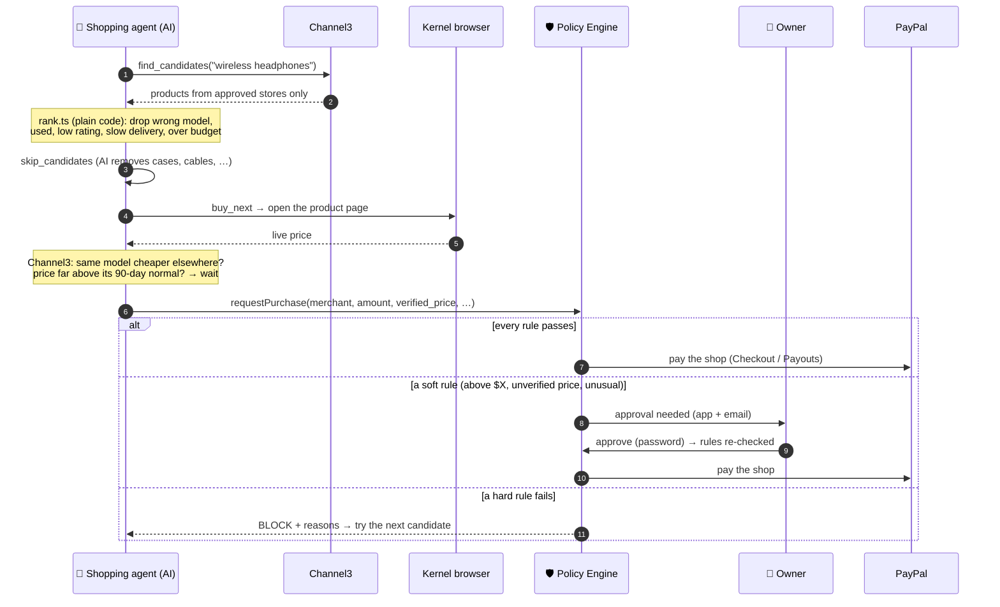
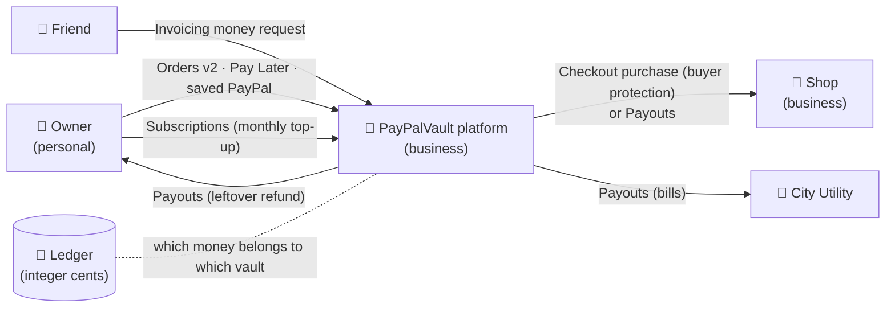
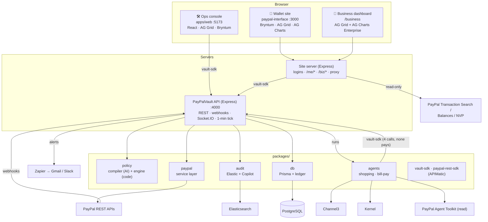

<div align="center">

# 🛡️ PayPalVault

### Give an AI agent a budget, not your wallet.

**Policy-limited PayPal vaults for AI shopping agents, and a PayPal Business dashboard for the shops they buy from.**


*Built for the **Build What's Next with PayPal and AI** Global Hackathon 2026. All money is sandbox money.*

</div>

---

## 📖 Contents

1. [The idea in one minute](#-the-idea-in-one-minute)
2. [Two sides of one product](#-two-sides-of-one-product)
3. [**Part 1: Personal side, PayPalVault**](#-part-1--personal-side-paypalvault)
   - [What a person can do](#11-what-a-person-can-do)
   - [Vault types and control modes](#12-vault-types-and-control-modes)
   - [Creating a vault](#13-creating-a-vault-plain-english--rules)
   - [Funding a vault](#14-funding-a-vault-paypal-only)
   - [The AI agents](#15-the-ai-agents)
   - [The Policy Engine (the guardrail)](#16-the-policy-engine-the-guardrail)
   - [Paying shops and closing vaults](#17-paying-shops-and-closing-vaults)
   - [Managing a vault](#18-managing-a-vault)
   - [Bryntum: calendar, timeline, board, plan](#19-bryntum-calendar-timeline-board-plan)
   - [Answer from your inbox](#110-answer-from-your-inbox)
   - [Verified by PayPal](#111-verified-by-paypal)
   - [Audit Copilot](#112-audit-copilot-elastic)
   - [Operations dashboard (React)](#113-operations-dashboard-react--apps-web)
4. [**Part 2: Business side, the seller dashboard**](#-part-2--business-side-the-seller-dashboard)
   - [The confidentiality rule](#21-the-confidentiality-rule)
   - [The PayPal Business home](#22-the-paypal-business-home)
   - [The AG Grid Enterprise transactions grid](#23-the-ag-grid-enterprise-transactions-grid)
   - [Ask the grid in plain English](#24-ask-the-grid-in-plain-english)
   - [Agent-era insights](#25-agent-era-insights)
   - [Accountant report and TV mode](#26-accountant-report-and-tv-mode)
   - [Where the seller data comes from](#27-where-the-seller-data-comes-from)
5. [How money moves](#-how-money-moves)
6. [Architecture](#-architecture)
7. [Tech and sponsor tools](#-tech-and-sponsor-tools)
8. [Getting started](#-getting-started)
9. [Configuration (.env)](#-configuration-env)
10. [API reference](#-api-reference)
11. [Data model](#-data-model)
12. [Safety guarantees](#-safety-guarantees)
13. [Testing](#-testing)
14. [Deploying to Render](#-deploying-to-render)
15. [Demo script](#-demo-script)
16. [Project layout](#-project-layout)

---

## 💡 The idea in one minute

AI agents can already shop. The problem is trust: nobody wants to hand an agent their PayPal account.

**PayPalVault** puts a small, rule-bound wallet between you and the agent:

```text
  "Buy me noise-cancelling headphones, max $45, before Sunday. Ask me first."
                                    │
                         AI turns it into rules
                                    ▼
   ┌──────────────── Vault: $50, ends Sunday, Ask me ────────────────┐
   │  AI agent searches  ──►  asks to buy  ──►  Policy Engine decides  │
   │                                          (fixed code, not AI)    │
   └──────────────────────────────────┬───────────────────────────────┘
                                      ▼
            ✅ approve  ·  ⛔ block  ·  🙋 ask the owner (app or email)
                                      ▼
            PayPal pays the shop  ·  leftovers refunded when the vault ends
```

- 🧠 **The AI writes the rules and does the shopping.** It **never** decides whether money moves.
- 🛡️ **A deterministic Policy Engine** checks every purchase: budget, per-item limit, shop, category, daily limit, live price, duplicates, unusual spending.
- 💸 **Every cent moves through PayPal** (Orders, Checkout, Payouts, Subscriptions, Invoicing), and every payment is **checked against PayPal's own records**.
- 🏪 **Shops get a PayPal Business dashboard** that recognises AI-agent sales without revealing anything about the buyer.

---

## 🧭 Two sides of one product

| | 👤 **Personal: PayPalVault** | 🏪 **Business: seller dashboard** |
| :--- | :--- | :--- |
| **Who** | A PayPal user who lets an AI agent shop or pay bills | A shop that receives payments from AI agents (and everyone else) |
| **Where** | Wallet site `http://localhost:3000` (+ ops console `:5173`) | Same site, `http://localhost:3000/business` |
| **Log in as** | `kajla` / `1234` · `jugal` / `1234` | `audiostore` / `12345678` · `cityutility` / `12345678` |
| **Sees** | Their own vaults, rules, agent logs, approvals, refunds | **Payments received only.** Never a customer's rules, budget, limits or missed sales |
| **Star tools** | AI agents · Policy Engine · Bryntum (4 products) · Channel3 · Elastic | AG Grid **Enterprise** · AG Charts Enterprise · plain-English grid AI |

---

# 👤 Part 1 · Personal side: PayPalVault

## 1.1 What a person can do

| | Feature | In one line |
| :---: | :--- | :--- |
| ✍️ | **Describe, don't configure** | Type what you want in plain English; AI turns it into rules you review before anything happens. |
| 🔗 | **Start from a product link** | Paste a store link; Channel3 fills in the item, the price, other stores and its 90-day price history. |
| 💳 | **Fund with PayPal** | Pay now from your linked PayPal, **Pay Later** (Pay in 4), or **ask a friend** to fund it with a PayPal money request. |
| 🐷 | **Save first, then shop** | `$20 every week` from your PayPal until the goal is reached; then the agent shops. |
| 🤖 | **Agent shops for you** | Searches approved stores, compares prices, checks the live price, asks to buy. |
| 🙋 | **You stay in control** | *Ask me* (pick from top 3), *Ask above $X*, or *Autopilot*: always inside the rules. |
| 📧 | **Approve from email** | Approve / Reject / Pick buttons in the alert email; password needed to spend. |
| 🗓️ | **See everything on a calendar** | Bryntum Calendar, Timeline (with **Replay**), Board and Plan; drag to reschedule. |
| ✅ | **Verified by PayPal** | Every payment checked read-only against PayPal's own records. |
| 💬 | **Ask "why?"** | Audit Copilot answers from cited audit records: *"Why was my purchase blocked?"* |
| ↩️ | **Leftovers come home** | When a vault ends, PayPal Payouts returns what's left to your PayPal. |

## 1.2 Vault types and control modes

**Three vault types**

| Type | What the agent does | Paid with |
| :--- | :--- | :--- |
| 🛍️ **SHOPPING** | Finds and buys one item, or a **shopping list** (up to 10 items, each with its own max price; leftover budget can roll over to later items) | PayPal Checkout (buyer protection), Payouts as fallback |
| 🧾 **UTILITY** | **Bill-pay agent** reads the utility's PayPal invoices and pays the open ones that match | Payouts; the invoice is then marked paid in PayPal. Optional monthly **PayPal Subscription** tops the vault up |
| 🐷 **SAVINGS** | No agent: `$X every day / week / month` is taken from your saved PayPal until the goal. A shopping vault can **save first** and shop once the goal is reached | PayPal saved-account payments (Vault API) |

**Three control modes** (the *Ask me* switch on the create screen and the vault page)

| Mode | Behaviour |
| :--- | :--- |
| **Ask me** | The agent proposes its **top 3 options** (photo, price, pros/cons, stores compared, price history). Nothing is bought until you pick one. |
| **Ask above $X** | Buys alone up to `$X`, asks you above it. |
| **Autopilot** | Buys alone, always within the rules. |

## 1.3 Creating a vault: plain English → rules

```text
Buy / Save  ─►  Amount · Description · Ask me switch · Pay: [Pay now] [Pay later] [Ask a friend]
            ─►  AI compiles the rules  ─►  Review (only real problems are flagged)  ─►  Password  ─►  Done
```

1. **The AI writes a draft** (`packages/policy/src/compiler.ts`): Claude first, Gemini as automatic backup, via the Vercel AI SDK `generateObject` + **Zod**. It knows the current time, your time zone and the registered shops, so *"before Sunday"* becomes an exact timestamp.
2. **Code fixes the draft** (`normalizeDraft`): USD only, budget between $0 and $10,000, per-item limit ≤ budget, only registered shops, end date 7 days by default and 90 at most (2 years for savings). Every change becomes a warning.
3. **You review it.** The yellow box shows only real problems: a shop removed, an item limit over budget, a list cut to 10 items, an end date shortened.

> The LLM only **writes** the policy. It never **decides** whether a payment goes through.

## 1.4 Funding a vault (PayPal only)

| Option | How it works | PayPal API |
| :--- | :--- | :--- |
| **Pay now** | Taken from your PayPal account, linked once in a popup on `sandbox.paypal.com` (saved payment method) | Vault (saved PayPal) + Orders v2 |
| **Pay Later** | PayPal's Pay in 4: the vault gets the full amount now, you repay PayPal in 4 parts (US, $30–$1,500) | JS SDK Pay Later + Orders v2 |
| **PayPal button** | Classic approve-and-capture flow (ops console) | JS SDK + Orders v2 |
| **Ask a friend** | The platform sends a **PayPal money request** to a friend; their payment goes straight into the vault. Friends see it under *"Money requests for you"* | Invoicing v2 |
| **Monthly top-up** | Utility vaults only | Subscriptions + Catalog Products |
| **Savings plan** | `$X every day / week / month`, pause / resume / pay now / move the next payment | Saved PayPal (Vault) |

## 1.5 The AI agents

Each agent lives **inside one vault** and only knows that vault. It talks to PayPalVault through the APIMatic-generated SDK, which exposes only **four calls**: read the vault, list shops, **ask to buy**, propose options. There is no call that pays, approves, refunds or closes.

### 🛍️ Shopping agent (`packages/agents/src/shopping.ts`)



- **Filtering and ranking are code, not AI** (`rank.ts`): required keywords, condition (new only), min rating, max delivery days, preferred keywords, and ranking weights for price / rating / delivery / model match.
- **Channel3 drives decisions** (`channel3.ts`):
  - **Compare stores:** the same model (same brand + model code, e.g. `WH-CH530`) at every approved store; the cheapest wins.
  - **Price history:** today's price vs. its **90-day** low / average. Clearly high → the agent **waits** (`WAITING_FOR_PRICE`) and checks again later.
  - **Savings:** every vault reports what Channel3 data saved.
- **Kernel** opens the product page in a cloud browser to read the **live price** (plain fetch as fallback). A different live price → `PRICE_MISMATCH` → next candidate.
- **Watch mode:** no match → look again every `check_every_minutes` until the vault ends. Funding starts the watch; a rejected pick restarts it.
- **Demo store** (`/demo-store`): price traps, used items, low ratings, slow delivery, an unapproved shop, and a **price drop** you can trigger live for judges.

### 🧾 Bill-pay agent (`packages/agents/src/billpay.ts`)

Reads the utility's invoices with the **PayPal Agent Toolkit** (read-only actions: `invoices.list`, `invoices.get`), and asks to pay each open invoice addressed to the platform. The engine re-checks the invoice **with PayPal** (exists, issued by this merchant, still open, exact total) before paying. After the payout succeeds, the invoice is recorded as paid in PayPal.

> No money-moving toolkit action is turned on. Money moves only through the Policy Engine.

## 1.6 The Policy Engine (the guardrail)

`packages/policy/src/engine.ts`: plain TypeScript, no AI, **32 unit tests**. It returns `APPROVE`, `BLOCK` or `NEEDS_HUMAN`, plus **every** reason (not just the first).

<table>
<tr><th>⛔ Hard rules → <code>BLOCK</code></th><th>🙋 Soft rules → <code>NEEDS_HUMAN</code></th></tr>
<tr><td>

| Check | Reason code |
| :--- | :--- |
| Vault active, not expired | `VAULT_INACTIVE` / `VAULT_EXPIRED` |
| Amount ≤ per-item limit | `MAX_LIMIT_EXCEEDED` |
| Amount ≤ vault balance | `INSUFFICIENT_VAULT_BALANCE` |
| Shop approved + registered | `MERCHANT_NOT_APPROVED` / `_REGISTERED` |
| Category allowed (tree: Headphones → Audio → Electronics) | `CATEGORY_NOT_ALLOWED` |
| Daily purchase count | `DAILY_LIMIT_REACHED` |
| Listed price = live price | `PRICE_MISMATCH` |
| Shopping-list item limit | item-limit codes |
| Bill: invoice exists, from this shop, open, exact total | `INVOICE_*` |

</td><td>

| Check | Flag |
| :--- | :--- |
| Above the *Ask above $X* amount | `ABOVE_HUMAN_APPROVAL_THRESHOLD` |
| Live price not verified | `PRICE_NOT_VERIFIED` |
| Same shop + amount within 10 min | `POSSIBLE_DUPLICATE` |
| Elastic anomaly score ≥ 0.8 | `UNUSUAL_SPEND` |

When the owner approves, the engine **runs again**, ignoring soft flags, so a hard rule can still block it.

</td></tr>
</table>

## 1.7 Paying shops and closing vaults

- **Purchases** are paid with **PayPal Checkout** (Orders v2, shop = payee, paid from the platform's saved PayPal): buyer protection, a receipt, and item details for the shop. If Checkout isn't set up or PayPal refuses, it falls back to **Payouts**. Bills always use Payouts.
- **Never pays twice:** the ledger entry id is the `PayPal-Request-Id`, the payout `sender_item_id` and the invoice id, so a retry is always the same payment.
- **Holds first:** a purchase holds the money (`PENDING`) before PayPal is called; a failure gives it back.
- **When a vault ends**, the background tick (every minute):
  1. re-sends payouts that never got an answer, and syncs pending ones;
  2. expires vaults that were never funded;
  3. **refunds the leftover balance** to the owner's PayPal with Payouts (`LIQUIDATED`);
  4. runs watch-mode agents that are due, and savings payments that are due;
  5. runs the nightly *Verified by PayPal* check.
- **Webhooks** are the fast path (signature-verified, stored once, safe to replay); the tick and the **Sync** button are the backstop.

## 1.8 Managing a vault

The **Manage** page of each vault:

| Section | What you see / do |
| :--- | :--- |
| **Status + Ask me switch** | Change the control mode (password) |
| **Agent logs** | Live status with a pulsing dot, and a clean log: 🔵 bought · 🟡 needs you · 🔴 blocked |
| **Options to pick** (Ask me) | Up to 3 cards with photo, price, pros/cons, **stores compared**, a **90-day price chart** (AG Charts) |
| **Activity tracker** | Like an order tracker: created → funded → friend requests → rule changes → approvals → payments → refunds → closed, then hollow "what's next" dots |
| **Rules** | Change rules or amount (AI preview first; a lower amount refunds the difference) |
| **Verified by PayPal** | Per-payment badges with PayPal's transaction id; **Verify now** button |
| **Actions** | Run agent now · stop watching · sync · liquidate · move the end date |

Also on the wallet home: **vault cards** (status pill + Timeline / Manage), **Money requests for you**, **Vault history**, your **live PayPal balance**, and **All activity**, a statement across every vault (AG Grid). Everything updates live over Socket.IO.

## 1.9 Bryntum: calendar, timeline, board, plan

Four **Bryntum Enterprise** products share one core on one page (`paypal-interface/bryntum/entry.js`, bundled by `scripts/build-bryntum.mjs`). **Dragging changes real things**, always after a password check in a Bryntum Popup:

| View | Product | Highlights |
| :--- | :--- | :--- |
| 🗓️ **Vault calendar** | **Calendar** | Day / Week / Month / Year views; one coloured calendar per vault with a sidebar; money in/out, purchases, approvals, blocks, friend requests, rule changes; faded future events. **Year heatmap** of money moved. **Drag** the next savings payment or *Vault ends* to reschedule them, with a **what-if pill** while dragging (*"+1 day · the agent keeps its budget until Nov 9"*). |
| 📈 **Timeline** | **Scheduler** | Four lanes: **Vault · Money · AI agent · You**, stacked milestones, a "now" line. Drag *Ends*, the next payment or the agent's *Next check*. **▶ Replay** plays the vault's history back step by step with narration. **Run now** streams the agent's steps live onto its lane. |
| 🗂️ **Board** | **TaskBoard** | One card per thing to buy: **Searching → Options ready → Needs you → Bought**. Cards move on their own; Pick / Approve / Reject from the card. |
| 🧱 **Plan** | **Gantt** | Savings plan as chained payments (dependencies) → Goal → *Agent shops* → *Vault ends*. Drag the next payment and the later ones follow. |

## 1.10 Answer from your inbox

Alerts go through **Zapier** (Webhooks by Zapier → Gmail / Slack) for blocked buys, approvals needed, options ready, refunds and payout failures.

- The *approval needed* email has **Approve / Reject** buttons; *options ready* has **Pick 1 / 2 / 3 / None of these**.
- Each button is a **signed link** (`INTERNAL_API_KEY`) for one decision, valid **24 h**, usable **once**.
- Opening it **never acts by itself** (mail scanners open links). It shows a confirm page; **Approve and Pick need the owner's password** and re-check the rules.

## 1.11 Verified by PayPal

All vault money sits in one platform PayPal account; the split into vaults is our ledger. `apps/api/src/services/verify.ts` asks PayPal about **every ledger entry** (Orders, Payments, Payouts, Invoicing: read-only) and labels it:

`✅ VERIFIED` · `⏳ WAITING` · `⚠️ MISMATCH` · `○ UNCHECKED`, with PayPal's transaction id.

It runs nightly (`VERIFY_HOUR`) and from **Verify now**. A mismatch sends an alert. It never moves money and never changes the ledger.

## 1.12 Audit Copilot (Elastic)

- Every decision and payment is written to **Elasticsearch** (`paypalvault-audit`) with a plain-English summary, indexed twice: keyword (BM25) and **semantic** (ELSER).
- **Anomaly score** feeds the `UNUSUAL_SPEND` rule: 2× the vault's median amount scores 0, 5× scores 1, and a new shop or new category adds 0.2. Fewer than 3 past spends means no score.
- **Copilot** (`POST /api/audit/ask`): hybrid search (BM25 + semantic, RRF) finds the top records, then the AI answers **only from them, citing ids**: *"blocked because the live price differed … [decision-cmvi…]"*.
- Elastic is optional: without it, everything else still works.

## 1.13 Operations dashboard (React · `apps/web`)

A one-page console for running the platform: **React + Vite**, **AG Grid**, **Bryntum Scheduler (React)**, **PayPal JS SDK**, **Socket.IO**. It talks to the API **only through the APIMatic SDK** (`pay-pal-vault-api`).

| Panel | Tool | Shows |
| :--- | :--- | :--- |
| Deploy vault | AI via API | Plain English → policy preview → confirm |
| Fund button | PayPal JS SDK | PayPal + Pay Later; monthly subscription for utility vaults |
| Vaults grid | AG Grid | Name, type, budget, balance bar, status, expiry countdown |
| Live decision log | AG Grid + Socket.IO | Green / red / amber rows with reason codes |
| Pending approvals | AG Grid | `NEEDS_HUMAN` with Approve / Reject |
| Vault timeline | Bryntum Scheduler | Each vault's life with its events |
| Vault panel | – | Rules, run agent (live steps), stop, sync, liquidate, pick options |
| Audit Copilot | Chat | Cited answers |

---

# 🏪 Part 2 · Business side: the seller dashboard

A **PayPal Business-style** home for the shops agents buy from (`/business`), built on **AG Grid Enterprise** and **AG Charts Enterprise**. Log in as `audiostore` / `12345678` or `cityutility` / `12345678`.

## 2.1 The confidentiality rule

> **A shop learns only what any PayPal payment tells it.**

| ✅ A shop sees | ⛔ A shop never sees |
| :--- | :--- |
| Payments it received, refunds, fees, withdrawals | A customer's rules, budget, limits or control mode |
| The item that was bought | What the agent looked at, compared or decided **not** to buy |
| An **anonymous buyer label** (`Customer 7F2A9C`) | Vault names, balances, owners, emails |
| Whether the payment came from an AI agent | Blocked purchases, proposals, missed sales |

- Buyer labels are an HMAC of the business + user id: the same buyer gets the same label at one shop, but labels **can't be linked across shops**.
- *Bought together* only shows a product pair once **at least 2 different buyers** paid for both (counts only, never who).
- The page never connects to the platform's live socket (which carries every customer's vault events; the server refuses it with `403`). It polls a **payments-only** fingerprint (`/biz/pulse`) instead.
- Nothing on the business side talks to, slows, or influences any customer or agent.

## 2.2 The PayPal Business home

Tabs: **Home · Activity · Get Paid · AI sales · Reports · Help**

- **Live PayPal balance** of the business's own sandbox account, with refresh.
- **Recent activity** and an **AI agent sales** teaser.
- **Get Paid**: invoices, payment links, QR code, Checkout buttons (demo tiles), plus Seller Protection info.
- A **morning briefing** pinned to the top of the grid: yesterday vs. the day before, and today so far.

## 2.3 The AG Grid Enterprise transactions grid

**Every transaction on the business's PayPal account** (sales, invoices, payouts received, refunds, fees, withdrawals), with **AI-agent payments recognised and tagged**.

| AG Grid Enterprise feature | How it's used |
| :--- | :--- |
| **Row grouping + aggregation** | Drag a header to group by day, month, item, source, type, status, payer; sums with a pinned **grand total** |
| **Pivot mode + tool panels** | Columns / Filters side panels; pivot by any dimension |
| **Set filters** | On every category column; dates compare by calendar day |
| **Master / detail** | ▸ opens a transaction's line items in a nested grid |
| **Cell editing + undo / redo** | Your own bookkeeping: **Reconciled** ✓, **Tag** (rich select: Follow up, Wholesale, Gift, VIP, Disputed, Tax review), **Note** (large text editor), saved per business |
| **Range selection + status bar** | Select cells → sum / avg / count |
| **Integrated Charts** | **Chart presets** made from the grid's rows and **linked to them**: filter the grid, the chart follows |
| **Cross-filter charts** | *Sales per day*, *Sales by source*, *Top items*: click a bar or slice and the grid, the KPIs and the other charts filter to it |
| **Sparklines** | Payments per hour over the last 24 h, per product (Stampede watch) |
| **Saved views** | Columns, grouping, pivot, filters and sort saved as named views |
| **Excel export** | Real numbers with formats, not text |
| **Source chips** | All · AI agents · Other PayPal · Money out |
| **KPIs** | Follow every filter, chip, search and chart click |

Columns: Time · Item · Gross · Fee · Net · Source · Type · Payer · Status · **PayPal check** · Reconciled · Tag · Note (+ hidden Day, Month, Sales, AI-agent sales, Other sales, Category, Storefront).

## 2.4 Ask the grid in plain English

Type *"refunds over $40 this week"*, *"AI agent sales by day"* or *"biggest payments from invoices"*. The AI (`business.ask`) returns **AG Grid settings** (column filters, sort, group-by, quick search) plus a one-line explanation, and the grid applies them.

- Only the listed columns are allowed; unknown columns are dropped.
- **Works without AI too:** when every model is out of quota, a built-in rule parser (`quickAsk`) understands amounts, date ranges (*today, last week, last 7 days*), refunds, fees, failed, pending, sources, grouping and sorting.

## 2.5 Agent-era insights

| Tab | What it does |
| :--- | :--- |
| ⚡ **Stampede watch** | Agents buy at machine speed, so a price typed wrong in the shop can sell out in minutes. This watches **payment speed per product** (default: 5 payments in 10 min = *Stampede*; a price below 60% of usual = *Price drop*) and **alerts the owner**. It never contacts, slows or blocks any agent. |
| 🧺 **Bought together** | Product pairs paid for by the same (anonymous) buyer within 30 days: buyers, attach rate, median gap in days, revenue. Shown only with ≥ 2 different buyers. |
| 🤖 **AI agent sales** | Agent payments tagged *AI agent (PayPalVault)*, matched to PayPal's own records by transaction id, then by amount within 15 minutes. Agent payments PayPal hasn't reported yet show at once from the ledger. |

## 2.6 Accountant report and TV mode

- 📒 **Accountant report**: a finance-only export as an **Excel workbook** (a *Transactions* sheet and a *Daily totals* sheet, styled headers, real number formats) or CSV. Totals count only what actually moved (failed / reversed rows count for nothing).
- 📺 **TV mode**: a full-screen, dark, live view of payments as they arrive, for a shop's wall screen.

## 2.7 Where the seller data comes from

All read-only; nothing here moves money.

| Data | First choice | Fallback |
| :--- | :--- | :--- |
| **Transactions** | PayPal **REST Transaction Search** (`/v1/reporting/transactions`) with the business's own REST app (*Transaction search* feature on) | Classic **NVP TransactionSearch** + `GetTransactionDetails` for item names (retried up to 3×) |
| **Balance** | PayPal **REST Balances** API | NVP `GetBalance` → a hidden browser logging in to `sandbox.paypal.com` |
| **AI-agent payments** | PayPalVault ledger (shown immediately) | – |
| **Bookkeeping** (Reconciled / Tag / Note) | Saved per business in `paypal-interface/data/` | – |

- Transactions are cached per business and re-synced in the background every 2 minutes (*Sync now* forces it). The first sync reads **180 days** in 31-day chunks; later syncs re-read the last 3 days for late arrivals.
- If the agents' payments aren't in the connected account, the page says which PayPal account the agents pay, so the right credentials can be connected.
- **50 sample transactions** per business (a live stampede, repeat buyers, refunds, a dispute hold, withdrawals) make every feature demo-able. They carry a *Sample* badge and `BIZ_SAMPLE_DATA=0` turns them off.

---

## 💸 How money moves

| Sandbox account | Type | Role |
| :--- | :--- | :--- |
| `paypalvault-platform@…` | Business | PayPalVault itself: holds all vault money, owns the REST app |
| `kajla@…`, `jugal@…` | Personal | Vault owners: fund vaults, receive refunds, fund friends' vaults |
| `audio-store@…` | Business | Shop for shopping vaults (BestBuy / Target / Walmart are stand-in shops paying into the same account) |
| `city-utility@…` | Business | Utility that sends PayPal invoices (its own REST app) |



- A **vault** is a row with a budget, a balance and a policy; the real money sits in the platform account; the **ledger** tracks each vault's share.
- Real store names map to sandbox merchant accounts through the `merchants` table, because real stores can't receive sandbox money.

---

## 🏗️ Architecture



- **One door to PayPal:** only `packages/paypal` talks to PayPal's money APIs. The business side's read-only reporting calls are the only exception.
- **One door to the money:** agents reach the API only through the SDK's four non-paying calls; every payment goes through the Policy Engine.
- **One public URL:** the site server is the only thing exposed (e.g. a Cloudflare tunnel). It forwards just `/socket.io` and `/webhooks` to the API, which stays private.

---

## 🧰 Tech and sponsor tools

| Tool | Where it's used |
| :--- | :--- |
| **PayPal Orders v2 + JS SDK** | Funding (PayPal button, Pay Later), Checkout purchases to shops |
| **PayPal Vault (saved payment methods)** | Link PayPal once, *Pay now*, savings payments, the platform's Checkout payer |
| **PayPal Payouts** | Paying shops (fallback), bills, leftover refunds |
| **PayPal Subscriptions + Catalog Products** | Monthly utility top-up |
| **PayPal Invoicing v2** | Utility bills, **Ask a friend** money requests |
| **PayPal Webhooks** | Signature-verified fast path for captures, payouts, subscriptions, invoices |
| **PayPal Transaction Search, Balances, NVP** | Seller dashboard (read-only) |
| **PayPal Agent Toolkit** | Bill-pay agent reads invoices (read actions only) |
| **PayPal Server SDK** (APIMatic-generated) | Typed Orders / Payments / Vault / Subscriptions calls |
| **Claude** (`claude-sonnet-5-5`) + **Gemini** fallback · **Vercel AI SDK** · **Zod** | Policy compiler, agents, Audit Copilot, ask-the-grid |
| **AG Grid Enterprise + AG Charts Enterprise** | Seller dashboard (see [2.3](#23-the-ag-grid-enterprise-transactions-grid)) |
| **AG Grid + AG Charts Community** | Wallet *All activity* statement, 90-day price charts, ops console grids |
| **Bryntum Enterprise** (Calendar, Scheduler, Gantt, TaskBoard; Scheduler React) | Vault calendar / timeline / board / plan (see [1.9](#19-bryntum-calendar-timeline-board-plan)), ops console timeline |
| **APIMatic** | `pay-pal-vault-api` SDK from our OpenAPI 3.1 spec (used by the site, the agents and the ops console), `paypal-rest-sdk` from PayPal's published specs (Payouts, Invoicing, Webhooks), private docs portal |
| **Channel3** | Product search, store comparison, 90-day price history, product lookup from a link |
| **Kernel** | Cloud browser that reads the live price on the product page |
| **Elasticsearch** (Elastic Cloud, ELSER) | Audit log, hybrid search, anomaly score, Copilot retrieval |
| **Zapier** | Alert emails / Slack with signed Approve / Reject / Pick buttons |
| **PostgreSQL + Prisma** | Vaults, policies, ledger, decisions, proposals, fund requests |
| **Socket.IO** | Live updates (vaults, decisions, ledger, agent steps) |
| **Render** | Hosting: API, site, Postgres, cron sweeper |
| **Postman / Newman** | PayPal sandbox and end-to-end API collections |

---

## 🚀 Getting started

### Prerequisites

- **Node.js 20+** and npm
- **PostgreSQL** (local or Render)
- A **PayPal Developer** account with sandbox accounts and apps (below)
- An **Anthropic** and/or **Google Gemini** API key
- Optional: Channel3, Kernel, Elastic, Zapier, AG Grid and Bryntum licence keys

### 1. PayPal sandbox setup

1. **Sandbox accounts** (developer.paypal.com → Testing Tools): the platform (business), one or two personal owners with a big balance, `audio-store` and `city-utility` (business).
2. **Platform app** (Apps & Credentials, linked to the platform): turn on **Payouts, Subscriptions, Invoicing, Save payment methods**.
3. **City Utility app**: used to send invoices.
4. **Business dashboard (optional):** a REST app per business with **Transaction search** on (`AUDIO_STORE_CLIENT_ID` / `_SECRET`), or that account's NVP API credentials.

### 2. Install, configure, migrate

```bash
git clone https://github.com/kajlaM/PayPal-Wallet.git && cd PayPal-Wallet
npm install
cp .env.example .env            # fill it in (see Configuration below)
npm run db:deploy               # apply the Prisma migrations
npm run db:seed                 # demo user + the merchant registry
```

### 3. One-time PayPal setup

```bash
npm run setup:plan -w @paypalvault/paypal          # monthly top-up plan → PAYPAL_UTILITY_PLAN_ID
npm run setup:checkout -w apps/api                 # save the platform's PayPal for Checkout purchases
npm run setup:webhooks -w packages/paypal -- https://<public-url>   # → PAYPAL_WEBHOOK_ID, UTILITY_WEBHOOK_ID
```

### 4. Run it

```bash
npm run up                # API + site + Cloudflare link (prints https://<name>.trycloudflare.com)
npm run up -- --local     # same, without the tunnel
```

Or part by part:

```bash
npm run api:dev           # PayPalVault API      http://localhost:4000
npm run site:dev          # wallet + business    http://localhost:3000   (business: /business)
npm run web:dev           # ops console          http://localhost:5173
```

### 5. Log in

| Side | Username | Password |
| :--- | :--- | :--- |
| 👤 Personal | `kajla` · `jugal` (or their sandbox email) | `1234` |
| 🏪 Business | `audiostore` · `cityutility` (or their sandbox email) | `12345678` |

> A personal user links their PayPal once (a popup on `sandbox.paypal.com`), after which *Pay now* and savings work without another PayPal login.

---

## ⚙️ Configuration (`.env`)

<details>
<summary><b>PayPal</b></summary>

| Variable | Purpose |
| :--- | :--- |
| `PAYPAL_CLIENT_ID` / `PAYPAL_CLIENT_SECRET` | Platform REST app |
| `PAYPAL_BASE_URL` | `https://api-m.sandbox.paypal.com` |
| `PAYPAL_WEBHOOK_ID` / `UTILITY_WEBHOOK_ID` | From `setup:webhooks` |
| `PAYPAL_UTILITY_PLAN_ID` | From `setup:plan` |
| `UTILITY_CLIENT_ID` / `UTILITY_CLIENT_SECRET` | City Utility app (invoices) |
| `PLATFORM_SANDBOX_EMAIL`, `USER_SANDBOX_EMAIL`, `AUDIO_STORE_SANDBOX_EMAIL`, `CITY_UTILITY_SANDBOX_EMAIL` | Sandbox accounts (the seed uses the merchant emails) |
| `MERCHANT_PAYMENTS` | `payouts` = always pay shops with Payouts instead of Checkout |

</details>

<details>
<summary><b>AI and sponsor tools</b></summary>

| Variable | Purpose |
| :--- | :--- |
| `ANTHROPIC_API_KEY`, `CLAUDE_MODEL` | Claude (first choice) |
| `GOOGLE_GENERATIVE_AI_API_KEY`, `GEMINI_MODEL` | Gemini fallback (comma-separated list, tried in order) |
| `CHANNEL3_API_KEY` | Product data (empty = demo store) |
| `DEMO_STORE` | `on` = also search the demo store when a Channel3 key is set |
| `KERNEL_API_KEY` | Live-price browser (empty = plain fetch) |
| `ELASTIC_URL`, `ELASTIC_API_KEY` | Audit log + Copilot (empty = off) |
| `ZAPIER_HOOK_URL`, `ALERT_RECIPIENTS`, `ALERT_CC`, `ALERT_TIMEZONE` | Alert emails |
| `AG_GRID_LICENSE_KEY` | AG Grid Enterprise (empty = trial watermark) |
| `BRYNTUM_LICENSE_KEY` | Bryntum Enterprise (empty = trial mode) |

</details>

<details>
<summary><b>Business dashboard</b></summary>

| Variable | Purpose |
| :--- | :--- |
| `<PREFIX>_CLIENT_ID` / `_CLIENT_SECRET` | The business's REST app (Transaction search + Balances), e.g. `AUDIO_STORE_*`, `CITY_UTILITY_*` or `UTILITY_*` |
| `<PREFIX>_API_USERNAME` / `_API_PASSWORD` / `_API_SIGNATURE` | NVP fallback (TransactionSearch, GetBalance) |
| `<PREFIX>_SANDBOX_PASSWORD` | Last-resort balance read through a hidden browser |
| `BIZ_SAMPLE_DATA` | `0` turns the 50 sample transactions off |

</details>

<details>
<summary><b>Servers and infrastructure</b></summary>

| Variable | Purpose |
| :--- | :--- |
| `DATABASE_URL` | PostgreSQL |
| `PORT` / `INTERFACE_PORT` | API (4000) / site (3000) |
| `INTERNAL_API_KEY` | Internal routes (`x-internal-key`) and email-link signatures. Never leaves the servers |
| `PAYPALVAULT_API_URL` | Where the site, agents and sweeper reach the API |
| `SITE_URL` | Public site address (email buttons, "Open the vault" links) |
| `DASHBOARD_URL` | Ops console address in alerts |
| `VITE_API_URL`, `VITE_PAYPAL_CLIENT_ID` | Ops console build settings |
| `BACKGROUND_JOBS` | `off` = no 1-minute tick in the API (use the `apps/sweeper` cron) |
| `VERIFY_HOUR` | Hour of the nightly *Verified by PayPal* run |

</details>

---

## 🔌 API reference

The PayPalVault API (`apps/api`, port 4000) is described in **OpenAPI 3.1** (`apps/api/openapi/paypalvault.openapi.json`), built from the same Zod schemas the routes validate with; a test checks it matches the live routes. 🔒 = internal key only (the site, the agent and the background jobs).

<details>
<summary><b>Vaults</b></summary>

| Method | Route | What it does |
| :--- | :--- | :--- |
| GET | `/api/vaults` | All vaults with totals, Channel3 savings, PayPal check summary |
| GET | `/api/vaults/details` | Every vault of one customer, with full details |
| GET | `/api/vaults/{id}` | One vault: ledger, decisions, rule history, proposals, savings plan |
| POST | `/api/vaults/compile` | Plain English → rules (preview only) |
| POST | `/api/vaults` | Create a vault from reviewed rules |
| POST | `/api/vaults/{id}/policy` | Change rules or amount (new version; a lower amount refunds the difference) |
| POST | `/api/vaults/{id}/expiry` | Move the end date |
| POST | `/api/vaults/{id}/liquidate` | Close and refund the rest (Payouts) |
| POST | `/api/vaults/{id}/sync` | Ask PayPal again about pending payments |
| POST | `/api/vaults/{id}/verify` | Check every payment against PayPal's records |

</details>

<details>
<summary><b>Funding</b></summary>

| Method | Route | What it does |
| :--- | :--- | :--- |
| POST | `/api/vaults/{id}/fund/order` · `/fund/capture` | PayPal button order, then capture |
| POST | `/api/vaults/{id}/fund/recorded` 🔒 | Record a payment taken from the owner's saved PayPal |
| POST | `/api/vaults/{id}/fund/requests` · `/sync` · `/{requestId}/cancel` | Ask a friend (PayPal money request) |
| GET / POST | `/api/fund-requests` · `/api/fund-requests/{id}/sync` | The friend's side |
| POST | `/api/vaults/{id}/subscribe` · `/subscribe/confirm` | Monthly top-up subscription |
| POST | `/api/vaults/{id}/savings/charge` 🔒 · `/next` · `/pause` · `/resume` | Savings plan |

</details>

<details>
<summary><b>Purchases and agents</b></summary>

| Method | Route | What it does |
| :--- | :--- | :--- |
| POST | `/api/vaults/{id}/spend` 🔒 | The agent **asks** to buy; the Policy Engine decides |
| POST | `/api/vaults/{id}/decisions/{decisionId}/approve` · `/reject` | Owner approves (rules re-checked) or rejects |
| POST | `/api/vaults/{id}/proposals` 🔒 | Agent proposes up to 3 options |
| POST | `/api/vaults/{id}/proposals/{proposalId}/choose` · `/reject` | Owner picks one, or none |
| POST | `/api/vaults/{id}/agent` · `/agent/stop` · `/agent/next` | Run now, stop watching, move the next check |
| POST | `/api/products/lookup` | Product link → product, stores, 90-day price (Channel3) |

</details>

<details>
<summary><b>Audit, system, webhooks</b></summary>

| Method | Route | What it does |
| :--- | :--- | :--- |
| GET | `/api/audit/search` | Search the audit log (keyword + meaning) |
| POST | `/api/audit/ask` | Audit Copilot |
| POST | `/api/audit/reindex` 🔒 | Rewrite everything into the audit log |
| GET | `/api/merchants` · `/api/ledger` · `/api/decisions` · `/health` | Data and health |
| POST | `/api/jobs/tick` 🔒 | Run the background jobs once (for a cron) |
| POST | `/webhooks/paypal` · `/webhooks/paypal/utility` | PayPal webhooks (signature-verified) |

</details>

<details>
<summary><b>Business dashboard (site server, business login)</b></summary>

| Method | Route | What it does |
| :--- | :--- | :--- |
| GET | `/biz/me` | Business name, sandbox email, storefronts |
| GET | `/biz/balance` | Live PayPal balance (`?fresh=1` skips the 30 s cache) |
| GET | `/biz/transactions` | Every transaction + AI-agent payments + connection status |
| POST | `/biz/sync` | Read new transactions from PayPal now |
| GET | `/biz/pulse` | Payments-only change fingerprint (polled) |
| GET | `/biz/together` | Bought-together pairs (counts only) |
| POST | `/biz/notes` | Save Reconciled / Tag / Note |
| POST | `/biz/ask` | Plain English → grid filters / sort / grouping |

</details>

### SDKs (APIMatic)

```bash
npx @apimatic/cli@2.2.0 auth login     # once
npm run apimatic -- sdk                # spec → packages/vault-sdk (pay-pal-vault-api)
npm run apimatic -- paypal-sdk         # PayPal Payouts + Invoicing + Webhooks → packages/paypal-rest-sdk
npm run apimatic -- portal | serve     # private docs portal (local only)
```

> Spec tip: write nullable fields as `type: [X, 'null']` and give routes that return a list or `null` an explicit `response`. APIMatic drops the `null` from `anyOf: [$ref, null]`, and the SDK then rejects real responses.

---

## 🗄️ Data model

| Table | Holds |
| :--- | :--- |
| `users` | Vault owners (PayPal email) |
| `vaults` | Name, type (`SHOPPING` / `UTILITY` / `SAVINGS`), budget, balance, status (`PENDING_FUNDING` / `SAVING` / `ACTIVE` / `EXPIRED` / `LIQUIDATED`), expiry, savings plan, agent watch times |
| `policies` | Versioned policy JSON + the plain-English text it came from |
| `ledger_entries` | `FUND` / `SPEND` / `LIQUIDATE`, `PENDING` / `COMPLETED` / `FAILED`, cents, PayPal refs, `paidVia` (Checkout / Payouts), PayPal check result |
| `decisions` | Every Policy Engine result with the request and all reasons |
| `proposals` | *Ask me* option sets (with Channel3 data) |
| `merchants` | Registered shops, category, website, sandbox payout email |
| `fund_requests` | *Ask a friend* PayPal money requests |
| `paypal_links` | Saved PayPal accounts (owners and the platform) |
| `paypal_events` | Every webhook, stored once by event id |

**Ledger rules:** money is **integer cents**; a balance changes only through ledger entries, inside a transaction that locks the vault row (`SELECT … FOR UPDATE`), so two simultaneous purchases can't both spend the same dollars.

---

## 🔐 Safety guarantees

| Guarantee | How |
| :--- | :--- |
| An agent can't move money | It has 4 SDK calls, none of which pays; every purchase passes the Policy Engine |
| The AI can't approve itself | The engine is deterministic code; the AI only writes rules and proposals |
| No double spending | Row lock on the vault + held (`PENDING`) entries; tested with 10 parallel purchases |
| No double payment | Ledger id = `PayPal-Request-Id` / payout item id / invoice id; retries reuse it |
| Prices can't be faked | Merchant, amount and verified price come from data (Channel3, Kernel), never from the AI |
| Spending needs the owner | Password for every money action; email links are signed, single-use and expire in 24 h |
| Webhooks can't be forged | Signature check with PayPal; each event processed once |
| Shops learn nothing private | Anonymous per-shop buyer labels; payments-only data; no platform socket |
| The ledger matches PayPal | Nightly read-only *Verified by PayPal* check; mismatches alert |
| Money always comes home | The expiry sweeper refunds leftovers; failed refunds retry, then wait for a human |

---

## 🧪 Testing

```bash
npm run typecheck                       # every workspace
npm test -w @paypalvault/policy         # 32: every rule and reason code, no LLM
npm test -w @paypalvault/agents         # 20: ranking, Channel3 matching, options, verification
npm test -w @paypalvault/db             # 15: double spend, duplicate webhooks, liquidation (real DB)
npm test -w @paypalvault/api            # 12: emails, approval links, OpenAPI ⇄ routes
npm test -w @paypalvault/audit          #  4
npm test -w @paypalvault/paypal         #  2
```

**85 unit tests.** Every `db` test ends with `reconcile()` (balance = ledger).

| Also tested with | What |
| :--- | :--- |
| **Postman / Newman** (`postman/`) | PayPal sandbox calls, declined captures and refused payouts (`PayPal-Mock-Response`), and the full API flow: create → fund → BLOCK cases → NEEDS_HUMAN → pay → liquidate |
| **Live end-to-end** | The ops console's SDK client against the real API: AI-compiled policy → vault → PayPal order → funded from a linked PayPal → agent → approval → payout to the shop → sync → liquidation refund, plus every error path |
| **Webhook replay** | PayPal Webhooks Simulator, and the same event twice (ignored) |
| **Reconciliation** | *Verified by PayPal* against sandbox records |

---

## ☁️ Deploying to Render

| Service | Render type | Notes |
| :--- | :--- | :--- |
| `paypal-interface` | Web Service | The public site (wallet + business). Set `SITE_URL`, `PAYPALVAULT_API_URL` |
| `apps/api` | Private Service / Web Service | Runs the tick unless `BACKGROUND_JOBS=off` |
| `apps/sweeper` | Cron Job (`* * * * *`) | `npm run start -w apps/sweeper`; needs `PAYPALVAULT_API_URL`, `INTERNAL_API_KEY` |
| `apps/web` | Static Site | `VITE_API_URL`, `VITE_PAYPAL_CLIENT_ID` |
| Database | Render Postgres | `npm run db:deploy` on build |

After deploying, re-run `setup:webhooks` with the public URL (`https://<site>/webhooks/paypal`).

---

## 🎬 Demo script

1. **Personal: describe it.** *"Buy noise-cancelling headphones before Sunday, $50, max $45 each, ask me first."* → rules → fund with PayPal.
2. **Guardrail:** the agent finds a $48 pair → `MAX_LIMIT_EXCEEDED`, a red row, an alert email.
3. **Smart buying:** Channel3 shows the same model cheaper at another approved store, and a price far above its 90-day normal makes the agent **wait**.
4. **Ask me:** three options arrive by email → **Pick 2** → password → paid with PayPal Checkout → ✅ *Verified by PayPal*.
5. **Bryntum:** drag the vault's end on the calendar (what-if pill) and **Replay** the timeline.
6. **Copilot:** *"Why was the first purchase blocked?"* → a cited answer.
7. **Liquidation:** end the vault → leftovers return to the owner's PayPal.
8. **Business:** log in as Audio Store → the AI-agent sale appears with an anonymous buyer → *"AI agent sales by day"* in plain English → **Stampede watch** → an Excel accountant report.

---

## 📁 Project layout

```text
PayPal-Wallet/
├── apps/
│   ├── api/                 Express API: routes, webhooks, Socket.IO, background tick, OpenAPI
│   ├── web/                 Ops console: React + Vite, AG Grid, Bryntum Scheduler, PayPal JS SDK
│   └── sweeper/             Cron job: one background tick, then exit
├── packages/
│   ├── policy/              Policy schema, AI compiler, deterministic engine, shopping lists, savings
│   ├── agents/              Shopping + bill-pay agents, ranking, Channel3, Kernel, Agent Toolkit
│   ├── paypal/              The only PayPal money layer (Orders, Checkout, Payouts, Vault, Invoicing, …)
│   ├── audit/               Elastic audit log, anomaly score, Copilot
│   ├── db/                  Prisma schema, migrations, ledger (row locks)
│   ├── vault-sdk/           APIMatic SDK for the PayPalVault API (pay-pal-vault-api)
│   └── paypal-rest-sdk/     APIMatic SDK from PayPal's published specs
├── paypal-interface/        Wallet site + business dashboard (Express + vanilla JS)
│   ├── index.html · app.js            👤 personal wallet (Bryntum, AG Grid, AG Charts)
│   ├── business.html · business.js    🏪 seller dashboard (AG Grid + AG Charts Enterprise)
│   ├── business*.ts                   seller data: transactions, balance, notes, samples
│   └── server.ts                      logins, /me/*, /biz/*, proxy to the API
├── apimatic/                API specs + APIMatic build inputs (portal output not committed)
├── postman/                 Postman collections + sandbox environment
└── scripts/                 up (whole stack), Bryntum bundle, APIMatic
```

---

<div align="center">

**PayPalVault**: *AI that shops with rules, money that moves only through PayPal.*

Thanks to **PayPal**, **AG Grid**, **Bryntum**, **APIMatic**, **Channel3**, **Kernel**, **Elastic** and **Render** for the developer tools and sandbox infrastructure.

</div>
