# AG Grid and AG Charts in PayPal Envelope

[← Back to the main README](../../README.md)

**PayPal Counter** is the side of PayPal Envelope built for shops. When AI agents start buying, a shop needs to answer new questions: *Which of my sales came from agents? Is something selling suspiciously fast? What should I tell my accountant?* We answered all of them with **AG Grid Enterprise** and **AG Charts Enterprise**.

We chose AG Grid because a shop owner's real work is bookkeeping: grouping, filtering, totals, reconciling and exporting. AG Grid does all of it in one component, and its charts are drawn **from the grid's own rows**, so a chart and the table can never disagree. Every table and chart on the shop side is AG Grid; we wrote no table or chart code of our own.

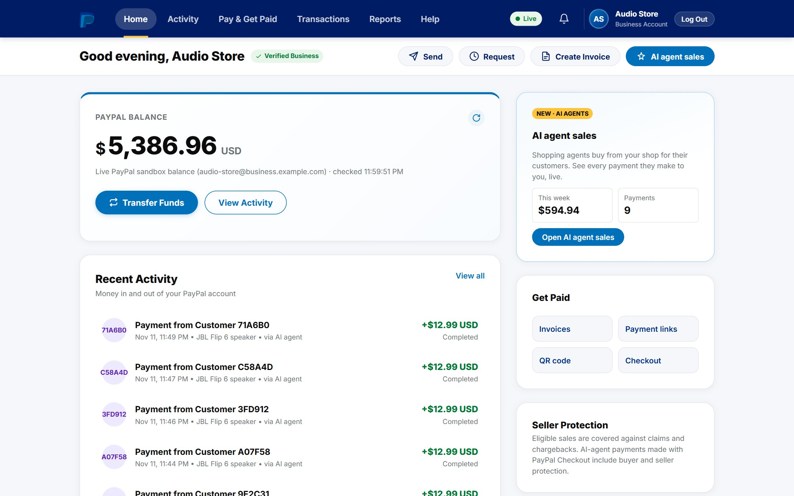

---

## Contents

**The main grid**

1. [The transactions grid](#1-the-transactions-grid)
2. [AI-agent sales, tagged](#2-ai-agent-sales-tagged)
3. [Opening a sale: master and detail](#3-opening-a-sale-master-and-detail)
4. [Grouping and the grand total](#4-grouping-and-the-grand-total)
5. [Pivot mode](#5-pivot-mode)
6. [Tool panels and set filters](#6-tool-panels-and-set-filters)
7. [Your own bookkeeping: editing with undo](#7-your-own-bookkeeping-editing-with-undo)
8. [Selecting rows and the right-click menu](#8-selecting-rows-and-the-right-click-menu)
9. [Saved views](#9-saved-views)
10. [The morning briefing](#10-the-morning-briefing)

**Charts and totals**

11. [Totals that follow every filter](#11-totals-that-follow-every-filter)
12. [Cross-filter charts](#12-cross-filter-charts)
13. [Chart presets and linked charts](#13-chart-presets-and-linked-charts)

**Asking, watching and exporting**

14. [Ask the grid in plain English](#14-ask-the-grid-in-plain-english)
15. [Spike in demand](#15-spike-in-demand)
16. [Bought together](#16-bought-together)
17. [Excel and CSV export](#17-excel-and-csv-export)
18. [The accountant report](#18-the-accountant-report)
19. [TV mode](#19-tv-mode)

**Elsewhere in the project**

20. [The people's side and the operations console](#20-the-peoples-side-and-the-operations-console)
21. [Loading, licence and themes](#21-loading-licence-and-themes)

---

## 1. The transactions grid

**What it is.** The heart of PayPal Counter: one AG Grid Enterprise table with **every transaction on the shop's PayPal account**, not only agent sales. Sales, invoices, payouts received, refunds, fees and withdrawals all sit together, newest first.

**What it contains.**

| Column | What it shows |
| :--- | :--- |
| Time | When it happened. The date filter compares whole days, so "equals Nov 4" works on timestamps. |
| Item | What was bought, with a *Sample* badge on demo rows. Clicking the arrow opens the line items. |
| Gross, Fee, Net | Money columns, summed in groups and in the grand total. Negative amounts are red. |
| Source | AI agent, PayPal Checkout, Payouts, Invoice, Subscription, PayPal payment or Bank |
| Type | Payment received, Refund, Fee, Withdrawal and so on, as a coloured pill |
| Payer | A name for normal payments; an anonymous label such as *Customer 7F2A9C* for agent payments |
| Status | Completed, Pending, Failed or Reversed; cells flash when the status changes |
| PayPal check | Confirmed, Processing, Differs or Not checked, with PayPal's note on hover |
| Reconciled, Tag, Note | The shop's own bookkeeping, editable |
| Hidden helpers | Day, Month, Sales, AI-agent sales, Other sales, Category, Storefront and PayPal ID, ready for grouping, pivoting and charts |

**How it is used.** The shop owner logs in to PayPal Business and opens PayPal Counter. Four **source chips** sit above the grid (*All*, *AI agents*, *Other PayPal*, *Money out*), each with a live count, and a search box filters across every column.

**How it is made.** The page loads the AG Grid Enterprise bundle and builds the grid with `createGrid`. Rows come from `/biz/transactions`, which merges the shop's PayPal report with the platform's agent payments. Each money column is built from one helper so they behave the same way everywhere:

```js
const money = (field, headerName, extra = {}) => moneyCol(field, headerName, {
  aggFunc: 'sum', enableValue: true, chartDataType: 'series', width: 115,
  cellClassRules: { 'biz-neg': (p) => p.value < 0 }, ...extra,
});
```

The source chips use AG Grid's **external filter**, so they combine with every column filter and the search box:

```js
isExternalFilterPresent: () => sourceFilter !== 'all',
doesExternalFilterPass: (node) => matchSource(node.data),
```

---

## 2. AI-agent sales, tagged

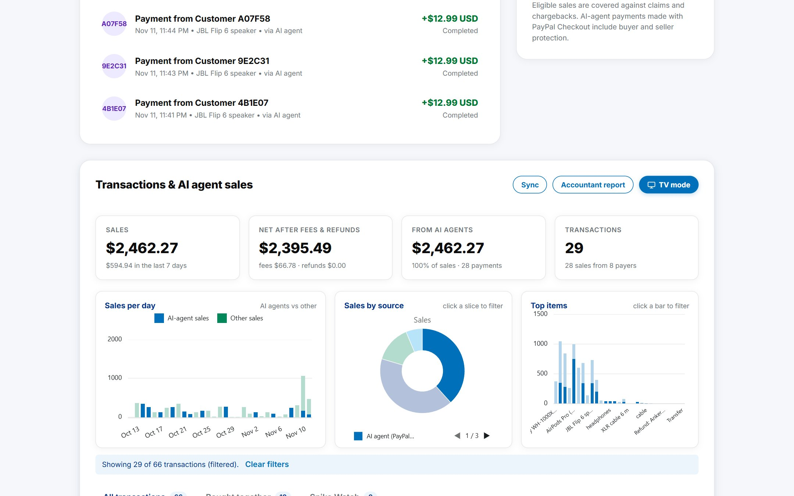

**What it is.** Every payment an AI agent made is marked with an *✦ AI agent* pill in the Source column, so the owner can tell agent sales from everything else at a glance.

**What it contains.** The pill, the payment method the agent used (PayPal Checkout or Payouts) in the detail row, and an anonymous buyer label in the Payer column. Hovering the payer explains that the buyer paid through an AI agent and stays anonymous.

**How it is used.** Click the *AI agents* chip to see only agent sales, or group by Source to compare them with other sales.

**How it is made.** On the server, `business.ts` matches the platform's agent payments to the shop's PayPal transactions, first by PayPal's own ids and then by the same amount within 15 minutes, and marks matched rows with `agent: true`. The Source column's renderer draws the pill for those rows:

```js
const sourceHtml = (p) => p.data?.agent
  ? '<span class="biz-pill agent">✦ AI agent</span>'
  : `<span class="biz-source-name">${escapeHtml(p.value)}</span>`;
```

---

## 3. Opening a sale: master and detail

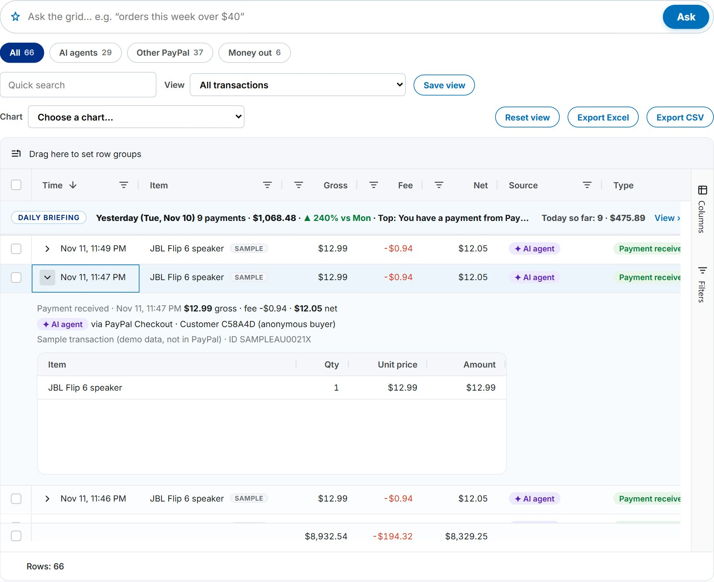

**What it is.** Any transaction can be expanded to show its line items in a nested grid, with a summary of the payment above them.

**What it contains.** The summary shows the type and time, gross, fee and net, how it was paid, the buyer label, PayPal's note and transaction id, the invoice id if there is one, and any refund linked to it. Below it, a small grid lists each item with quantity, unit price and amount.

**How it is used.** Click the arrow in the Time column of any row.

**How it is made.** AG Grid's **master/detail** feature. Every real row is a master (the briefing row is not), and the detail is a template with our summary on top and a nested grid underneath:

```js
masterDetail: true,
isRowMaster: (d) => Boolean(d && !d.__briefing),
detailRowAutoHeight: true,
detailCellRendererParams: {
  template: (p) => `<div class="biz-master">${detailHeader(p.data)}<div data-ref="eDetailGrid"></div></div>`,
  detailGridOptions: { columnDefs: [ /* Item, Qty, Unit price, Amount */ ], domLayout: 'autoHeight' },
  getDetailRowData: (p) => p.successCallback(p.data.lines ?? []),
},
```

---

## 4. Grouping and the grand total

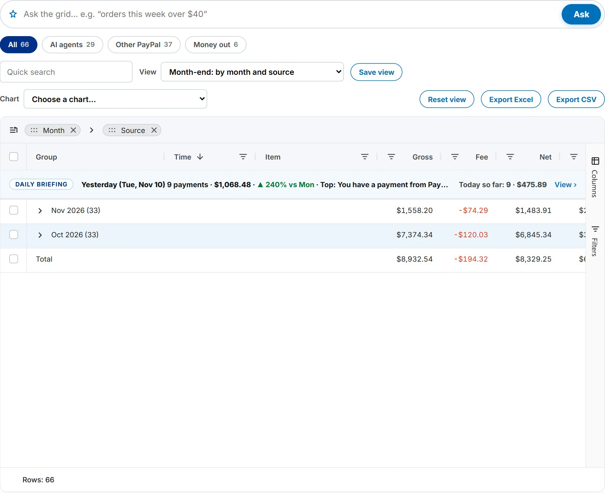

**What it is.** Rows can be grouped by any category, with sums per group and a grand total at the bottom.

**What it contains.** A group bar above the grid, group rows with a count (for example *Sun, Nov 8 (9)*), summed money columns per group, and a *Total* row that adds up everything still visible.

**How it is used.** Drag a column header (Day, Month, Item, Source, Type, Status, Payer, Tag) into the group bar. Drag a second one to make nested groups, such as month and then source.

**How it is made.** Category columns share one definition that allows grouping, pivoting and set filtering. The money columns sum by default, and the grid always shows the group bar and a grand total:

```js
const group = { filter: 'agSetColumnFilter', enableRowGroup: true, enablePivot: true, chartDataType: 'category' };

rowGroupPanelShow: 'always',
suppressAggFuncInHeader: true,
grandTotalRow: 'bottom',
autoGroupColumnDef: { headerName: 'Group', minWidth: 250 },
```

---

## 5. Pivot mode

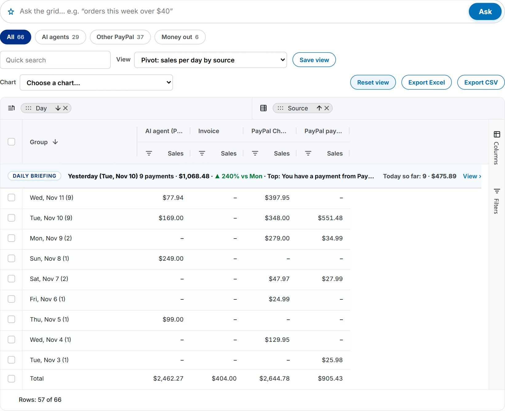

**What it is.** Turns one column's values into columns of their own, such as *sales per day, split by source*.

**What it contains.** One row per day, one column per source (AI agent, Invoice, PayPal Checkout, PayPal payment), sales in each cell, and the grand total underneath.

**How it is used.** Pick *Pivot: sales per day by source* from the view list, or turn on pivot mode in the Columns panel and drag columns into it yourself.

**How it is made.** The ready-made view switches on pivot mode, groups by day, pivots by source and sums the sales column. It also filters to sales only, so money-out sources don't create empty columns:

```js
api.setGridOption('pivotMode', true);
api.applyColumnState({ state: [
  { colId: 'day', rowGroup: true, sort: 'desc' },
  { colId: 'source', pivot: true },
  { colId: 'sales', aggFunc: 'sum' },
] });
api.setFilterModel({ type: { filterType: 'set', values: ['Payment received', 'Payout received'] } });
```

---

## 6. Tool panels and set filters

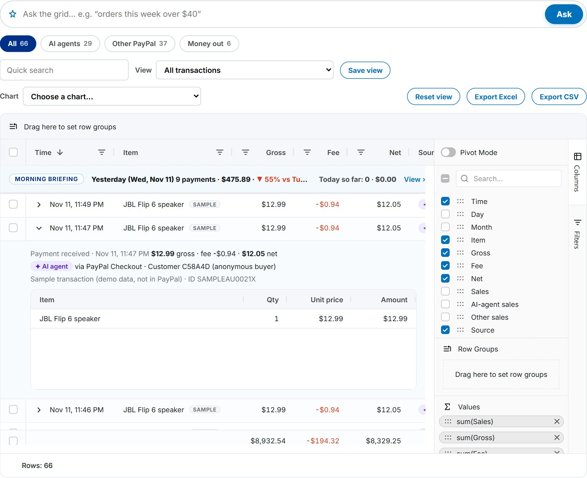

**What it is.** The *Columns* and *Filters* panels on the right side of the grid, and a checklist filter on every category column.

**What it contains.** The Columns panel lists every column, including the hidden helpers, so the owner can show, hide, group, pivot or sum any of them. The Filters panel lists every active filter in one place. Set filters show each distinct value with a checkbox.

**How it is used.** Open a panel from the side bar, or open a column's filter and tick the values you want, for example only *Refund* and *Fee*.

**How it is made.**

```js
sideBar: { toolPanels: ['columns', 'filters'] },
```

and `filter: 'agSetColumnFilter'` on every category column (through the shared `group` definition above).

---

## 7. Your own bookkeeping: editing with undo

**What it is.** Three columns belong to the shop, not to PayPal: **Reconciled**, **Tag** and **Note**. The owner can mark a transaction as matching their books, tag it, and write a note.

**What it contains.** A checkbox for Reconciled; a rich drop-down for Tag with *Follow up*, *Wholesale*, *Gift*, *VIP*, *Disputed* and *Tax review*; a large text editor for Note (up to 500 characters). Up to 25 edits can be undone and redone.

**How it is used.** Double-click a cell, or press Enter, to edit it. Press Ctrl/⌘+Z to undo.

**How it is made.** AG Grid's built-in editors, with undo turned on. Each change is saved to the server for that shop only, and put back if saving fails:

```js
{ field: 'tag', editable, cellEditor: 'agRichSelectCellEditor', cellEditorParams: { values: TAGS } },
{ field: 'note', editable, cellEditor: 'agLargeTextCellEditor', cellEditorPopup: true, cellEditorParams: { maxLength: 500 } },
undoRedoCellEditing: true,
undoRedoCellEditingLimit: 25,
onCellValueChanged: saveEdit, // POST /biz/notes, rolled back on error
```

The notes are stored per shop on the server and never sent to PayPal, customers or agents.

---

## 8. Selecting rows and the right-click menu

**What it is.** Checkbox selection for many rows at once, and a right-click menu with shop-specific actions.

**What it contains.** A checkbox column pinned on the left, a *Mark N reconciled* button that appears when rows are selected, and a context menu with *Mark reconciled*, *Export selected to Excel*, *Copy PayPal transaction ID* and *Show only this payer*, followed by AG Grid's own copy, chart and export items.

**How it is used.** Tick rows, then use the button or right-click. Selecting a group selects every visible transaction in it.

**How it is made.**

```js
rowSelection: { mode: 'multiRow', checkboxes: true, headerCheckbox: true, groupSelects: 'filteredDescendants' },
selectionColumnDef: { pinned: 'left', width: 48 },
getContextMenuItems, // our items + p.defaultItems
```

---

## 9. Saved views

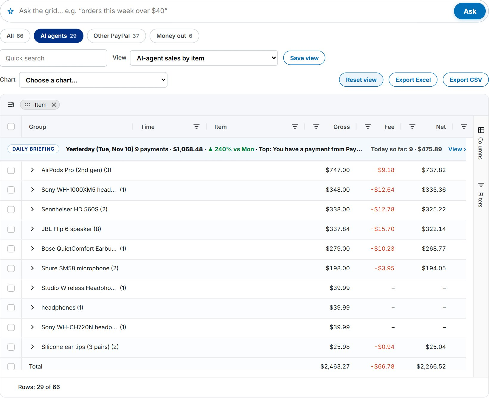

**What it is.** A drop-down of whole grid layouts that can be restored in one click.

**What it contains.** Six ready-made views, plus any the owner saves:

| View | What it sets |
| :--- | :--- |
| All transactions | Newest first, no grouping |
| AI-agent sales by item | AI agents only, grouped by item, biggest first |
| Month-end: by month and source | Two levels of grouping with sales |
| Pivot: sales per day by source | Pivot mode, sales only |
| Money out | Refunds, disputes and withdrawals |
| Still to reconcile | Only rows not yet ticked |
| *Saved by you* | Any layout you build, saved by name |

**How it is used.** Pick a view from the *View* list. To save your own, arrange the grid and press *Save view*. *Reset view* clears everything.

**How it is made.** Ready-made views set column state and filters directly. Your own views use AG Grid's **grid state** API, which captures columns, grouping, pivot, filters and sort in one object, stored per shop in the browser:

```js
mine.push({ name, state: apis.orders.getState(), source: sourceFilter });
// later
api.setState(v.state, ['rowSelection', 'focusedCell', 'scroll', 'cellSelection', 'rowGroupExpansion', 'pagination']);
```

---

## 10. The morning briefing

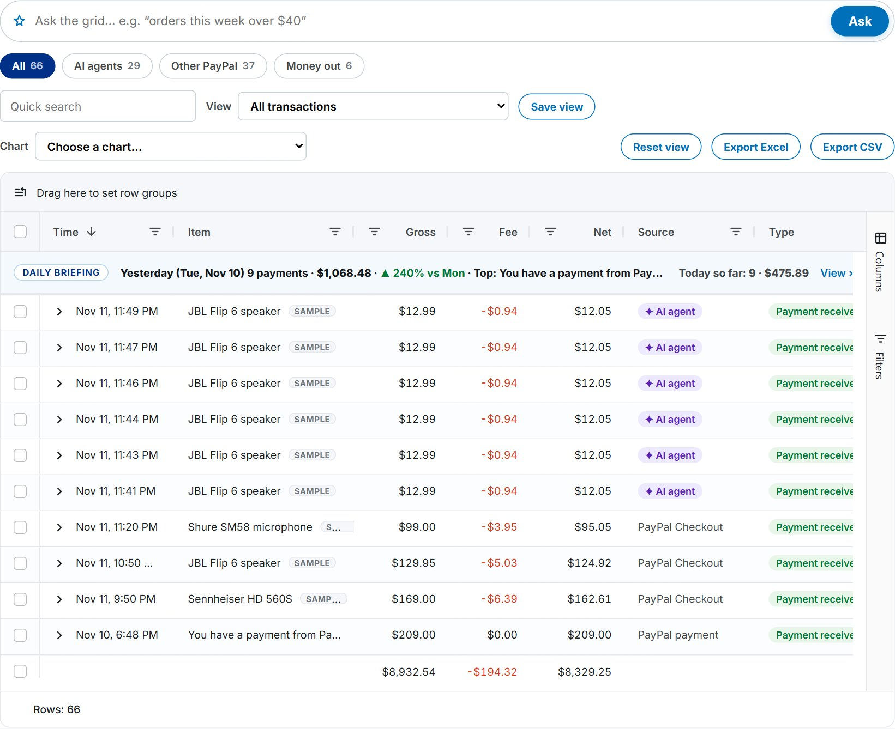

**What it is.** A one-line summary pinned to the top of the grid, so the first thing an owner sees is how business went.

**What it contains.** Yesterday's number of payments and revenue, the change against the day before (for example *▼ 16% vs Sat*), the top item, any failed payments, and today so far. Before noon it is titled *Morning briefing*, afterwards *Daily briefing*.

**How it is used.** Read it at a glance. Clicking it filters the grid to yesterday's payments.

**How it is made.** A **pinned top row** drawn as a **full-width row**, so it spans every column and stays put while scrolling:

```js
pinnedTopRowData: [briefing()],
isFullWidthRow: (p) => Boolean(p.rowNode.data?.__briefing),
fullWidthCellRenderer: (p) => /* briefingHtml(p.data) */,
onRowClicked: (p) => { if (p.data?.__briefing) showBriefingDay(p.data); },
```

---

## 11. Totals that follow every filter

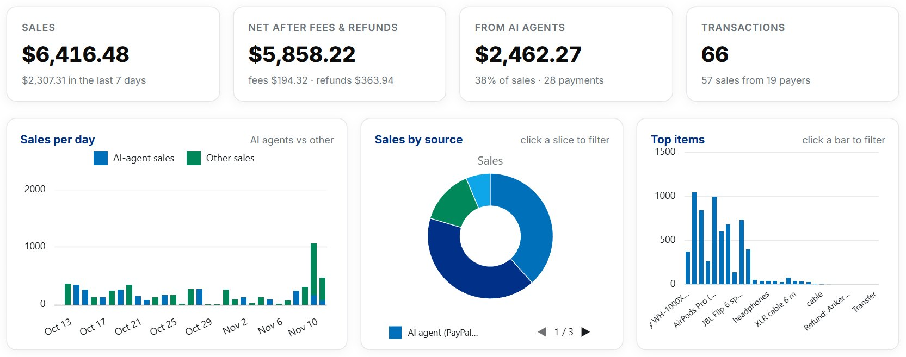

**What it is.** Four tiles above the grid that always describe exactly what the grid is showing.

**What it contains.**

| Tile | Value | Underneath |
| :--- | :--- | :--- |
| Sales | Gross sales | Sales in the last 7 days |
| Net after fees and refunds | Sales minus fees and refunds | The fees and refunds |
| From AI agents | Agent sales | Their share of all sales and the number of payments |
| Transactions | Rows shown | Sales and the number of different payers |

A note appears when anything is filtered (*"Showing 29 of 59 transactions (filtered)"*) with a *Clear filters* link.

**How it is used.** Filter the grid any way (a chip, a column filter, a search, a chart click) and the tiles update.

**How it is made.** Whenever the grid's filter or model changes, the tiles are recomputed from the rows that passed **every** filter:

```js
onFilterChanged: () => afterChange('orders'),
onModelUpdated: () => afterChange('orders'),

apis.orders.forEachNodeAfterFilter((n) => { if (n.data && !n.group) rows.push(n.data); });
```

---

## 12. Cross-filter charts

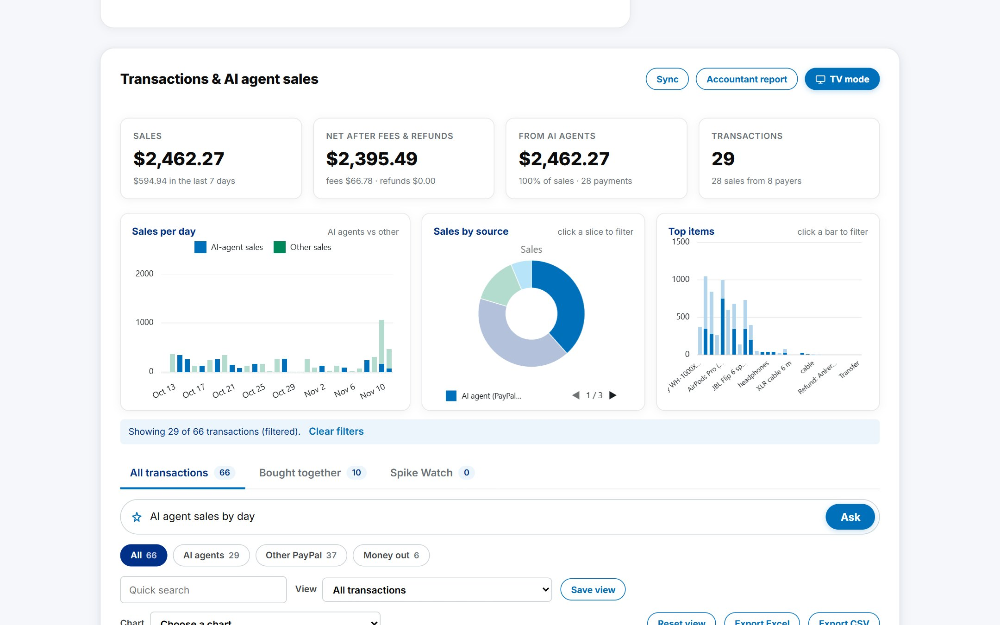

**What it is.** Three charts above the grid that are also filters.

**What it contains.** **Sales per day** (columns split into AI-agent sales and other sales), **Sales by source** (a donut), and **Top items** (columns, biggest first).

**How it is used.** Click a bar or a slice: the grid, the totals and the other two charts all narrow to it. Click again to clear.

**How it is made.** AG Grid Enterprise's **cross-filter charts**, created from the grid's own columns, in our PayPal-coloured chart theme:

```js
api.createCrossFilterChart({
  chartType: 'column', chartThemeName: 'paypal', aggFunc: 'sum',
  cellRange: { columns: ['day', 'agentSales', 'otherSales'] },
  sort: [{ colId: 'day', sort: 'asc' }],
  chartContainer: $('chartRevenue'),
});
api.createCrossFilterChart({ chartType: 'donut', cellRange: { columns: ['source', 'sales'] }, chartContainer: $('chartSource') });
api.createCrossFilterChart({ chartType: 'column', cellRange: { columns: ['product', 'sales'] }, sort: [{ colId: 'sales', sort: 'desc' }], chartContainer: $('chartProducts') });
```

The hidden *AI-agent sales* and *Other sales* columns exist only so these charts can split each day in two.

---

## 13. Chart presets and linked charts

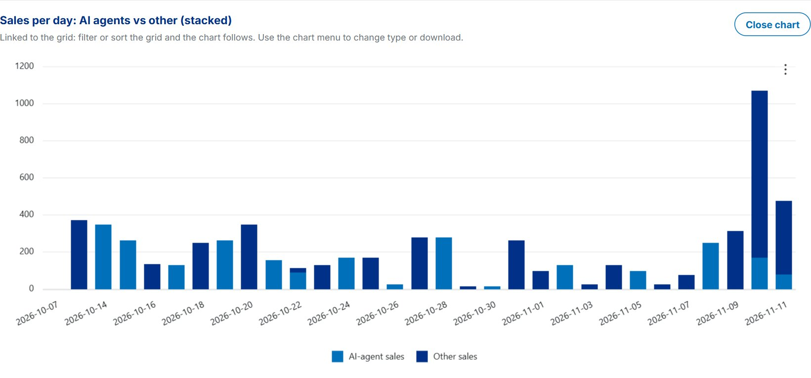

**What it is.** Ready-made charts, built from the grid with one click, that stay **linked** to the grid.

**What it contains.**

| Preset | Chart |
| :--- | :--- |
| Sales by source | Donut |
| Sales per day: AI agents against other sales | Stacked columns |
| Sales by item | Bars |
| Net by transaction type | Bars |
| Gross against fees by source | Grouped columns |
| Sales per day by source | Pivot chart |

**How it is used.** Pick a preset from the *Chart* list. The chart opens in a panel under the grid. Filter the grid and the chart redraws; close it with ×. Owners can also select any cells and choose *Chart range* from the right-click menu.

**How it is made.** **Integrated Charts**: a range chart over the grid's columns, or a pivot chart in pivot mode, opened in our own panel:

```js
enableCharts: true,
cellSelection: true,
chartThemes: ['paypal', 'ag-default', 'ag-vivid', 'ag-material'],
customChartThemes: { paypal: { baseTheme: 'ag-default', palette: { fills: PAYPAL_FILLS, strokes: PAYPAL_FILLS } } },
createChartContainer: (chartRef) => dockChart(chartRef),

api.createRangeChart({ chartThemeName: 'paypal', chartType: 'donut', aggFunc: 'sum', cellRange: { columns: ['source', 'sales'] } });
api.createPivotChart({ chartType: 'stackedColumn', chartThemeName: 'paypal' });
```

---

## 14. Ask the grid in plain English

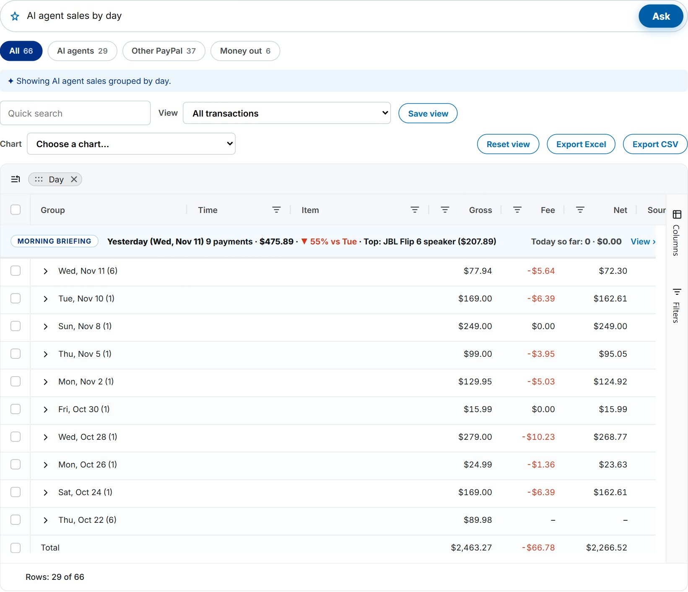

**What it is.** A search box that understands requests such as *"refunds over $40 this week"*, *"AI agent sales by day"* or *"biggest payments from invoices"*, and turns them into real grid settings.

**What it contains.** The ask box with example questions, and a line underneath that says what the grid now shows, for example *"✦ Showing AI agent sales grouped by day."*

**How it is used.** Type a question and press *Ask*. The filters, sort and grouping it sets are ordinary grid settings, so the owner can adjust them by hand afterwards.

**How it is made.**

1. The page sends the text to `/biz/ask`.
2. An AI model, given the grid's columns, their types and today's date, returns filters, sort, a group-by column, a search term and an explanation. Unknown columns are dropped on the server.
3. The page turns each answer into an AG Grid filter model. Dates become day ranges, numbers become number filters, and category columns become **set filters** with the matching values:

```js
if (SET_COLUMNS.has(column)) {
  const all = [...new Set(data.orders.map((r) => String(r[column] ?? '')))];
  return { filterType: 'set', values: all.filter((v) => v.toLowerCase().includes(want)) };
}
```

4. It applies them with `setFilterModel`, `applyColumnState` (sort and grouping) and the quick filter.

When every AI model is busy, built-in rules on the server still understand amounts, date ranges, refunds, fees, failures, sources, grouping and sorting.

---

## 15. Spike in demand

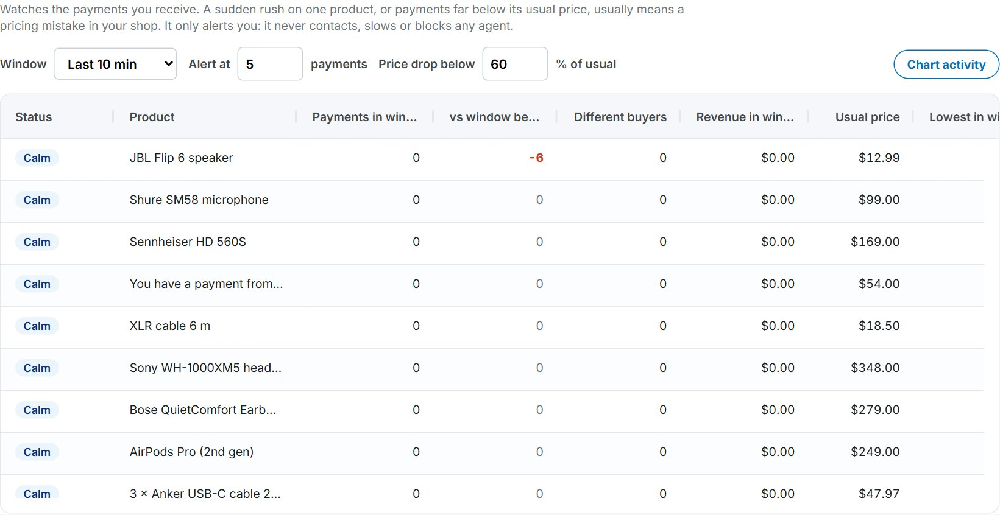

**What it is.** A watch on **how fast each product is being paid for**. Agents buy at machine speed: if a shop types a price wrong, hundreds of agents can find and buy it within minutes. This tab spots that early and tells the owner. It never contacts, slows or blocks any agent.

**What it contains.** One row per product:

| Column | How it's worked out |
| :--- | :--- |
| Status | **Spike** when payments in the window reach the threshold from several different buyers; **Price drop** when the lowest price in the window is below a set share of the usual price; otherwise **Busy** or **Calm** |
| Payments in window | Count, flashing when it changes |
| vs window before | The difference from the previous window, in green or red |
| Different buyers | Distinct anonymous labels |
| Revenue in window | The sum |
| Usual price | The median price of the product before the window |
| Lowest in window | Highlighted when it's a price drop |
| Last 24 h | A sparkline of payments per hour |
| Mark checked | Silences the alert until the next payment for that product |

**How it is used.** The owner chooses the window (for example the last 10 minutes or 24 hours), the alert threshold (5 payments by default) and the price-drop level (60% by default). An alert shows as a red banner, a pop-up message, a red row and a count on the tab, and in TV mode. *Chart activity* turns the table into a grouped bar chart.

**How it is made.** The rows are computed in the browser from the payments already received, then shown in an AG Grid with the **sparkline cell renderer**:

```js
{ field: 'spark', headerName: 'Last 24 h', cellRenderer: 'agSparklineCellRenderer',
  cellRendererParams: { sparklineOptions: { type: 'bar', fill: '#0070BA' } } },
rowClassRules: { 'biz-row-alert': (p) => (p.data?.level === 'Spike' || p.data?.level === 'Price drop') && !p.data?.acked },
```

The level rule:

```js
const level = inWin.length >= threshold && buyers >= Math.min(3, threshold) ? 'Spike'
  : lowest < usual * (dropPct / 100) ? 'Price drop'
  : inWin.length >= Math.ceil(threshold / 2) ? 'Busy'
  : 'Calm';
```

---

## 16. Bought together

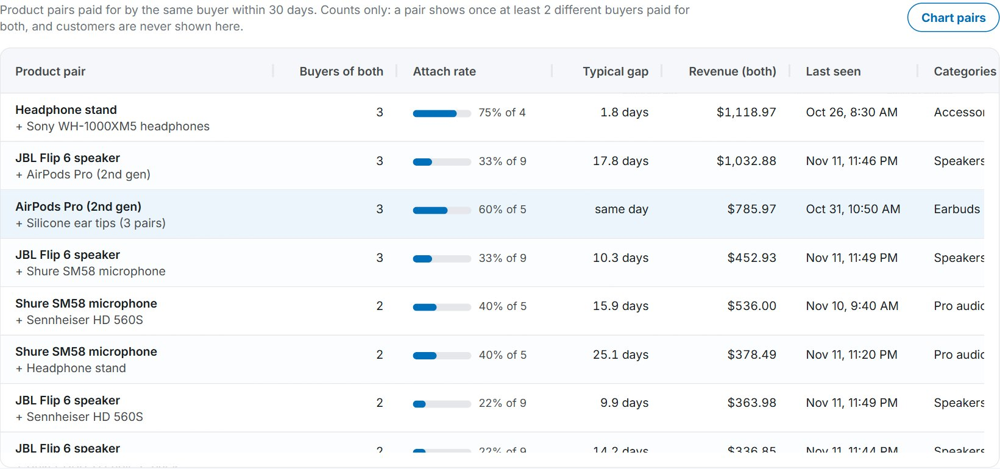

**What it is.** Pairs of products that the same customer bought within 30 days, a simple way for a shop to spot bundles.

**What it contains.** Each pair, how many different buyers bought both, the attach rate (with a bar), the typical gap in days, the revenue from both, when it last happened and the categories.

**How it is used.** Open the *Bought together* tab. *Chart pairs* draws it.

**How it is made.** The server builds the pairs from the shop's own sales, using the anonymous labels. It sends **counts only**, never who bought, and keeps a pair only once **at least two different buyers** bought both, so no one can be singled out. The page shows the result in an AG Grid with a bar renderer for the attach rate.

---

## 17. Excel and CSV export

**What it is.** One-click export of the grid as it stands.

**What it contains.** Time (as a real date), type, item, source, payer, gross, fee, net, status, PayPal check, reconciled, tag, note and PayPal ID. In pivot mode, the pivot table itself is exported.

**How it is used.** Press *Export Excel* or *Export CSV*, or export only selected rows from the right-click menu.

**How it is made.** `exportDataAsExcel` and `exportDataAsCsv`, with Excel styles so headers are shaded and negative amounts are red, and numbers stay numbers instead of text.

---

## 18. The accountant report

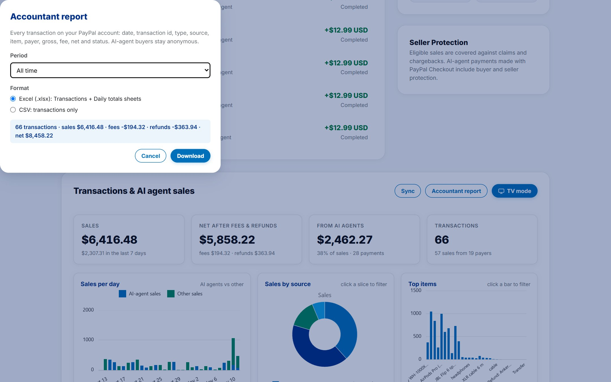

**What it is.** A finance-only export for a chosen period, ready to send to an accountant.

**What it contains.** An **Excel workbook** with a *Transactions* sheet and a *Daily totals* sheet, with a title, shaded headers, a `#,##0.00` money format and bold total rows. Or a **CSV** of the transactions. A preview line shows the period's count, sales, fees, refunds and net before downloading.

**How it is used.** Press *Accountant report*, choose a period (this month, last month, and so on) and a format, then *Download*.

**How it is made.** Two hidden AG Grids, one per sheet, are exported together into one workbook. Totals count only money that actually moved: failed and reversed rows count for nothing. AI-agent buyers stay anonymous.

```js
const acctMoney = { type: 'rightAligned', cellClass: 'money', useValueFormatterForExport: false };
excelStyles: [
  { id: 'header', font: { bold: true }, interior: { color: '#E8F1F8', pattern: 'Solid' } },
  { id: 'money', numberFormat: { format: '#,##0.00' } },
  { id: 'title', font: { bold: true, size: 14, color: '#003087' } },
],
```

---

## 19. TV mode

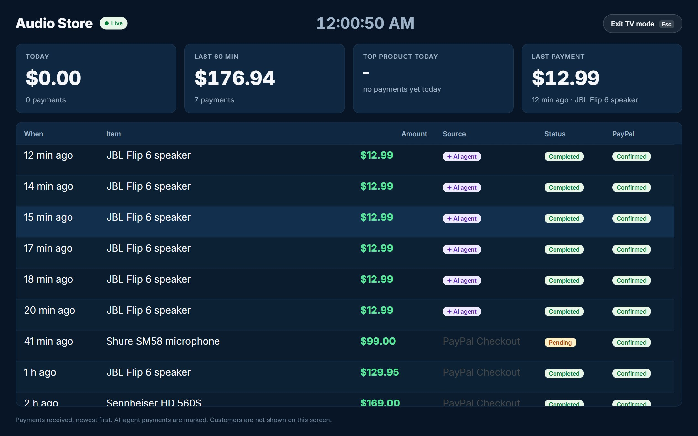

**What it is.** A full-screen, dark view of payments as they arrive, for a screen on the shop wall.

**What it contains.** The shop's name and a live clock; tiles for today, the last 60 minutes, today's top product and the last payment; the latest 60 sales with time, item, amount, source, status and PayPal check; and the spike alert as a red banner. Each new sale pops up and its row flashes.

**How it is used.** Press *TV mode*. Esc leaves it.

**How it is made.** A separate AG Grid with its own theme, built with `themeQuartz.withParams`: navy background, 20-pixel text and 64-pixel rows. New rows are highlighted with `flashCells`, and the relative times refresh every 30 seconds.

```js
const tvTheme = themeQuartz.withParams({
  backgroundColor: '#0B1C2E', foregroundColor: '#F5F7FA', headerBackgroundColor: '#0F2740',
  oddRowBackgroundColor: '#0D2134', accentColor: '#3AA0FF', fontSize: 20, wrapperBorderRadius: 14,
});
tvApi.flashCells({ rowNodes: nodes, flashDuration: 2500, fadeDuration: 1500 });
```

---

## 20. The people's side and the operations console

- **All activity.** On the people's site, AG Grid Community shows one statement across all of a person's envelopes: date, description, envelope, type, shop, amount (in or out), status, the PayPal check (with PayPal's note on hover) and PayPal's reference. A pinned bottom row shows the net total of whatever is filtered, type chips use the external filter, and clicking a row opens that envelope's timeline at that payment.
- **90-day price charts.** AG Charts Community draws the price history on a product card when you start from a link, and on each option the agent suggests, with today's price marked.
- **Operations console.** AG Grid for React shows every envelope with a balance bar and countdown, a live decision log coloured green, red and amber with the reasons, the ledger with PayPal references, and pending approvals with Approve and Reject buttons. All of them refresh from live updates.

---

## 21. Loading, licence and themes

- The website serves the AG Grid and AG Charts bundles directly from the installed packages. People's pages load the free Community bundles. Only PayPal Counter loads the Enterprise bundles, charts first, so the grid finds AG Charts for Integrated Charts.
- The licence key comes from `AG_GRID_LICENSE_KEY` in `.env` and is applied to both AG Grid and AG Charts. Without a key, every Enterprise feature still works with a trial watermark.
- One theme in PayPal colours (`themeQuartz.withParams`, accent `#0070BA`, Inter font, rounded corners), a dark theme for TV mode, and a PayPal chart palette shared by every chart.

**Where it lives:** `paypal-interface/business.html` and `business.js` (every grid, chart, view and export), `paypal-interface/business.ts` (rows, matching, Bought together and the ask endpoint on the server), `paypal-interface/business-notes.ts` (bookkeeping storage), `paypal-interface/app.js` (activity statement and price charts), `apps/web/src/components/` (console grids).

[← Back to the main README](../../README.md)
