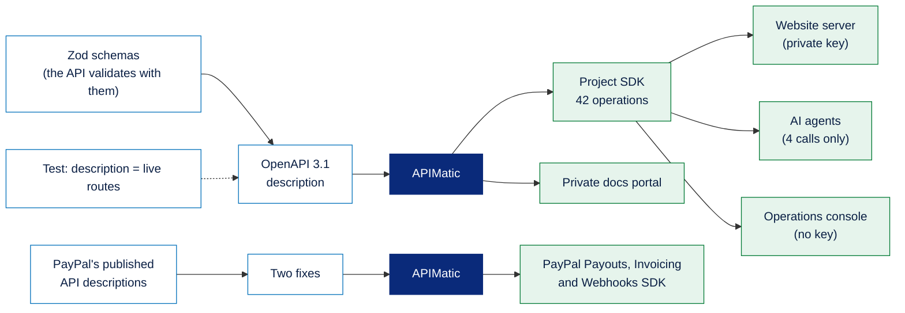

# APIMatic in PayPal Envelope

[← Back to the main README](../../README.md)

The PayPal Envelope API has three very different callers: the **website server**, which holds a private key; the **AI agent**, which must only be able to *ask* to buy; and the **operations console** in a browser, which must never hold a key at all. Hand-written requests in three places drift apart over time, and a mistake in one could give the agent more power than it should have.

With **APIMatic**, every caller uses the same typed SDK, generated from one API description, and that description is itself generated from the schemas the API uses to validate requests. We also used APIMatic to build an SDK for the PayPal APIs that PayPal's own Server SDK doesn't cover.



---

## Contents

1. [An API description that can't drift](#1-an-api-description-that-cant-drift)
2. [The project SDK](#2-the-project-sdk)
3. [How each caller uses it](#3-how-each-caller-uses-it)
4. [The agent's four calls](#4-the-agents-four-calls)
5. [An SDK for PayPal Payouts, Invoicing and Webhooks](#5-an-sdk-for-paypal-payouts-invoicing-and-webhooks)
6. [Private documentation portal](#6-private-documentation-portal)
7. [What we learned](#7-what-we-learned)
8. [Commands](#commands)

---

## 1. An API description that can't drift

**What it is.** An **OpenAPI 3.1** description of the private PayPal Envelope API, built from the code itself.

**What it contains.** Every operation's method and path, its name (which becomes the SDK method), its group, a summary, request and response shapes, status codes, and whether it needs the private key.

**How it is used.** `npm run openapi -w apps/api` writes it. APIMatic reads it to generate the SDK and the documentation.

**How it is made.**

1. Every request shape is a **Zod schema** in `apps/api/src/api-schemas.ts`. The routes validate incoming requests with exactly these schemas.
2. `apps/api/src/openapi.ts` lists each operation once and converts the same Zod schemas to JSON Schema with `z.toJSONSchema`.
3. Two shapes that SDK generators read badly are rewritten without changing what they accept: *"this type or null"* becomes a type list, and fixed two-item arrays (such as a date and a price) become plain arrays.
4. **A test keeps it honest.** It walks the live Express routes and fails if the description lists a route the API doesn't serve, or misses one it does. A second test checks that money can only leave an envelope through the rule engine, and that agent-only routes need the private key.

---

## 2. The project SDK

**What it is.** A TypeScript SDK for the PayPal Envelope API, generated by APIMatic.

**What it contains.** 42 operations, typed request and response models, typed errors, a non-throwing result form (`.asApiResult()`), retries for safe calls only, and a machine-readable map of the whole SDK.

| Group | Operations |
| :--- | :--- |
| Envelopes | List, get one, get all of a person's with details, write rules from plain English, create, change rules, change the end date, close and refund, sync with PayPal |
| Funding | Create a PayPal order, capture it, record a saved-account payment; create, list, check and cancel friends' money requests; subscribe and confirm a subscription |
| Purchases | Ask to buy, approve, reject, suggest options, pick an option, reject all options |
| Agent | Run now, stop watching, move the next check |
| Savings | Pay the next one now, move it, pause, resume |
| Products | Look up a product from a link |
| Audit | Search, ask a question, rebuild the index |
| System | Health, shops, ledger, decisions, run the minute job |
| Verification | Check an envelope against PayPal |

**How it is made.** `npm run apimatic -- sdk` writes the latest description and runs the APIMatic CLI to generate the package. The SDK is used as a local workspace package.

---

## 3. How each caller uses it

| Caller | Private key | How it uses the SDK |
| :--- | :--- | :--- |
| **Website server** | Yes, sent only to operations that declare they need it | Uses `.asApiResult()` so errors become one error type; allows up to 3 minutes for AI and product lookups; never retries a POST |
| **Operations console** (browser) | **No** | The key must never reach a browser, so the console can only call public operations |
| **AI agents** | Yes | Wrapped so only four calls are reachable (next section) |

The SDK's models use camelCase while the API speaks snake_case JSON. Every caller converts requests into the SDK's models and responses back with the SDK's own schemas, so the JSON on the wire and in the app code stays exactly the API's. We checked that round trip on every stored rule set, purchase request and envelope.

```js
const result = await client().purchases.requestPurchase({ id, body: apiRequestSchema.decode(request) }).asApiResult();
const answer = result.ok ? result.value : result.payload.body; // 200 approved, 202 needs you, 403 blocked
```

---

## 4. The agent's four calls

**What it is.** The safety heart of the project: the only way an AI agent can reach the money.

**What it contains.**

| Call | What it does |
| :--- | :--- |
| Read the envelope | Rules, balance and items still to buy |
| List the shops | The registered merchants |
| **Ask to buy** | The rule engine decides: approved and paid, waiting for the owner, or blocked |
| Suggest options | In *Ask me* mode, save the top three for the owner |

**How it is made.** A small module in `packages/agents/src/` creates the SDK client privately and exports only these four functions. There is no call that pays, approves, refunds, changes rules or closes an envelope. The SDK never retries a POST, so a purchase request is never sent twice.

---

## 5. An SDK for PayPal Payouts, Invoicing and Webhooks

**What it is.** PayPal's Server SDK covers Orders, Payments, saved accounts and Subscriptions, but not Payouts, Invoicing or webhook management. We generated our own SDK for those from PayPal's published OpenAPI descriptions.

**What it contains.** Typed clients for payouts (send, read), invoices (list, read), and webhooks (list, create, update, delete).

**How it is made.** Two fixes were needed before generating (`scripts/apimatic.mjs`):

1. PayPal lists **error messages as enum values**, some longer than APIMatic's 100-character limit for a name. Those lists only label error text, so they became plain strings.
2. PayPal marks some fields **required** that it doesn't always send. A failed payout item's error has no `debug_id`, and the generated SDK rejected that reply. A failed payout is exactly when we need to read its status, so the required lists were dropped.

The wrapper (`packages/paypal/src/rest-sdk.ts`) keeps one client per PayPal app, each with its own login token, always pointed at the sandbox. If PayPal returns something its own description doesn't allow, the same call is re-read through a small REST client with **the same request id**, so even a payout can't happen twice.

---

## 6. Private documentation portal

**What it is.** A static documentation site for the API, viewed only on a developer's machine.

**What it contains.** Every operation with examples, plus three written pages: *How money moves safely*, *Purchases* and *Verified by PayPal*.

**How it is made.** `npm run apimatic -- portal` builds it from the same description and pages; `serve` shows it locally. Nothing is published, because the API is private by design.

---

## 7. What we learned

- **Write "or null" as a type list,** and give operations that return a list or nothing an explicit response. APIMatic dropped the `null` from `anyOf: [type, null]`, and the generated SDK then rejected real responses.
- **A generated client still needs a gate.** The SDK can call all 42 operations. What keeps the agent safe is the small module that hides the client and exposes four calls.

---

## Commands

```bash
npx @apimatic/cli@2.2.0 auth login     # once
npm run apimatic -- spec               # write the latest API description
npm run apimatic -- sdk                # generate the project SDK
npm run apimatic -- paypal-sdk         # generate the PayPal Payouts, Invoicing and Webhooks SDK
npm run apimatic -- portal             # build the private documentation portal
npm run apimatic -- serve              # view it locally
```

**Where it lives:** `apps/api/src/api-schemas.ts`, `apps/api/src/openapi.ts`, `apps/api/src/routes/openapi.test.ts`, `scripts/apimatic.mjs`, the two generated SDK packages under `packages/`, and the inputs under `apimatic/`.

[← Back to the main README](../../README.md)
