# Bryntum in PayPal Envelope

[← Back to the main README](../../README.md)

An envelope is something that lives in time. It is created, filled with money, searched for, paused while it waits for a better price, asks its owner a question, pays a shop and closes on a date. A list of log lines hides that story, and it gives no way to change *when* things happen.

We used **four Bryntum Enterprise products** to show an envelope's life four ways: a **Calendar** of every envelope, a **Scheduler** timeline of one envelope, a **TaskBoard** of the items being bought, and a **Gantt** plan of a savings goal. They aren't just pictures. Dragging in them changes real data, such as when an envelope ends or when the next savings payment is taken, after a live preview and a password check.

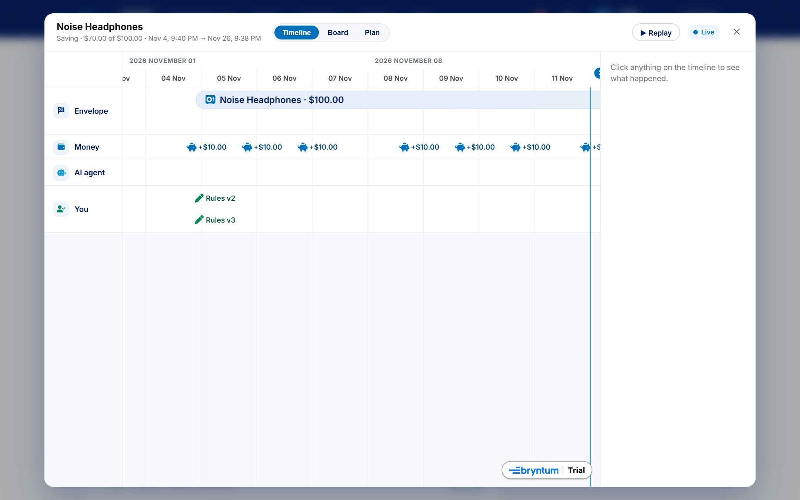

---

## Contents

1. [Why Bryntum](#why-bryntum)
2. [Envelope calendar (Bryntum Calendar)](#1-envelope-calendar-bryntum-calendar)
   - [Every envelope in one calendar](#11-every-envelope-in-one-calendar)
   - [See only the envelopes you want](#12-see-only-the-envelopes-you-want)
   - [Day, week, month and year](#13-day-week-month-and-year)
   - [The year heatmap](#14-the-year-heatmap)
   - [Drag to reschedule](#15-drag-to-reschedule)
3. [Envelope timeline (Bryntum Scheduler)](#2-envelope-timeline-bryntum-scheduler)
   - [Four lanes](#21-four-lanes)
   - [Replay every step](#22-replay-every-step)
   - [Run now, live](#23-run-now-live)
   - [Dragging on the timeline](#24-dragging-on-the-timeline)
4. [Shopping board (Bryntum TaskBoard)](#3-shopping-board-bryntum-taskboard)
5. [Savings plan (Bryntum Gantt)](#4-savings-plan-bryntum-gantt)
6. [The what-if preview and the password pop-up](#5-the-what-if-preview-and-the-password-pop-up)
7. [The operations console timeline (Scheduler for React)](#6-the-operations-console-timeline-scheduler-for-react)
8. [How the four products are bundled and loaded](#7-how-the-four-products-are-bundled-and-loaded)

---

## Why Bryntum

| Need | What Bryntum gave us |
| :--- | :--- |
| Show many envelopes over weeks and months | A real calendar with day, week, month and year views, resources and colours |
| Show one envelope's story in order | A scheduler with lanes, milestones, a "now" line, zooming and highlighting |
| Show the agent's progress on each item | A task board whose cards animate between columns |
| Show a savings plan whose payments depend on each other | A Gantt chart with dependencies and a scheduling engine |
| Let people change dates safely | Drag and drop with validation hooks, asynchronous confirmation, pop-ups and toasts |

The four Enterprise packages share **one core**, so they run on the same page without conflicts. We wrote the data mapping and the rules; Bryntum provides the views.

---

## 1. Envelope calendar (Bryntum Calendar)

Open it from the *Calendar* button on the wallet home.

### 1.1 Every envelope in one calendar

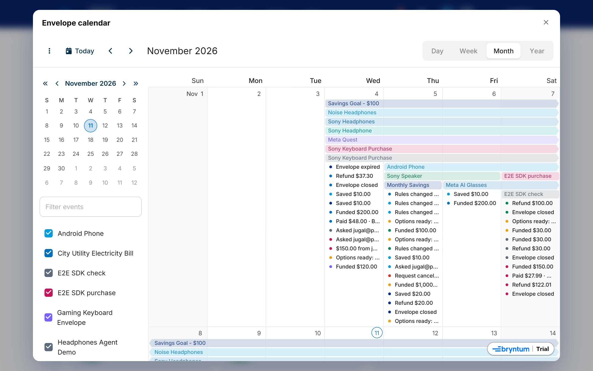

**What it is.** One calendar that shows money, purchases and deadlines for all of a person's envelopes together.

**What it contains.** Each envelope is a **resource** with its own colour. On the calendar:

| Event | Example | Colour |
| :--- | :--- | :--- |
| The envelope's life | An all-day bar from the day it was created to its end date | The envelope's colour |
| Money in | *Funded $100.00*, *Saved $20.00*, *$50.00 from jugal@…* | The envelope's colour |
| Money out | *Paid $69.00 · BestBuy*, *Refund $31.00* | The envelope's colour |
| Blocked purchases | *Blocked $112.00 · Target*, or *Blocked 6 buys* on a busy day | Red |
| Waiting on you | *Needs approval: $98.00 · Target*, *Options ready: pick one* | Amber |
| Rule changes and friend requests | *Rules changed (v2)*, *Asked jugal@…* | The envelope's colour |
| Coming up | The next savings payments, the agent's next check, *Envelope ends* | Faded, marked *Upcoming* |

Hovering an event shows a tooltip with the envelope's name, the event, the time and details, such as the reasons a purchase was blocked.

**How it is made.** All of a person's envelopes, with their ledger, decisions, rule versions, proposals and friend requests, arrive in **one request**. (The API batches its database queries for this, which cut loading 27 envelopes from about 17 seconds to the time of one.) A function turns them into Bryntum resources and events:

```js
resources.push({ id: envelope.id, name: envelope.name, eventColor: COLORS[i % COLORS.length] });
events.push({
  id, resourceId: v.id, name: title, startDate, endDate, allDay,
  draggable: !!action, resizable: false,
  eventColor: KIND_COLORS[kind], cls: [`cal-${kind}`, upcoming ? 'cal-upcoming' : ''].join(' '),
});
```

A moment (a payment or a decision) becomes a 30-minute event that never crosses midnight, so it stays on its own day. Blocked purchases are grouped per day, so a busy day shows *Blocked 6 buys* instead of six separate events. The calendar is read-only except for two movable events, and nothing can be created or deleted from it:

```js
features: {
  eventEdit: false, eventMenu: false, scheduleMenu: false, eventCopyPaste: false,
  drag: { creatable: false, resizable: false },
  eventTooltip: { renderer: ({ eventRecord }) => calTipHtml(calInfo.get(eventRecord.id)) },
},
```

### 1.2 See only the envelopes you want

**What it is.** A sidebar listing every envelope with a checkbox.

**How it is used.** Untick an envelope to hide its events; tick it to bring them back.

**How it is made.** Bryntum Calendar's built-in **resource filter** in the sidebar, fed by the envelope resources.

### 1.3 Day, week, month and year

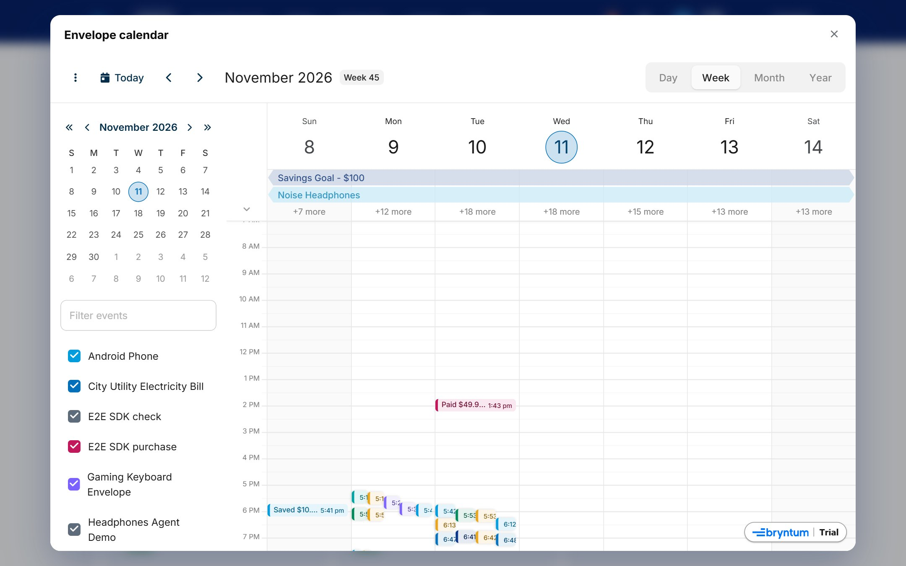

**What it is.** Four ways to zoom: a single day, a week, a month and a whole year.

**How it is used.** Pick a mode at the top right. The calendar opens on the month view.

**How it is made.** Bryntum Calendar's **modes**. We turned off the agenda mode, let month rows grow with their events, and gave the year view a custom day renderer:

```js
mode: 'month',
modes: {
  agenda: null,
  month: { showWeekColumn: false, autoRowHeight: true },
  year: { dayCellRenderer: heatCell, showEvents: false, eventCountTip: false },
},
```

### 1.4 The year heatmap

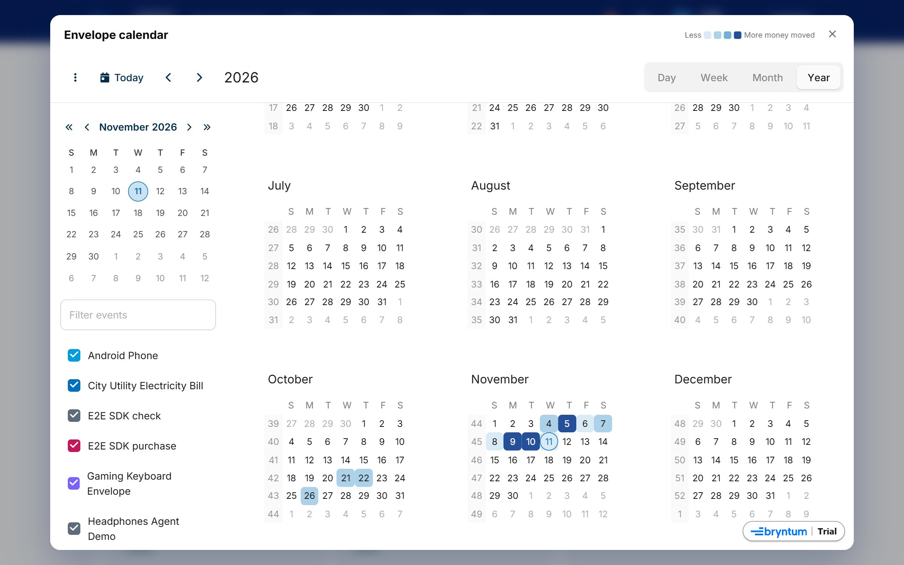

**What it is.** In the year view, each day is shaded by **how much money moved** that day across all envelopes, in four steps from light to dark.

**How it is used.** Scan the year to see busy days. Hovering a day shows the amounts, for example *"+$100.00 in · −$69.00 out"*.

**How it is made.** Before drawing, the ledger entries of every envelope are summed per day (money in and money out, failed entries skipped). The year view's `dayCellRenderer` then adds a CSS class for the level and a tooltip:

```js
function heatCell(cell) {
  const h = calHeat.get(dayKey(cell.date));
  if (!h) return;
  const level = Math.min(4, Math.max(1, Math.ceil(((h.in + h.out) / calHeatMax) * 4)));
  cell.cellConfig.className[`cal-heat-${level}`] = true;
  cell.cellConfig.dataset = { btip: `+${usd(h.in)} in · −${usd(h.out)} out` };
}
```

### 1.5 Drag to reschedule

**What it is.** Two events on the calendar can be moved by dragging: an envelope's **end date**, and the **next savings payment**.

**What it contains.** While dragging, a small label follows the pointer and says what the drop would do, for example *"+3 days · the agent keeps its budget until Nov 17"*. When the drop is allowed, a pop-up shows the old and new dates and asks for the password.

**How it is used.** Drag *Envelope ends* to end an envelope earlier or later, or drag the next *Saving $20.00* to move it. The later savings payments keep their rhythm from the new date.

**How it is made.** Calendar drag events: one to remember which event is being dragged, one to draw the preview, and one that runs our confirmation before the drop is finalised. Returning `false` puts the event back where it was:

```js
listeners: {
  beforeDragMove: ({ eventRecord }) => { calDragId = eventRecord?.id ?? null; },
  drag: ({ newStartDate, domEvent }) => { /* draw whatIf(...) next to the pointer */ },
  beforeDragMoveEnd: (e) => onCalendarDrop(e), // password pop-up, then save, or snap back
},
```

See [the what-if preview and the password pop-up](#5-the-what-if-preview-and-the-password-pop-up) for the rules behind it.

---

## 2. Envelope timeline (Bryntum Scheduler)

Open it from *Timeline* on any envelope card.

### 2.1 Four lanes

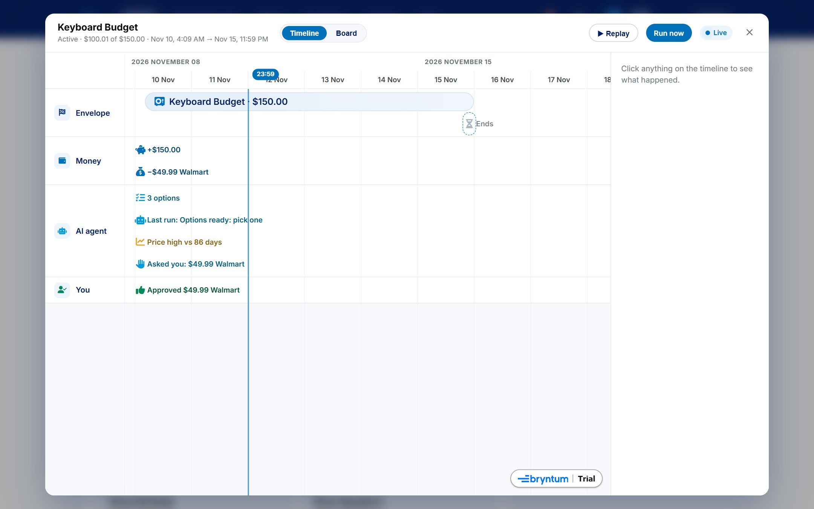

**What it is.** One envelope laid out on a time axis, in four lanes, so you can see who did what and when.

**What it contains.**

| Lane | What appears there |
| :--- | :--- |
| **Envelope** | Its life as a bar, *Closed* or *Expired*, and *Ends* (movable while open) |
| **Money** | Every payment in (*+$100.00*, *+$50.00 from a friend*), out (*−$69.00 BestBuy*) and back (*↩ $31.00*), plus upcoming savings payments |
| **AI agent** | What the agent compared and found, *Bought*, *Blocked* or *Asks you*, and its next check |
| **You** | Your rule changes, approvals, rejections and picks |

Each lane has its own icon and colour. Completed things use the lane colour, waiting things are amber, blocked ones red and future ones grey. A line marks the current time. Clicking an event shows its full details in a side panel. Many moments close together stack into readable rows instead of overlapping.

**How it is made.** Each lane is a Scheduler **resource**, and each moment a zero-length event, which Bryntum draws as a **milestone** with its label:

```js
new Scheduler({
  resources: lanes, events,
  eventStyle: 'rounded',
  milestoneLayoutMode: 'estimate', milestoneCharWidth: 7, milestoneTextPosition: 'always-outside',
  features: {
    eventEdit: false, eventResize: false, eventDragCreate: false,
    timeRanges: { showCurrentTimeLine: true },
    eventDrag: { constrainDragToResource: true, tooltipTemplate: /* what-if */ },
  },
});
```

The time scale is chosen from the envelope's length (hours for a short one, days or weeks for a long one), and the view opens at the start of the envelope, where most of the action is.

### 2.2 Replay every step

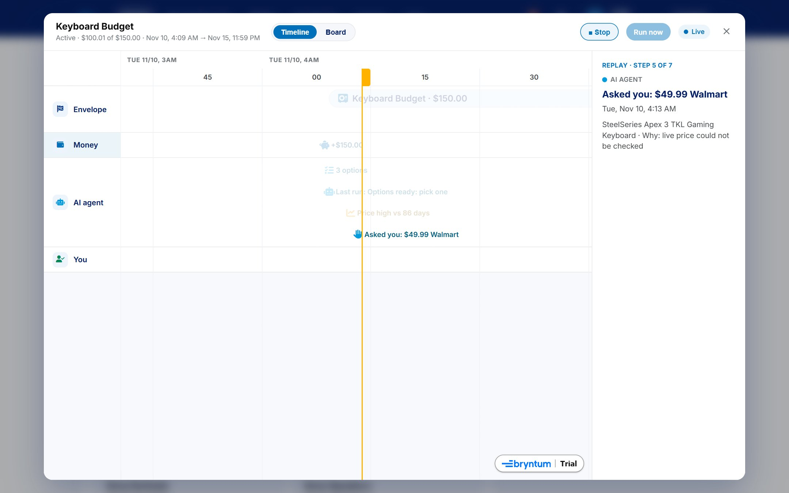

**What it is.** A button that plays an envelope's history back in order, like a recording, so the owner can see exactly what the agent did.

**What it contains.** The timeline zooms to the period with activity, empties, and then adds each step one at a time with a moving marker. The side panel narrates each step: *"Replay · step 6 of 6 · Blocked · The price was over your limit."*

**How it is used.** Press *▶ Replay*. Press *■ Stop* to end it early. Live updates wait until the replay finishes.

**How it is made.** Built from Scheduler APIs: `zoomToSpan` to frame the activity, a **time range** used as the moving marker, `eventStore.add` to reveal each step, and `highlightEvents` to spotlight it:

```js
timeline.zoomToSpan({ startDate: new Date(first - span * 0.15), endDate: new Date(last + span * 0.4) });
const [marker] = timeline.timeRangeStore.add({ id: 'replay', startDate: new Date(first), cls: 'tl-replay-marker' });
for (const e of steps) {
  marker.startDate = e.startDate;
  timeline.eventStore.add(e);
  timeline.highlightEvents({ events: [e.id], unhighlightOthers: true });
  await sleep(1100);
}
```

### 2.3 Run now, live

**What it is.** A button that starts the agent and lets the owner watch it work on the *AI agent* lane.

**How it is used.** Press *Run now*. Each step the agent takes appears on the lane as it happens; when the run ends, a Bryntum **Toast** shows the result, such as *"Run finished: bought"*.

**How it is made.** The page zooms to the next few minutes, then each live `agent:step` event (sent over Socket.IO) is added to the agent lane, highlighted and scrolled into view with `scrollEventIntoView`.

### 2.4 Dragging on the timeline

Three events can be dragged on the timeline: **Ends**, the **next savings payment** and the agent's **next check**. Dragging is limited to the event's own lane (`constrainDragToResource`), the tooltip shows the what-if preview, and the drop waits for confirmation through Bryntum's asynchronous finalise:

```js
beforeEventDropFinalize: ({ context }) => {
  context.async = true;
  onTimelineDrop(context.eventRecord, context.startDate).then((ok) => context.finalize(ok));
},
```

Moving the agent's next check moves no money, so it needs no password; the other two do.

---

## 3. Shopping board (Bryntum TaskBoard)

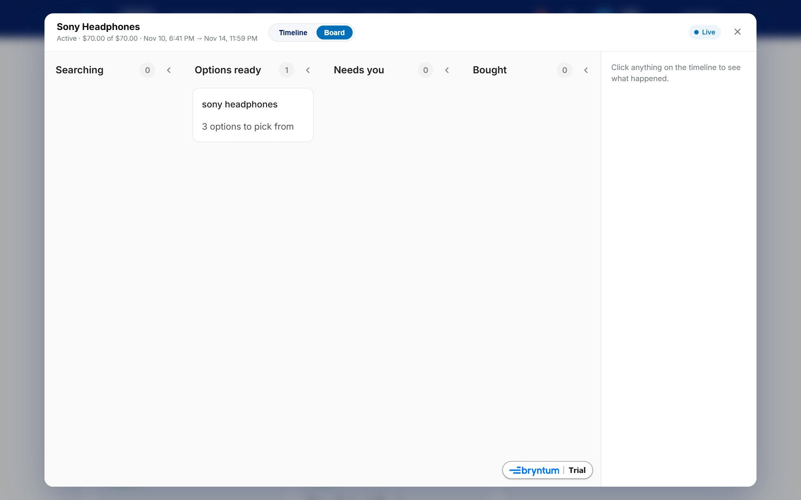

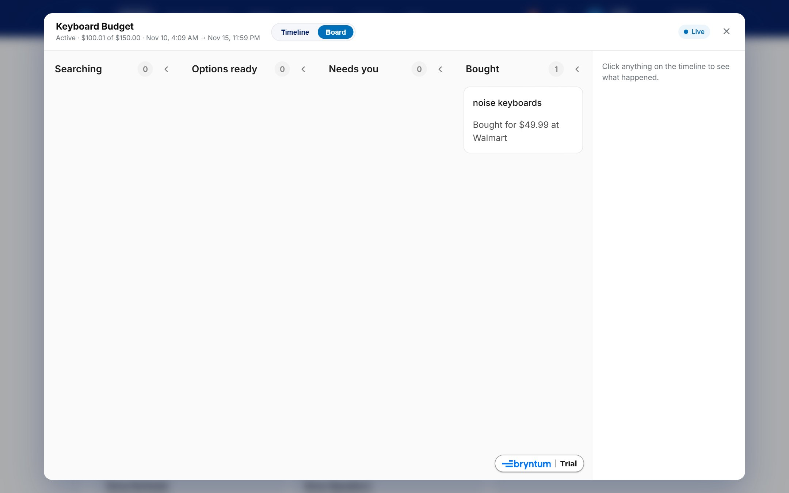

**What it is.** A board for shopping envelopes, with one card per thing to buy. It answers *"where is my agent with each item?"* at a glance.

**What it contains.** Four columns with counts in their headers:

| Column | When a card is there | Card text |
| :--- | :--- | :--- |
| **Searching** | Nothing is waiting and nothing is bought | *Up to $45.00* (the item's current limit) |
| **Options ready** | The agent suggested options to pick from | *3 options to pick from* |
| **Needs you** | A purchase is waiting for approval | *$98.00 at Target · approve?* |
| **Bought** | Paid | *Bought for $69.00 at BestBuy* |

A single-item envelope has one card. A shopping list has one card per item.

**How it is used.** Watch the cards move as the agent works. Click a card to see its details and, when it's waiting on you, **Pick**, **Approve** or **Reject** right there (each confirmed with your password).

**How it is made.** The card's column comes from the envelope's data: an open proposal for the item puts it in *Options ready*, an unresolved approval in *Needs you*, a completed payment in *Bought*. The board is created once, with manual dragging and editing switched off, and then **updated in place** on every live event. That lets Bryntum animate each card into its new column:

```js
new TaskBoard({
  columnField: 'status',
  columns: [{ id: 'searching' }, { id: 'options' }, { id: 'approval' }, { id: 'bought' }],
  useDomTransition: true,   // cards glide to their new column
  showCountInHeader: true,
  features: { taskDrag: false, taskEdit: false, taskMenu: false, columnDrag: false },
});
// on every update
store.getById(t.id).set({ status: t.status, description: t.description, eventColor: t.eventColor });
```

---

## 4. Savings plan (Bryntum Gantt)

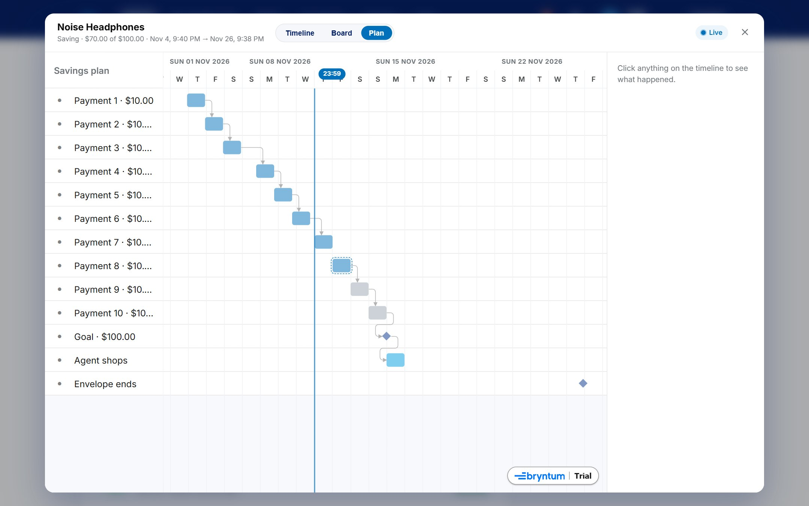

**What it is.** For envelopes paid into over time, a plan of every payment leading to the goal.

**What it contains.** Each payment as a task (*Payment 3 · $20.00*). Payments already made are blue and complete; the next one is highlighted; later ones are grey. Each payment is linked to the next by a **finish-to-start dependency**, followed by a **Goal** milestone (*Goal · $500.00*), then *Agent shops* for an envelope that shops once full, and finally *Envelope ends*.

**How it is used.** Drag the **next** payment to another date. All later payments move with it, the goal moves too, and a preview shows the new last-payment date. On release you confirm with your password, and a Toast says *"Savings payment moved. The later payments follow."*

**How it is made.** The plan is a Gantt project with tasks and dependencies. Bryntum's **scheduling engine** moves the dependent payments. The project uses 24-hour days and 7-day weeks so dates are calendar dates, not working days:

```js
new Gantt({
  project: { startDate, tasks, dependencies: deps, hoursPerDay: 24, daysPerWeek: 7, daysPerMonth: 30 },
  features: {
    taskEdit: false, taskResize: false, taskDragCreate: false, dependencyEdit: false,
    dependencies: { allowCreate: false },
    taskDrag: { validatorFn: (records) => records.length === 1 && records[0].id === nextId },
  },
});
```

Only the next payment can be dragged (`validatorFn`). Paid ones are fixed (`manuallyScheduled`, not draggable). The drop is finalised asynchronously after the password check, just like the timeline.

---

## 5. The what-if preview and the password pop-up

Every drag in every view follows the same steps:

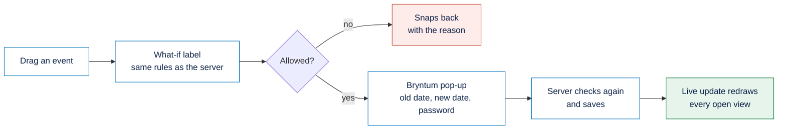

**The what-if label** uses the same date rules as the server (the same month arithmetic as the `policy` package), so it says in advance whether the server will accept the drop:

| Dragging | Example label | Refused when |
| :--- | :--- | :--- |
| Envelope ends | *+3 days · the agent keeps its budget until Nov 17* | Less than 5 minutes from now, more than 90 days away (two years for savings), or before the last savings payment |
| Next savings payment | *+2 days · 4 payments, last Dec 3 · envelope ends Dec 10 ✓* | The last payment would land after the envelope ends |
| Agent's next check | *The agent looks again in 3 h* | After the envelope ends |

**The password pop-up** is a Bryntum **Popup** with a password field and Cancel / Save buttons. If saving fails (a wrong password, or a rule the server refuses), the pop-up stays open with the message:

```js
new Popup({
  title: 'Change when the envelope ends', modal: true, centered: true, width: 420,
  items: {
    info: { type: 'widget', html },
    password: { type: 'passwordfield', label: 'Password' },
    error: { type: 'widget', html: '' },
  },
  bbar: [{ text: 'Cancel', onClick: () => popup.close() }, { text: okText, rendition: 'filled', onClick: submit }],
});
```

Moving an end date or a savings payment changes when money moves, so it needs the password. Moving the agent's next check doesn't, so it doesn't ask.

---

## 6. The operations console timeline (Scheduler for React)

The React operations console uses the **Bryntum Scheduler for React** to show every envelope at once: one row per envelope, a bar from creation to the end date (or the refund) coloured by status, and a marker for every payment coloured by its result (pending, completed or failed). The time scale adapts to the period shown, from hours to weeks. It is read-only and loaded only when its tab is opened.

```tsx
<BryntumScheduler resources={resources} events={events} viewPreset={viewPreset}
  readOnly eventMenuFeature={false} timeRangesFeature={{ showCurrentTimeLine: true }} />
```

---

## 7. How the four products are bundled and loaded

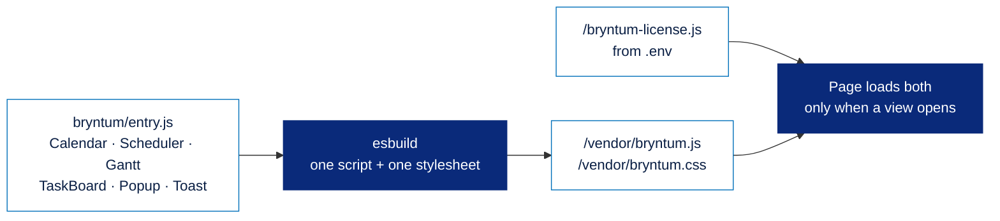

- `paypal-interface/bryntum/entry.js` exports only what the site uses from the Bryntum 8 Enterprise packages.
- `scripts/build-bryntum.mjs` bundles it with **esbuild** into one script, plus one stylesheet with its fonts. The website rebuilds the bundle on start when it is missing or older than its sources or the installed packages, so it never goes stale. `npm run build:bryntum` rebuilds it by hand.
- The page loads the licence first and the bundle only when a Bryntum view is opened, keeping the wallet's first load light.
- The licence key comes from `BRYNTUM_LICENSE_KEY` in `.env`. Without it the views run in trial mode.

**Where it lives:** `paypal-interface/app.js` (calendar, timeline, board, plan, what-if and password pop-up), `paypal-interface/bryntum/`, `scripts/build-bryntum.mjs`, and the timeline component in `apps/web/src/components/`.

[← Back to the main README](../../README.md)
