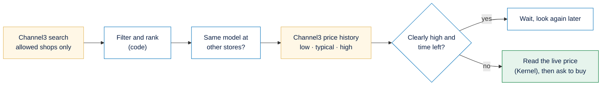
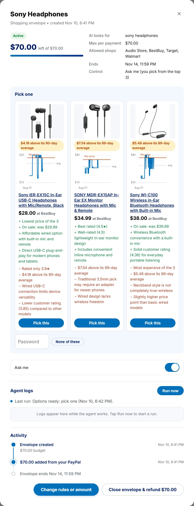
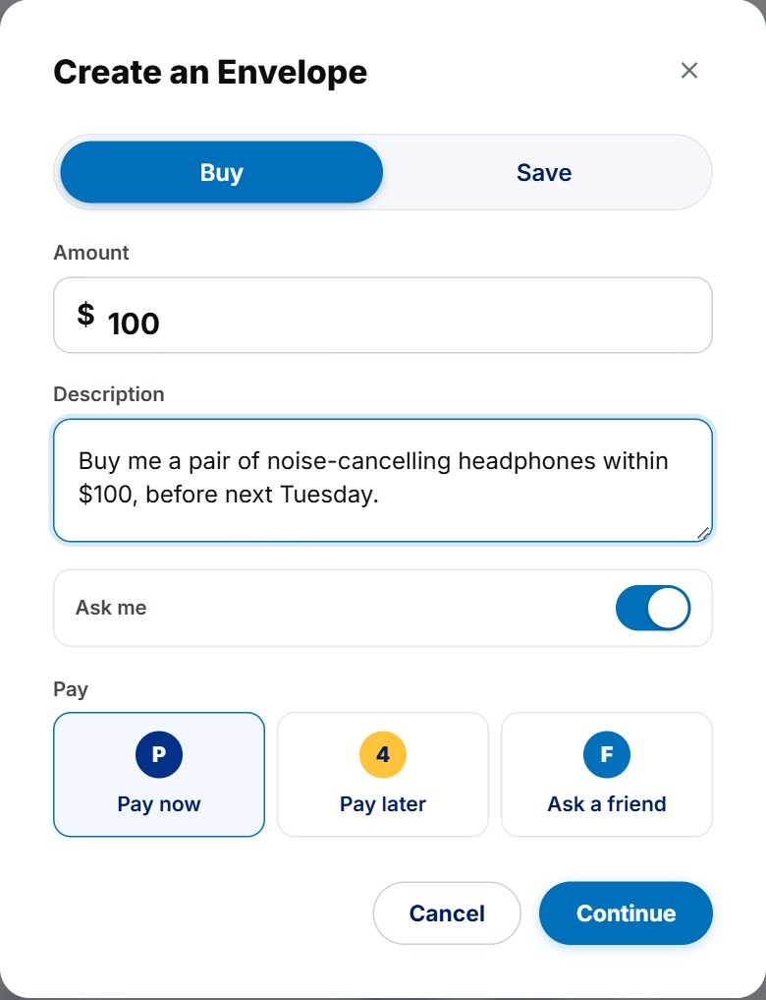

# Channel3 in PayPal Envelope

[← Back to the main README](../../README.md)

A shopping agent is only as good as the product data behind it. **Channel3** gives clean, structured product data across real stores: one product with offers from several shops, photos, ratings, categories and price tracking. With it the agent can do three things a plain search can't: **buy where the item is cheapest**, **avoid buying at a bad price**, and **start from a link you paste**.

All decisions made with Channel3's data are plain code. The AI never interprets prices.

---

## Contents

1. [What we use from Channel3](#what-we-use-from-channel3)
2. [Searching only your allowed shops](#1-searching-only-your-allowed-shops)
3. [Filtering and ranking the results](#2-filtering-and-ranking-the-results)
4. [Comparing stores for the same model](#3-comparing-stores-for-the-same-model)
5. [The 90-day price history](#4-the-90-day-price-history)
6. [The top 3 options](#5-the-top-3-options)
7. [Starting an envelope from a product link](#6-starting-an-envelope-from-a-product-link)
8. [What Channel3 saved you](#7-what-channel3-saved-you)
9. [Without a Channel3 key: the demo store](#8-without-a-channel3-key-the-demo-store)
10. [Configuration](#configuration)

---

## What we use from Channel3

| Channel3 endpoint | What we built with it |
| :--- | :--- |
| Website search | Match each allowed shop's domain (bestbuy.com, target.com, walmart.com) to its Channel3 id, cached |
| Product search | Search only allowed shops, in stock, under the budget, new only when the rules say so |
| Price history (90 days) | A low, typical or high verdict, and the daily points for the chart |
| Product lookup | Turn a pasted link into the product, its price at every store and its history |
| Start price tracking | Keep tracking a product someone pasted, so its history builds up |



---

## 1. Searching only your allowed shops

**What it is.** The agent's product search, limited to the shops in the envelope's rules.

**What it contains.** One candidate per store offer: title, price, shop, link, condition, rating, category path, photo (background removed when available), brand and pre-sale price.

**How it is used.** Automatically, every time the agent looks. The agent may try a better query if the results look wrong.

**How it is made.**

1. Take the envelope's allowed shops that have a real website.
2. Find each one's Channel3 website id once and keep it in memory.
3. Search with filters: the most the envelope may pay right now, only those websites, in stock only, and new only when the rules ask for it.
4. Keep only offers from allowed domains, in stock and in US dollars, and map each domain back to the registered shop name (`www.bestbuy.com` becomes *BestBuy*).

```js
await c3('/v1/search', { method: 'POST', body: JSON.stringify({
  query, limit: 30,
  filters: { price: { max_price: maxPrice }, website_ids: ids, availability: ['InStock'], ...(newOnly ? { conditions: ['new'] } : {}) },
}) });
```

---

## 2. Filtering and ranking the results

**What it is.** Plain code that removes products breaking the owner's rules and orders the rest by what the owner cares about.

**What it contains.** A list of candidates with a score, and a count of what was dropped and why.

| Dropped because | Rule |
| :--- | :--- |
| Over budget | Price above what the envelope may pay now |
| Shop not allowed | Not in the envelope's shops |
| Wrong category | No part of its category is allowed |
| Used | The rules say new only |
| Wrong model | Missing a word the owner insisted on, such as a model number |
| Low rating / slow delivery | Below the owner's minimum, when one was set |

**How it is made.** The rest are scored by the owner's weights for **price**, **rating**, **delivery** and **matching a preferred brand**, each scaled from 0 (worst in the list) to 1 (best). By default only price counts, so the cheapest suitable product comes first. Six unit tests cover the rules and weights.

---

## 3. Comparing stores for the same model

**What it is.** If the same headphones cost $48 at BestBuy and $55 at Target, the agent buys at BestBuy and skips the Target listing, with that reason.

**What it contains.** For each product, the cheapest new offer at each store (cheapest first), and how much buying here saves against the most expensive store. The agent sees it as text, for example *"BestBuy $48.00 · Walmart $52.00 · Target $55.00"*.

**How it is made.** Two listings are **the same model** when Channel3 says they are the same product, or when they share a brand and a **model code**: the longest word in the title that mixes letters and digits and isn't a unit. `WH-CH530` and `P30i` count; `60W`, `256GB` and `2pack` don't. Dashes and capitals are ignored.

```js
export function modelCode(title) {
  const words = title.split(/[\s,()/|]+/).map(norm)
    .filter((w) => w.length >= 3 && /[a-z]/.test(w) && /\d/.test(w) && !UNIT.test(w));
  return words.sort((a, b) => b.length - a.length)[0] ?? null;
}
```

---

## 4. The 90-day price history

**What it is.** A check of whether today's price is good for that product.

**What it contains.** A verdict (low, typical or high), the 90-day average, low and high, and one price per day for the chart.

| Verdict | Rule |
| :--- | :--- |
| Low | At the 90-day low (within 1%), or at least 10% under the 90-day average |
| High | At least 10% over the 90-day average |
| Typical | Anything in between |

**How it is used.** In Autopilot, when the verdict is *high* and the envelope ends more than two days from now, the agent passes the product over. If nothing else fits, the run ends as *waiting for a better price* and the agent looks again later. Close to the end date it buys anyway, so the owner still gets the item.

**How it is made.** History is fetched once per product and kept for 6 hours. Channel3's history mixes every store's prices, so each day keeps its **lowest** price, which is the best price anyone could have paid that day. The verdict is always computed from the numbers, and written in plain words: *"Lowest price in 90 days"*, *"$6.20 above its 90-day average ($48.80)"*.

---

## 5. The top 3 options



**What it is.** In *Ask me* mode, the agent doesn't buy. It shortlists three different products for the owner to choose from.

**What it contains.** For each option: a real photo, the title, the price and shop, a 90-day price chart, the stores compared, and two or three **pros and cons**.

**How it is used.** The owner picks one in the app or from the email; the pick then goes through the rule engine like any purchase.

**How it is made.** The pros and cons start from facts worked out in code, and the agent may add up to two short notes of its own:

| Fact | Example |
| :--- | :--- |
| Cheapest of the options | *Lowest price of the 3* |
| Store comparison | *Cheapest of 3 stores ($7.00 less than Target)*, or the con *Cheaper at Walmart ($52.00)* |
| On sale | *On sale: was $59.99* |
| Price history | *Lowest price in 90 days*, or the con *$6.20 above its 90-day average* |
| Rating | *Best rated (4.6★)*, or *Rated only 3.8★* |
| Live price | *Live price could not be checked* |

---

## 6. Starting an envelope from a product link



**What it is.** Paste a Best Buy, Walmart or Target link into *Create an Envelope*, and the product, its price, its price at other stores, a 90-day chart and the amount fill in.

**What it contains.** A product card with photo, brand and shop, a price verdict, a chart, a list of stores with ✓ next to allowed ones, and a note that Channel3 is now tracking the price.

**How it is used.** Paste the link and press the lookup button. Lower the amount to make the agent wait for a better price.

**How it is made.**

1. Channel3 reads the link (about 20 seconds, because it may load the page live).
2. Offers are filtered to US dollars, matched to store domains and sorted cheapest first, and the pasted store's own price is picked out.
3. Channel3 is asked to keep tracking the product, then the history and verdict are added.
4. The API marks which stores are on the allowed list. If the pasted store isn't, the card says the agent will look for this model at the allowed shops.

---

## 7. What Channel3 saved you

**What it is.** A running total, per envelope, of what Channel3's data saved.

**What it contains.** Money saved against the most expensive allowed store selling the same model, and money saved against each product's 90-day average.

**How it is made.** Every purchase request carries the Channel3 facts the agent used. The envelope list adds them up for purchases that weren't failed.

---

## 8. Without a Channel3 key: the demo store

**What it is.** A small demo shop served by the API, used when there's no Channel3 key (or alongside it with `DEMO_STORE=on`). Its product pages carry the same structured data real shops use, and each product tests one rule.

| Product | The catch | What happens |
| :--- | :--- | :--- |
| Bass Boost Wireless Headphones | Listed at $29.99, the page charges $37.99 | Blocked: the live price is different |
| Refurbished Wireless Headphones | Used | Removed when only new items are allowed |
| Generic Bluetooth Headphones | 2.8 stars | Removed when a minimum rating is set |
| Over-Ear Wireless Headphones | 12-day delivery | Removed when a delivery limit is set |
| Budget Wired Headphones | Sold by a shop that isn't allowed | Removed |
| Sony WH-CH520 | $59.99, over the budget | A demo call drops its price to $39.99, and the watching agent buys it live |
| USB-C Audio Cable | An accessory, not headphones | The agent skips it |

---

## Configuration

| Variable | Purpose |
| :--- | :--- |
| `CHANNEL3_API_KEY` | Channel3. Without it, the demo store is used and product links are off. |
| `DEMO_STORE` | `on` also searches the demo store when a Channel3 key is set |

**Where it lives:** `packages/agents/src/search.ts` (search and the demo store), `packages/agents/src/channel3.ts` (model codes, store comparison, history, verdicts, link lookup), `packages/agents/src/rank.ts` (filtering and ranking), `packages/agents/src/options.ts` (pros and cons), `apps/api/src/routes/demo-store.ts`.

[← Back to the main README](../../README.md)
