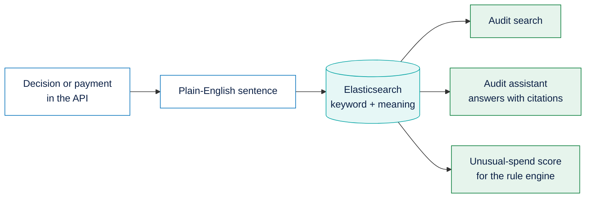

# Elastic in PayPal Envelope

[← Back to the main README](../../README.md)

People don't ask questions in error codes. They ask *"why was it too expensive?"*, while the record says the per-item limit was exceeded. **Elasticsearch** lets us store every decision and payment as a plain-English sentence and search it two ways at once, by keywords and by meaning, so either kind of question finds the right record. Its aggregations also give a quick statistical picture of an envelope's past spending, which we use to spot unusual purchases.

Elastic is optional: without it, everything else in the project keeps working.



---

## Contents

1. [The audit log](#1-the-audit-log)
2. [Search by keywords and by meaning](#2-search-by-keywords-and-by-meaning)
3. [The audit assistant](#3-the-audit-assistant)
4. [The unusual-spend check](#4-the-unusual-spend-check)
5. [Never in the way of a payment](#5-never-in-the-way-of-a-payment)
6. [Configuration](#configuration)

---

## 1. The audit log

**What it is.** One searchable record for every decision the rule engine makes and every change to a payment.

**What it contains.** The envelope, the type of record, the shop, the amount, the category, the result, every reason, who resolved it, the payment's status, the invoice, the time, and **a sentence a person can read**. All 28 of the rule engine's reasons have plain-English wording. Records read roughly like this:

> Blocked payment of $112.00 to Target for "Premium Noise-Cancelling" (category Headphones) from envelope "Headphones". Because the amount was above the per-purchase limit; the envelope did not have enough money left.

> Refunded the unused $31.00 from envelope "Headphones" to the owner; the envelope is closed.

**How it is used.** In the background: the owner never writes records, they only search them or ask about them.

**How it is made.** When the API starts, it creates the index (if needed) and subscribes to its own events. Every *decision created* and *ledger updated* event writes a document with a fixed id per decision or ledger entry, so writing again after a change simply updates it. The index stores exact-match fields for filtering, a text field for keyword search and a semantic field for meaning search. If the index ever needs rebuilding, one internal call rewrites every record from the database.

---

## 2. Search by keywords and by meaning

**What it is.** A search over the audit log that finds records by their words or by what they mean.

**What it contains.** The eight most relevant records for a question, optionally limited to one envelope.

**How it is made.** The sentence is indexed twice: as text for keyword search (BM25), and as a **semantic field** for search by meaning. A question runs both searches and merges them with **reciprocal rank fusion**:

```js
retriever: { rrf: { retrievers: [
  { standard: { query: { bool: { must: [{ match: { summary: query } }], filter } } } },
  { standard: { query: { bool: { must: [{ semantic: { field: 'summary_semantic', query } }], filter } } } },
], rank_window_size: 50 } },
```

The search degrades step by step rather than failing:

| If… | Then |
| :--- | :--- |
| The cluster doesn't support rank fusion | Meaning search alone |
| The embedding model can't be reached | Keyword search alone |
| Making an embedding fails while writing | The record is saved without its semantic field, so keyword search and history still work |

---

## 3. The audit assistant

**What it is.** A way to ask questions about an envelope's history in plain English, such as *"Why was my first purchase blocked?"*

**What it contains.** A two-to-four sentence answer that cites the records it used by their ids, plus the records themselves.

**How it is used.** In the operations console's *Audit Copilot* tab, optionally limited to the selected envelope.

**How it is made.** The search above finds the eight best records. They are given to an AI model with strict instructions: answer only from these records, cite each one by id, and say so if they don't answer the question. If no AI model is available, the assistant still shows the three most relevant records.

---

## 4. The unusual-spend check

**What it is.** A safety check that holds a purchase for the owner when it doesn't look like the envelope's past spending.

**What it contains.** A score from 0 (normal) to 1 (very unusual) and the reasons for it, such as *"5.2× the usual amount"* or *"first purchase from Target"*.

**How it is made.**

1. One Elastic query over the envelope's past approved purchases returns how many there were, the **median amount** (a percentiles aggregation), and which shops and categories were used (terms aggregations).
2. A pure function works out the score:

| Signal | Effect on the score |
| :--- | :--- |
| Amount twice the median | 0 |
| Amount five times the median | 1 (it rises evenly in between) |
| A shop this envelope never used | +0.2 |
| A category this envelope never used | +0.2 |
| Fewer than 3 past purchases | No score (not enough history) |

3. A score of **0.8 or more** makes the rule engine ask the owner first, even on Autopilot.

---

## 5. Never in the way of a payment

- Without Elastic configured, the audit routes say audit is off and everything else works normally.
- Audit records are written **in the background** after events. A failed write is logged and never interrupts a payment.
- The unusual-spend check **gives up after 2 seconds**, and any error counts as "no score", so a slow cluster can never hold up a purchase:

```js
const timeout = new Promise((resolve) => setTimeout(resolve, 2_000));
return Promise.race([anomalyScore(envelopeId, spend).then((r) => r.score).catch(() => undefined), timeout]);
```

---

## Configuration

| Variable | Purpose |
| :--- | :--- |
| `ELASTIC_URL`, `ELASTIC_API_KEY` | The Elastic Cloud deployment. Leave empty to turn audit off. |
| `ELASTIC_GEMINI_API_KEY` | Optional: embed with Google's `gemini-embedding-001` through an Elastic inference endpoint, instead of Elastic's default model |

**Where it lives:** `packages/audit/src/` (`store.ts` for the index and search, `describe.ts` for the sentences, `anomaly.ts` for the score, `copilot.ts` for the assistant), `apps/api/src/services/audit.ts` and `apps/api/src/routes/audit.ts`.

[← Back to the main README](../../README.md)
