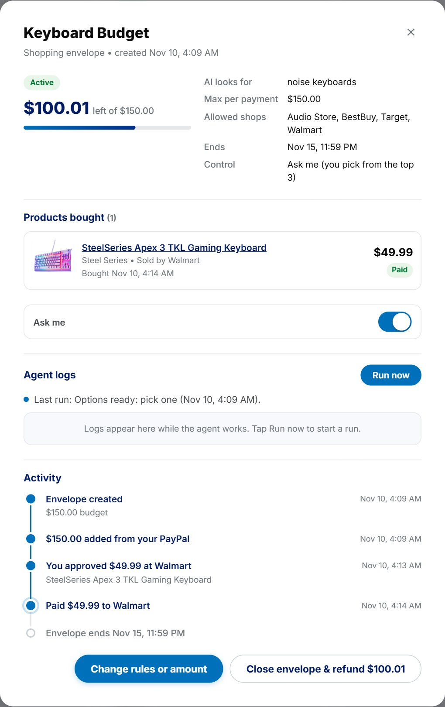
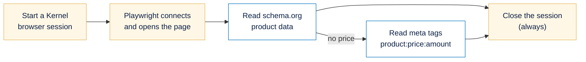

# Kernel in PayPal Envelope

[← Back to the main README](../../README.md)

Search results and product pages often disagree: a listing says $29.99 and the checkout page charges $37.99. Many shops also draw their prices with JavaScript, so a simple page download often sees no price at all. **Kernel** gives the agent a fresh, isolated cloud browser in seconds, so it can read the price the shop actually charges before it asks to buy.



---

## Contents

1. [What Kernel does here](#what-kernel-does-here)
2. [Reading the live price](#1-reading-the-live-price)
3. [How the live price protects the owner](#2-how-the-live-price-protects-the-owner)
4. [Checking the top 3 options](#3-checking-the-top-3-options)
5. [The hidden browser for the PayPal sandbox](#4-the-hidden-browser-for-the-paypal-sandbox)
6. [Configuration](#configuration)

---

## What Kernel does here

| Job | With a Kernel key | Without one |
| :--- | :--- | :--- |
| Read the live price on a product page | A Kernel cloud browser, driven by Playwright | A plain download of the page |
| Run the hidden browser for the PayPal sandbox (link an account, read a personal balance) | A Kernel cloud browser | Chrome on the same machine |

---

## 1. Reading the live price

**What it is.** Just before asking to buy, the agent opens the product page and reads the price on it.

**What it contains.** The live price (US dollars only), the seller and the product title, and which method read them (Kernel or a plain fetch). The agent's activity log shows it, for example *"Kernel read the live price: $112.00"*.

**How it is used.** Automatically, inside the agent's *buy next* step.

**How it is made.**



```js
const session = await kernel.browsers.create();
const browser = await chromium.connectOverCDP(session.cdp_ws_url);
const page = browser.contexts()[0]?.pages()[0] ?? (await browser.newPage());
await page.goto(url, { waitUntil: 'domcontentloaded', timeout: 30_000 });
const listing = extractListing(await page.content());
// finally: kernel.browsers.deleteByID(session.session_id)
```

The price is read by code, not AI. `extractListing` looks for the page's **schema.org product data** first (also inside nested data and offer lists), takes the first offer's price or lowest price, and only accepts US dollars. If that has no price, it falls back to **meta tags**. Unit tests cover each case, including pages with no price at all.

---

## 2. How the live price protects the owner

**What it is.** The live price travels with the agent's request, and the rule engine compares it with the price the agent asked to pay.

**What it contains.**

| What Kernel found | Result |
| :--- | :--- |
| The same price as the listing | The price check passes |
| A different price | **Blocked**: a possible overcharge, so the agent moves on to the next product |
| No readable price | The owner is **asked first**, in every control setting, even Autopilot |

**How it is made.** In the rule engine (plain code, simplified):

```js
if (envelopeType === 'SHOPPING') {
  if (req.verified_price === undefined) soft.push('PRICE_NOT_VERIFIED');
  else if (toCents(req.verified_price) !== amountCents) hard.push('PRICE_MISMATCH');
}
```

The demo store has a product listed at $29.99 whose page charges $37.99. The agent's purchase is blocked, and the owner's email says nothing needs doing because a possible overcharge was stopped.

---

## 3. Checking the top 3 options

**What it is.** In *Ask me* mode, the agent reads the live price of each of its top three options before suggesting them.

**What it contains.** For each option, the live price shown on the card, plus a warning when needed.

**How it is made.** An option whose live price is now above what the envelope may spend is dropped and replaced by the next one. An unreadable one is labelled *"Live price could not be checked: you will be asked again before paying"*, and a changed one *"Price changed on the shop page (was $X)"*.

---

## 4. The hidden browser for the PayPal sandbox

**What it is.** PayPal has no API for a **personal** account's balance, and personal sandbox accounts don't get the older API credentials either. So the website uses a hidden browser for two sandbox jobs.

**What it contains.**

- **The live sandbox balance**, read the way PayPal displays it, kept for 30 seconds and re-read after money moves, including money waiting to be accepted.
- **Automatic account linking** after login: open PayPal's approval page, sign in with the test password, approve, and catch PayPal's redirect.

**How it is made.** With a Kernel key this runs in a Kernel cloud browser. Otherwise it runs in Chrome on the same machine with a separate profile per account, so PayPal's login cookies are kept and most reads skip the login. Requests for the same account wait their turn, because a profile can only be open once.

> This is a **sandbox-only shortcut**. A real product never holds anyone's PayPal password.

---

## Configuration

| Variable | Purpose |
| :--- | :--- |
| `KERNEL_API_KEY` | Kernel cloud browsers. Without it, prices use a plain page download and the sandbox browser uses local Chrome. |
| `CHROME_PATH` | Local Chrome when Kernel isn't used. The default is the macOS path, so set it on Windows and Linux. |
| `KAJLA_SANDBOX_PASSWORD`, `JUGAL_SANDBOX_PASSWORD` | Test passwords for the hidden sandbox browser |

**Where it lives:** `packages/agents/src/verify.ts` (reading the price), `packages/agents/src/shopping.ts` (where the agent uses it), `packages/policy/src/engine.ts` (the price rule), `paypal-interface/sandbox-balance.ts` and `paypal-interface/paypal-link.ts` (the hidden sandbox browser).

[← Back to the main README](../../README.md)
