# PayPal in PayPal Envelope

[← Back to the main README](../../README.md)

PayPal is the backbone of PayPal Envelope. Every dollar that goes into an envelope, every purchase an agent makes, every bill paid and every refund moves through a PayPal API, and PayPal's own records are used to prove that the project's ledger tells the truth. Everything runs in the PayPal sandbox.

We used **eleven PayPal products**. This guide walks through each feature built on them: what it is, what it contains, how a person uses it, and how it is made.

---

## Contents

1. [The PayPal products we use](#the-paypal-products-we-use)
2. [The sandbox accounts and how money is held](#the-sandbox-accounts-and-how-money-is-held)
3. [Linking a PayPal account once](#1-linking-a-paypal-account-once)
4. [Pay now](#2-pay-now)
5. [Pay Later](#3-pay-later)
6. [Ask a friend](#4-ask-a-friend)
7. [Savings plans](#5-savings-plans)
8. [Monthly top-up](#6-monthly-top-up)
9. [Paying shops with PayPal Checkout](#7-paying-shops-with-paypal-checkout)
10. [Payouts: bills, refunds and the fallback](#8-payouts-bills-refunds-and-the-fallback)
11. [Utility bills and the PayPal Agent Toolkit](#9-utility-bills-and-the-paypal-agent-toolkit)
12. [Webhooks](#10-webhooks)
13. [Verified by PayPal](#11-verified-by-paypal)
14. [PayPal Counter's reports](#12-paypal-counters-reports)
15. [Never paying twice](#never-paying-twice)
16. [Configuration](#configuration)

---

## The PayPal products we use

| PayPal product | What we built with it |
| :--- | :--- |
| **Orders v2** | Funding envelopes, Pay Later, savings payments and Checkout purchases from shops |
| **JavaScript SDK** | The PayPal, Pay Later and Subscribe buttons |
| **Saved PayPal accounts** (v3 payment method tokens) | Link a person's PayPal once, then pay without a popup; save the platform's account for Checkout |
| **Payouts** | Paying utility bills, returning leftovers, and paying shops when Checkout isn't available |
| **Invoicing v2** | Utility bills, and *Ask a friend* money requests |
| **Subscriptions** and Catalog Products | A monthly top-up for bill envelopes |
| **Payments v2** | Reading captures to settle and verify purchases |
| **Webhooks** | Signature-verified updates for 17 event types |
| **Transaction Search, Balances, classic NVP** | PayPal Counter's transactions and live balance, read-only |
| **PayPal Agent Toolkit** | The bill-pay agent reads invoices, read-only |
| **PayPal Server SDK** | Typed calls for Orders, Payments, saved accounts and Subscriptions |

All the code that moves money lives in **one package**, `packages/paypal`. Nothing else in the project can pay, charge or refund.

---

## The sandbox accounts and how money is held

| Account | Type | Role |
| :--- | :--- | :--- |
| Platform | Business | Holds the money of every envelope. Its REST app creates orders, payouts, money requests and subscriptions. |
| Kajla, Jugal | Personal | Envelope owners. They fund envelopes, receive refunds and pay friends' requests. |
| Audio Store | Business | The shop. BestBuy, Target and Walmart are registered stand-ins that pay out to this account. |
| City Utility | Business | Sends bills through its own REST app. |

All envelope money sits in the platform's PayPal account. The project's **ledger** records which part of it belongs to which envelope. A **merchant registry** maps real store names to sandbox accounts, because real stores can't receive sandbox money.

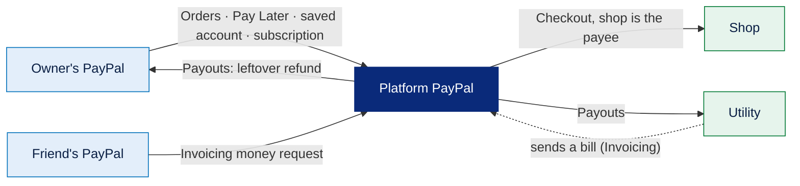

---

## 1. Linking a PayPal account once

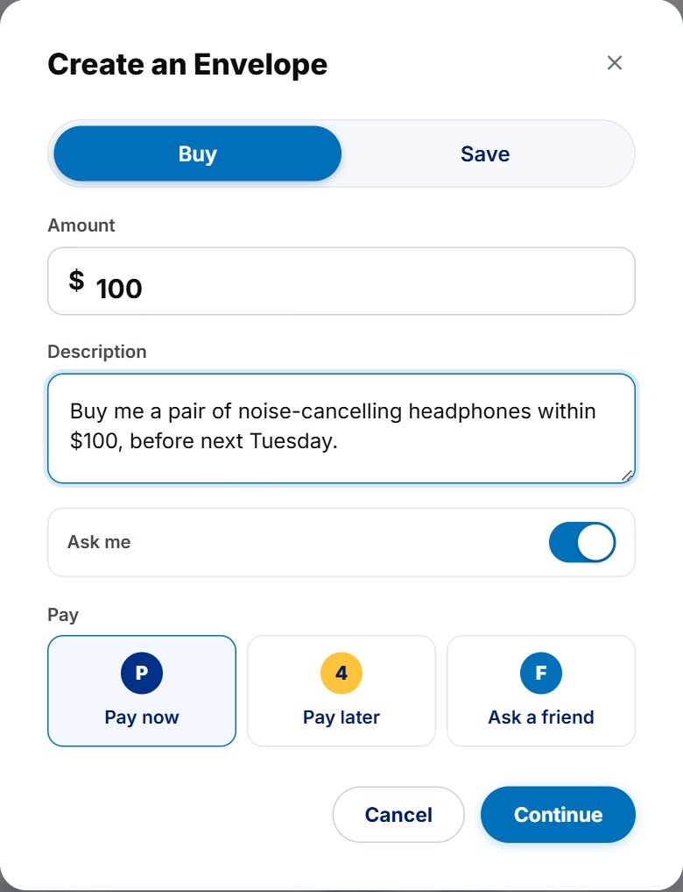

**What it is.** People link their PayPal account to PayPal Envelope once. After that, *Pay now* and savings payments work without a PayPal popup.

**What it contains.** A saved PayPal **payment token** per person, stored in the database with their PayPal email and the date it was linked.

**How it is used.** On the demo site, linking happens automatically after login. There is also a manual popup flow, and a person can unlink at any time.

**How it is made.**

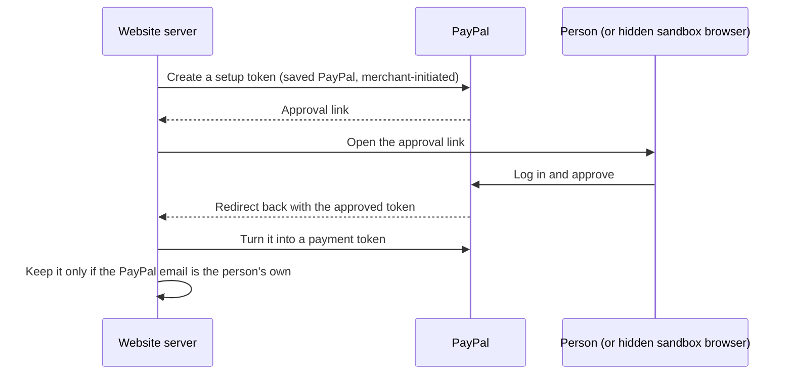

1. The platform creates a **setup token** for a saved PayPal account, with no shipping and return/cancel addresses on our site.
2. The person approves on `sandbox.paypal.com`. On the demo site a hidden browser does this after login, using the account's test password, so the person isn't asked to log in to PayPal again.
3. The approved setup token becomes a **payment token**. Its request id is tied to the setup token, so a retry never saves the account twice.
4. **Only the right account is kept.** If the approved PayPal email isn't the person's own sandbox email, the token is deleted and the link is refused. Nobody can fund envelopes from someone else's PayPal.

The same flow saves the **platform's own PayPal account** once (`npm run setup:checkout -w apps/api`). That saved account pays shops through Checkout.

---

## 2. Pay now

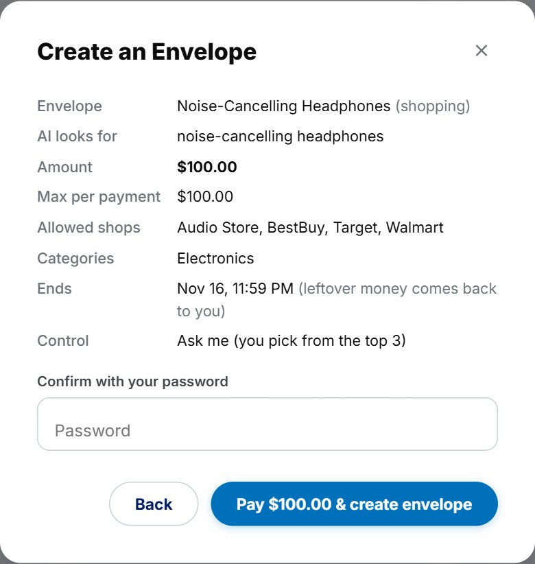

**What it is.** The envelope's amount is taken from the linked PayPal account as soon as the person confirms.

**What it contains.** One Orders v2 order, paid with the saved account, with the envelope's id as `custom_id`, and one funding entry in the ledger.

**How it is used.** Choose **Pay now** on the create form, review the rules and enter your password. The progress screen shows *"$100.00 taken from your PayPal"* and *"Envelope is active"*.

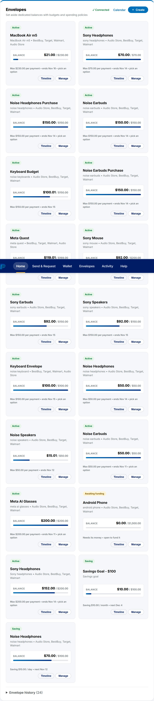

**How it is made.**

1. The site reads the live PayPal balance first and refuses a payment larger than it.
2. An order is created and paid with the saved account. PayPal usually captures it in the same call.
3. A funding entry is written to the ledger with the order id.
4. When the capture completes, the envelope is credited and becomes **active**, the agent starts, and the "your envelope is live" email goes out. A declined capture is recorded as failed and nothing is credited.
5. The request id is `fund-saved-<envelope>-attempt-<n>`: a double click returns the same order, and a retry after a decline gets a new one.

---

## 3. Pay Later

**What it is.** **PayPal Pay in 4.** The envelope gets the full amount today, so the agent can shop today, and the person repays PayPal in four parts.

**What it contains.** PayPal's own Pay Later button and an Orders v2 order for the envelope's amount.

**How it is used.** Choose **Pay later** on the create form. PayPal's window opens; approve with Pay Later. Pay in 4 is for US accounts between $30 and $1,500.

**How it is made.**

1. The API creates an order for the envelope's amount and records it in the ledger once.
2. The **JavaScript SDK** button opens PayPal with Pay Later switched on and cards and Venmo switched off, so only PayPal's own options appear.
3. After approval the API captures the order and credits the envelope.
4. If the browser closes before the capture, the `CHECKOUT.ORDER.APPROVED` webhook captures it instead.

---

## 4. Ask a friend

**What it is.** The owner asks a friend to fund an envelope. The friend gets a real **PayPal money request**, and their payment goes straight into the envelope, not through the owner's account.

**What it contains.** A PayPal invoice for the missing amount, a saved request (friend's email, amount, PayPal's pay link, status), and on the friend's side a *Money requests for you* list.

**How it is used.** Choose **Ask a friend** and enter their PayPal email and an optional message. The friend sees the request when they log in, pays it on PayPal, and can press *I paid it* to have it checked at once.

**How it is made.**

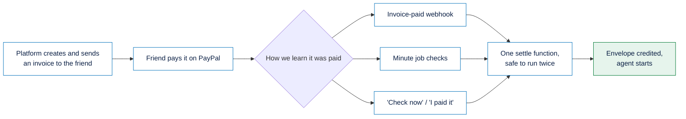

1. The platform creates an invoice for the missing amount, with the envelope's id as its reference, no tips and no partial payments, and a note with the owner's name and message. Then it sends it.
2. The payment is detected by the webhook, the minute job, or a manual check. All three call the same settle function, which credits the envelope once (the invoice id is the ledger reference).
3. If the envelope expires first, the request is cancelled at PayPal. If the friend paid at the last moment, the envelope is credited instead.

---

## 5. Savings plans

<table><tr>
<td>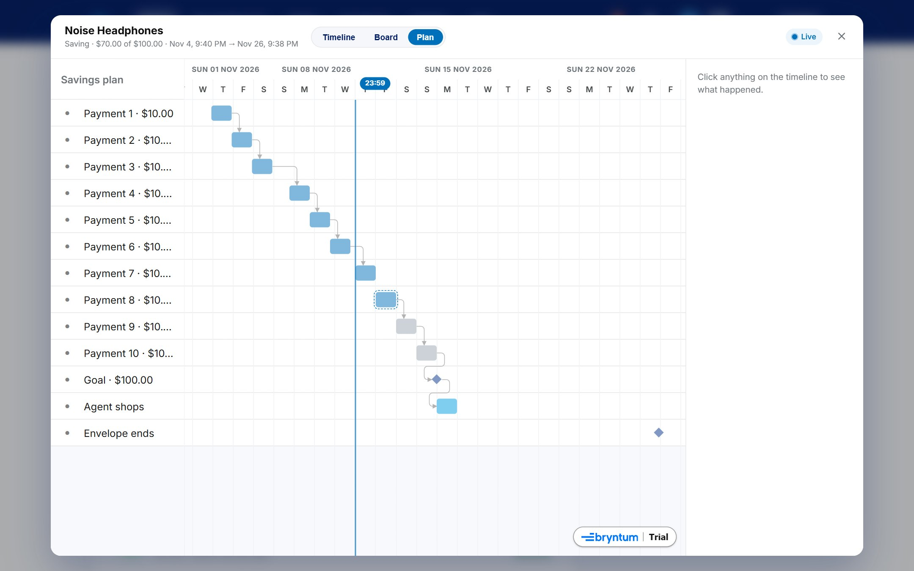</td>
<td>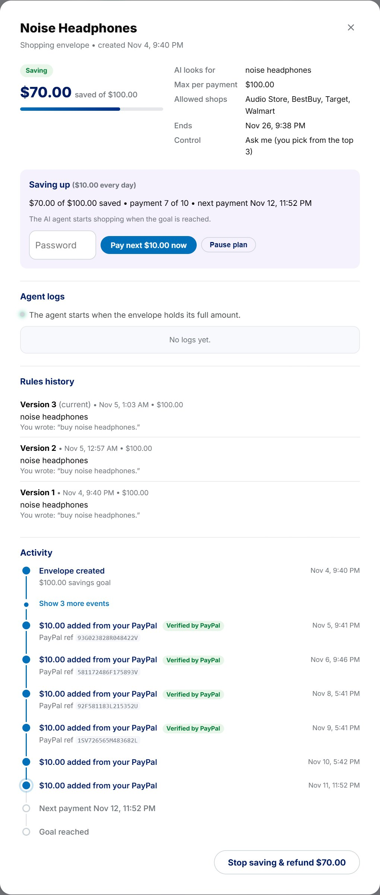</td>
</tr><tr>
<td></td>
<td></td>
</tr></table>

**What it is.** A fixed amount taken from the saved PayPal account every day, week or month until a goal is reached. A savings envelope only saves. A shopping envelope can **save first and shop later**: the agent starts once the goal is met.

**What it contains.** The amount per payment, the interval, the next payment date, the number of payments made and failed, and whether the plan is paused.

**How it is used.** Choose **Save** on the create form, set the goal and the pace, and confirm. Later you can **pay the next one now**, **pause**, **resume**, or **drag the next payment** to another date on the calendar.

**How it is made.**

- The first payment is taken when the envelope is created. Later ones are taken by the minute job, which **claims** each envelope before charging, so two servers can never take the same payment.
- Each payment is an Orders v2 order on the saved token, with a request id of envelope, payment number and attempt, so a network retry returns the same order instead of charging twice.
- The envelope stays in *saving* until it holds the full amount, then becomes *active*. Nothing can be spent while saving.
- A declined payment is retried the next day. After **three declines in a row** the plan pauses and the owner is emailed. A network error retries in an hour with the same request id.

---

## 6. Monthly top-up

**What it is.** A bill envelope can subscribe to a monthly PayPal plan that tops it up automatically.

**What it contains.** A Catalog Product, a monthly billing plan, and the subscription id stored on the envelope.

**How it is used.** On a bill envelope, choose the monthly option and approve the subscription with PayPal's Subscribe button.

**How it is made.**

- `npm run setup:plan -w packages/paypal` creates the Catalog Product and the monthly plan once.
- The Subscribe button creates the subscription with the envelope's id as `custom_id`. The API checks that the subscription belongs to that envelope and that plan before linking it.
- Each month, `PAYMENT.SALE.COMPLETED` credits the envelope once per sale id. Cancelling the subscription stops the top-ups.

---

## 7. Paying shops with PayPal Checkout

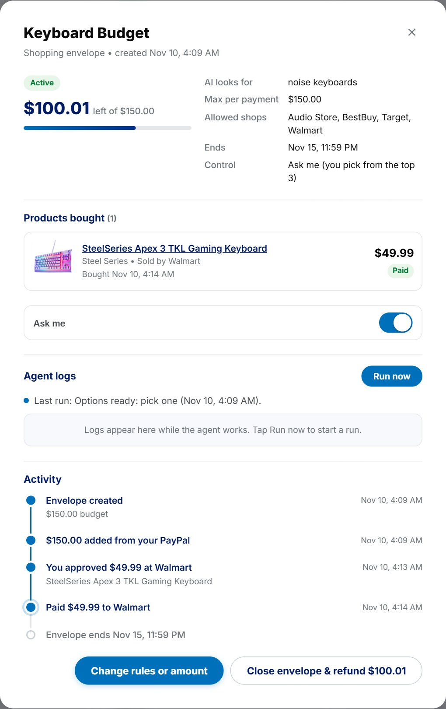

**What it is.** When the rule engine approves a purchase, the shop is paid with a **real PayPal purchase**: the shop is the payee, the purchase has buyer protection, the shop gets a receipt with the item, and it can refund normally.

**What it contains.** One Orders v2 order per purchase, paid from the platform's saved account, with the shop as payee and one line item (name, quantity, price and product link).

**How it is used.** Nothing to do: it happens after an approval, whether the agent bought alone, the owner approved it, or the owner picked an option.

**How it is made.**

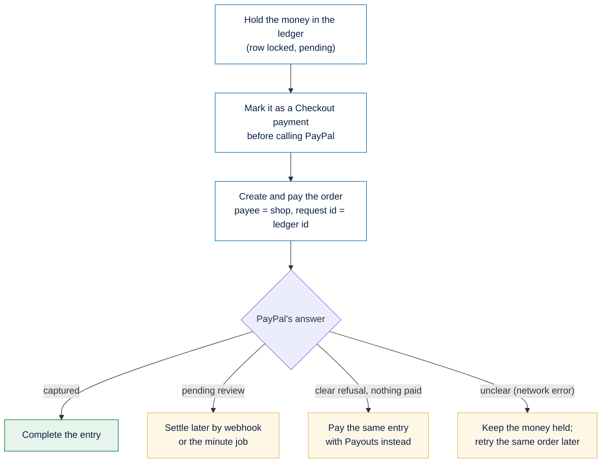

- The ledger entry id is the order's `custom_id`, its `invoice_id` and part of its request id, so the same purchase can never be paid twice.
- Marking the entry as Checkout **before** the call means an unclear outcome is only ever retried as the same order, never also paid another way.
- An error saying the order may already exist is never retried as a payout; it waits for a person.

---

## 8. Payouts: bills, refunds and the fallback

**What it is.** Payouts pays utility bills, returns leftover money to the owner, and pays shops when Checkout isn't available.

**What it contains.** One payout batch per ledger entry, whose batch id, item id and request id are all the ledger entry id.

**How it is used.** Automatically: after a bill is approved, when an envelope ends or is closed, or when its amount is lowered.

**How it is made.**

- Because the ledger entry id is the payout's id, PayPal refuses a second payout for the same entry, and webhooks find the entry again from the payout.
- Results arrive by webhook, or by the minute job and the *Sync* button. *Failed*, *returned*, *blocked*, *refunded* or *reversed* puts the held money back in the envelope.
- After a network error, the money stays held. Two minutes later the payout is re-sent with the same id, and PayPal returns the original batch instead of paying again.
- When an envelope ends, its whole balance becomes one refund entry paid to the owner. A failed refund is retried up to three times, then flagged for a person.
- The Postman collection uses PayPal's `PayPal-Mock-Response` header to force *insufficient funds* and prove the refusal path.

---

## 9. Utility bills and the PayPal Agent Toolkit

**What it is.** City Utility sends real PayPal invoices to the platform. A bill-pay agent reads them and asks to pay the open ones.

**What it contains.** The utility's invoices; the official **PayPal Agent Toolkit** with only two read actions enabled; and a payment recorded on the invoice once it is paid.

**How it is used.** Create a bill envelope (for example *"Pay the City Utility electricity bill"*). The agent finds the open bill and pays it within your rules.

**How it is made.**

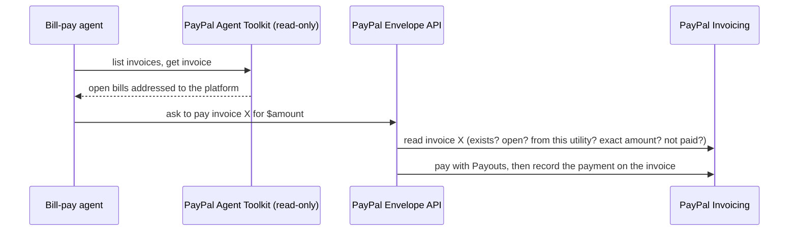

- The toolkit runs with the utility's credentials and **only `invoices.list` and `invoices.get` turned on**. No action that moves money is enabled. Long responses are trimmed to the fields the agent needs.
- Before paying, the API reads the invoice **from PayPal**: it must exist, be open, be issued by the utility's account, match the amount exactly, and not already be paid from any envelope.
- After the payout succeeds, a payment is recorded on the invoice so the utility sees it as paid.

---

## 10. Webhooks

**What it is.** PayPal tells the project about payments the moment they happen.

**What it contains.** One webhook for the platform app (17 event types) and one for the utility app (invoice paid or cancelled), registered with `npm run setup:webhooks -w packages/paypal -- https://<public-url>`.

**How it is made.**

- **Verified.** The webhook's raw body is passed to PayPal's signature check exactly as received, so PayPal checks the same bytes it signed.
- **Processed once.** Each event is stored by its id; a repeated event is ignored.
- **Safe to repeat.** Every handler can run twice with no extra effect.

| Event | What happens |
| :--- | :--- |
| Order approved | Capture and credit the funding |
| Capture completed or denied | Settle a Checkout purchase, or a funding payment |
| Payout item succeeded, failed, blocked, returned, refunded, denied or cancelled | Complete the payment, or put the money back |
| Payout batch success or denied | Re-check the batch, or fail it |
| Subscription activated or cancelled | Link or unlink the subscription |
| Sale completed | Credit a monthly top-up |
| Invoice paid or cancelled | Settle a friend's money request, or note a paid bill |

Webhooks are the fast path. The minute job and the *Sync* button ask PayPal again, so a missed webhook never loses money.

---

## 11. Verified by PayPal

**What it is.** A read-only check of **every ledger entry** against PayPal's own records. It never moves money and never changes the ledger.

**What it contains.** A label on each payment: **Verified**, **Waiting** (under 30 minutes old or still processing), **Mismatch** with PayPal's own words, or **Not checkable** (nothing reached PayPal), plus PayPal's transaction id.

**How it is used.** It runs every night and from the *Verify now* button. Labels appear on the envelope page and in *All activity*. A new mismatch is emailed to the owner once.

**How it is made.**

| Ledger entry | Asked with | Compared |
| :--- | :--- | :--- |
| Funding by order | Orders v2 | Captured, amount, payer is the owner, belongs to this envelope |
| Funding by a friend | Invoicing | Request paid, amount |
| Purchase through Checkout | Payments + the order | Status, amount, the right purchase, payee is the shop |
| Purchase through Payouts, or a refund | Payouts | Status, amount, receiver is the shop or the owner |

It also checks that the envelope's balance equals money in minus money out. A mismatch reads like PayPal says it, for example *"PayPal shows the shop refunded this $98.00 on Nov 9."*

---

## 12. PayPal Counter's reports

**What it is.** PayPal Counter shows **every** transaction on a shop's PayPal account, plus its live balance, read-only.

**What it contains.**

| Data | First choice | Fallback |
| :--- | :--- | :--- |
| Transactions | **Transaction Search** with the shop's own REST app | Classic NVP `TransactionSearch`, plus `GetTransactionDetails` for item names (retried up to three times) |
| Balance | **Balances** API | NVP `GetBalance`, then a hidden browser reading the sandbox page |

**How it is made.**

- The first sync reads 180 days in 31-day chunks (PayPal's limit per search). Later syncs re-read the last 3 days for late arrivals. Data is cached per shop and refreshed every 2 minutes; *Sync now* forces it.
- PayPal's event codes become plain words (*Payment received*, *Refund*, *Fee*, *Withdrawal to bank*) and a source (*PayPal Checkout*, *Payouts*, *Invoice*, *Subscription*).
- Agent payments are matched to PayPal's rows by capture id, payout transaction id or `custom_id`, then by the same amount within 15 minutes.
- If none of the agents' payments are in the connected account, the page says which PayPal account the agents actually pay.

---

## Never paying twice

| Money movement | What makes a retry safe |
| :--- | :--- |
| Funding order | A request id per envelope and attempt |
| Capture | A request id per order |
| Savings payment | A request id per envelope, payment number and attempt |
| Checkout purchase | The ledger entry id as request id and invoice id |
| Payout | The ledger entry id as request id, batch id and item id |
| Money request send or cancel | A request id per invoice |
| Bill marked paid | A request id per invoice |
| Saving an account | A request id per setup token |

On top of this, the ledger holds money **before** PayPal is called and releases it only when PayPal clearly refused.

**Three ways we call PayPal:**

| Layer | Used for |
| :--- | :--- |
| **PayPal Server SDK** | Orders, Payments, saved accounts, Subscriptions |
| **An SDK we generated from PayPal's published API descriptions** (with APIMatic) | Payouts, invoice reads, webhook management |
| **A small REST client** | Calls that need an exact request id or exact body bytes: invoice writes, money requests, the webhook signature check, Catalog Products |

All three report errors in the same shape, so every caller follows one rule: if PayPal clearly said no, give the money back; if the outcome is unclear, keep it held.

---

## Configuration

| Variable | Purpose |
| :--- | :--- |
| `PAYPAL_CLIENT_ID`, `PAYPAL_CLIENT_SECRET` | The platform's REST app, with Payouts, Subscriptions, Invoicing and saved payment methods turned on |
| `PAYPAL_BASE_URL` | `https://api-m.sandbox.paypal.com` |
| `PAYPAL_WEBHOOK_ID`, `UTILITY_WEBHOOK_ID` | Printed by `setup:webhooks` |
| `PAYPAL_UTILITY_PLAN_ID` | Printed by `setup:plan` |
| `UTILITY_CLIENT_ID`, `UTILITY_CLIENT_SECRET` | City Utility's REST app |
| `PLATFORM_SANDBOX_EMAIL`, `USER_SANDBOX_EMAIL`, `AUDIO_STORE_SANDBOX_EMAIL`, `CITY_UTILITY_SANDBOX_EMAIL` | Sandbox accounts |
| `MERCHANT_PAYMENTS` | `payouts` pays shops with Payouts instead of Checkout |
| `VITE_PAYPAL_CLIENT_ID` | Public client id for the buttons |
| `AUDIO_STORE_CLIENT_ID` / `_SECRET`, and NVP `_API_USERNAME`, `_API_PASSWORD`, `_API_SIGNATURE` | A shop's own credentials for PayPal Counter |
| `VERIFY_HOUR` | Hour of the nightly check |

**Where it lives:** `packages/paypal/src/` (`orders.ts`, `checkout.ts`, `payouts.ts`, `invoicing.ts`, `requests.ts`, `subscriptions.ts`, `webhooks.ts`, `sdk.ts`, `rest-sdk.ts`, `http.ts`); handlers in `apps/api/src/webhooks.ts` and `apps/api/src/services/`; PayPal Counter's reports in `paypal-interface/business-transactions.ts` and `business-balance.ts`.

**Limits.** Payouts, saved accounts and Invoicing need PayPal's production approval, and holding many people's money in one account would need licensing, so the project stays in the sandbox on purpose. Automatic linking and the personal balance use a hidden browser with a test password, which is a sandbox-only shortcut.

[← Back to the main README](../../README.md)
