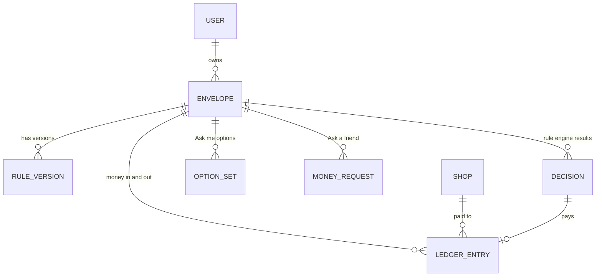
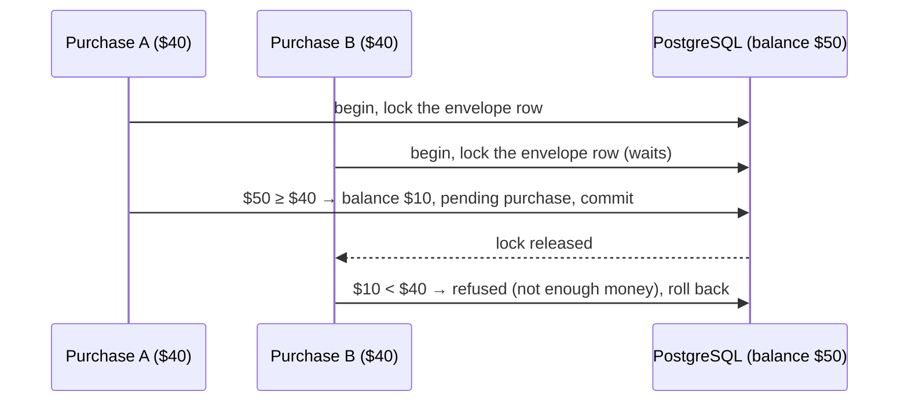

# PostgreSQL and Prisma in PayPal Envelope

[← Back to the main README](../../README.md)

Every envelope's money is tracked in a **ledger** stored in **PostgreSQL** and accessed through **Prisma**. The ledger is what makes an envelope real: it records which part of the platform's PayPal balance belongs to which envelope, and it is built so that two purchases can never spend the same dollar and a retry can never pay twice.

---

## Contents

1. [What is stored](#1-what-is-stored)
2. [The ledger rules](#2-the-ledger-rules)
3. [Two purchases at once](#3-two-purchases-at-once)
4. [Every money operation](#4-every-money-operation)
5. [Built-in protection against doing things twice](#5-built-in-protection-against-doing-things-twice)
6. [How the schema grew](#6-how-the-schema-grew)
7. [Tests against a real database](#7-tests-against-a-real-database)
8. [Commands](#commands)

---

## 1. What is stored



| Record | Holds |
| :--- | :--- |
| Users | Envelope owners, matched by their PayPal sandbox email |
| Envelopes | Name, kind (shopping, bill pay, savings), amount and balance in cents, status (waiting for money, saving, active, ended, closed), end date, subscription, when the agent last ran and runs next, the savings plan, and the email of the person who created it |
| Rule versions | Every version of an envelope's rules, with the plain-English text they came from |
| Ledger entries | Money in, purchases and refunds; pending, completed or failed; cents; PayPal's reference; the shop; the decision that caused it; the shopping-list item; Checkout or Payouts; and the last *Verified by PayPal* result |
| Decisions | Every rule-engine result with the full request, every reason, and who resolved it (approved or rejected by the owner, picked by the owner, or cancelled by a rule change) |
| Option sets | The agent's suggested options for *Ask me* envelopes, and which one was picked |
| Shops | Registered merchants: category, sandbox payout email and real website |
| Money requests | *Ask a friend* PayPal invoices: the friend's email, amount, pay link and status |
| Saved PayPal accounts | Payment method tokens for owners and the platform |
| PayPal events | Every webhook received, stored once by its id |

Money is stored in **whole cents** everywhere. Dollars appear only in rules people read. Indexes match the minute job's questions: envelopes by status and end date, by status and next agent run, and by status and next savings payment.

---

## 2. The ledger rules

1. **A balance only changes through the ledger functions** in `packages/db/src/ledger.ts`.
2. **Each one runs in a single transaction that locks the envelope's row first.**
3. **Money is held before PayPal is called.** An approved purchase lowers the balance and writes a *pending* entry. Only PayPal's answer completes or fails it.
4. **Every function is safe to call twice.** Completing or failing an entry only touches it while it is still pending, so a repeated webhook changes nothing.

The lock is a PostgreSQL row lock (`SELECT … FOR UPDATE`) on the envelope's row, taken inside a Prisma interactive transaction. Any other transaction that wants the same envelope waits until the first one commits, then reads the new balance.

---

## 3. Two purchases at once

**What it is.** The guarantee that two purchases arriving at the same moment can't both spend the same money.

**How it is made.**



The refused purchase is recorded as a blocked decision with that reason, so the agent sees why. A test runs **ten purchases at once** and checks that they never spend more than the balance.

---

## 4. Every money operation

| Operation | What it does | Why repeating it is safe |
| :--- | :--- | :--- |
| Start funding | Records a funding order before it is captured | PayPal's order id is unique |
| Complete funding | Credits the envelope; *waiting* becomes *active*, or stays *saving* until the goal | Only a pending entry is credited |
| Fail funding | Records a declined capture | Only a pending entry changes |
| Add funding | Money paid another way: a subscription payment or a friend's invoice | An existing PayPal reference is skipped |
| Hold a purchase | Checks the envelope is open, not ended and has enough money, then holds it | One held payment per decision |
| Complete a payment | A purchase or refund succeeded; the final refund closes the envelope | Only a pending entry changes |
| Fail a payment | Puts the held money back (and the amount, for a failed refund after lowering it) | Only a pending entry changes |
| Start closing | Waits for payments in progress, then turns the whole balance into one refund, or closes an empty envelope | Does nothing once closed |
| Change rules | Saves the next rules version. A lower amount creates a refund for the difference; a higher amount must already be paid in. | Version numbers are unique per envelope |
| Reconcile | Recomputes the balance from the entries and compares | Read-only |

---

## 5. Built-in protection against doing things twice

| Unique field | Prevents |
| :--- | :--- |
| A ledger entry's PayPal reference | Crediting the same order, sale or invoice twice |
| A ledger entry's decision | Paying the same approved purchase twice |
| A money request's invoice id | Two requests for one PayPal invoice |
| A PayPal event's id | Handling the same webhook twice |
| Envelope + rules version | Two rule versions with the same number |
| An envelope's subscription id | One subscription topping up two envelopes |

Each ledger entry's id is also PayPal's request id, payout item id and Checkout invoice id, so the database and PayPal always agree on what "the same payment" means.

---

## 6. How the schema grew

| Migration | Added |
| :--- | :--- |
| Initial | Users, envelopes, rules, ledger, shops, decisions, PayPal events |
| Agent watch | When the agent last ran, its result, and when it runs next |
| Ask me | Option sets for the owner to pick from |
| Shopping lists | The item each purchase was for |
| Savings and saved accounts | The savings kind and status, the savings plan, saved PayPal accounts |
| Money requests | *Ask a friend* |
| Checkout purchases | Whether a purchase was paid by Checkout or Payouts |
| PayPal verification | The *Verified by PayPal* result on each entry |
| Alert email | The email of the person who created an envelope |

---

## 7. Tests against a real database

`packages/db/src/ledger.test.ts` has 15 tests, and each one ends by reconciling the balance with the ledger:

- Two purchases that each fit, but not together: only one passes.
- **Ten purchases at once never spend more than the balance.**
- The same funding order credited twice counts once; the same subscription payment twice counts once.
- A failed payout returns the money once, even if reported twice.
- Closing waits for payments in progress, then refunds and closes; an empty envelope closes with no refund.
- Every rules version is kept. Lowering the amount refunds the difference and keeps the envelope open. A failed refund puts the money and the amount back. Raising the amount needs the extra paid in first. The amount can't drop below what was already spent, or change while a payment is in progress. Ended or closed envelopes can't be changed.
- An envelope paid into over time stays in *saving* until it is full, and can't spend before then.

---

## Commands

| Variable | Purpose |
| :--- | :--- |
| `DATABASE_URL` | PostgreSQL connection string |

```bash
npm run db:generate     # Prisma client
npm run db:migrate      # create a migration (development)
npm run db:deploy       # apply migrations
npm run db:seed         # demo user, plus Audio Store, BestBuy, Target, Walmart and City Utility
npm run db:studio       # browse the data
npm test -w packages/db
```

**Where it lives:** `packages/db/prisma/schema.prisma`, `packages/db/prisma/migrations/`, `packages/db/src/ledger.ts`, `packages/db/src/ledger.test.ts`.

[← Back to the main README](../../README.md)
