# Postman in PayPal Envelope

[← Back to the main README](../../README.md)

Unit tests prove our own logic. To prove the **money paths** behave correctly against PayPal itself, we wrote two **Postman** collections: one that tests the PayPal sandbox calls the project depends on, including forced failures, and one that walks the whole PayPal Envelope API from creating an envelope to refunding what's left. Both run in the Postman app or from the command line with Newman.

---

## Contents

1. [The collections](#the-collections)
2. [PayPal sandbox collection](#paypal-sandbox-collection)
3. [End-to-end API collection](#end-to-end-api-collection)
4. [Running them](#running-them)
5. [How this fits with the other tests](#how-this-fits-with-the-other-tests)

---

## The collections

The `postman/` folder holds:

| File | What it covers |
| :--- | :--- |
| PayPal sandbox collection | The raw PayPal calls, including failures forced with PayPal's `PayPal-Mock-Response` header (11 requests) |
| End-to-end API collection | The full flow through the API, with tests on every response (21 requests) |
| Sandbox environment | Base addresses, client ids, the private key and the ids passed from one request to the next |

---

## PayPal sandbox collection

| Area | Request | What it proves |
| :--- | :--- | :--- |
| Sign-in | Platform token, utility token | Both PayPal apps work |
| Funding orders | Create a $1.00 order, read it back | The order shape the project uses |
| | Capture before approval | PayPal refuses it |
| | Capture with a forced *instrument declined* | The decline path the ledger handles |
| Payouts | Send $1.00 to the shop, read the batch | The payout shape and its status |
| | Send the same batch id twice | PayPal refuses the second one, which is how a retry can never pay twice |
| | Payout with forced *insufficient funds* | The refusal path that returns held money |
| Invoicing | List the utility's invoices | The bill-pay agent's source data |

---

## End-to-end API collection

The collection creates a $20 envelope that may spend at most $10 per purchase, then walks through every important outcome:

```mermaid
flowchart LR
    classDef step fill:#FFFFFF,stroke:#0070BA,color:#0A1F44
    classDef bad fill:#FDECEA,stroke:#C2361B,color:#0A1F44
    classDef warn fill:#FFF7E6,stroke:#E2B65C,color:#0A1F44
    classDef ok fill:#E6F4EC,stroke:#007934,color:#0A1F44
    A["Create a $20<br/>envelope"]:::step --> B["Fund it<br/>(capture twice)"]:::step
    B --> C["Blocked cases<br/>limit · shop · price"]:::bad
    C --> D["Needs the owner<br/>no live price · repeat"]:::warn
    D --> E["Valid purchase<br/>paid, $15 left"]:::ok
    E --> F["Close and refund"]:::ok
    F --> G["Buy after closing<br/>blocked"]:::bad
```



| Step | Expected result |
| :--- | :--- |
| Health check, list shops | The API is up and the shop is registered |
| Write the rules from plain English | A $20 budget with a $10 per-purchase limit |
| Create the envelope | Waiting for its money |
| Ask to buy before funding | Blocked: the envelope isn't open yet |
| Ask to buy without the private key | Refused (401) |
| Create a PayPal order, then capture it after approval | Active, with $20 |
| Capture the same order again | Still $20: no double credit |
| Ask to buy above the per-purchase limit | Blocked |
| Ask to buy from a shop not on the list | Blocked |
| Ask to buy where the live price differs | Blocked |
| Ask to buy with no live price | Waits for the owner, who rejects it |
| A valid purchase | Approved and paid through PayPal |
| The same purchase again straight away | Waits for the owner as a possible duplicate, who rejects it |
| Read the envelope | $15 left, matching the ledger |
| Sync with PayPal | The payment is confirmed |
| Close the envelope | The rest is refunded to the owner |
| Ask to buy after closing | Blocked |

---

## Running them

1. Import both collections and the environment into Postman, and fill in the client ids, secrets and the private key.
2. Start the API with `npm run api:dev` for the end-to-end collection.
3. Run each collection in order (requests pass ids to the next ones). The funding step needs a sandbox buyer to approve the order once in a browser before the capture request.

Or from the command line:

```bash
npx newman run postman/<collection>.postman_collection.json -e postman/<environment>.postman_environment.json
```

---

## How this fits with the other tests

| What is tested | How | Count |
| :--- | :--- | :--- |
| Rules, ranking, emails, signed links, the API description | Unit tests | 86 in total |
| Ledger concurrency and repeats | Unit tests against a real PostgreSQL database | 15 of the 86 |
| PayPal's real behaviour (declines, repeats, refusals) | Postman sandbox collection | 11 requests |
| The whole API flow | Postman end-to-end collection | 21 requests |
| Webhooks | PayPal's webhook simulator; the same event sent twice is ignored | Manual |

[← Back to the main README](../../README.md)
