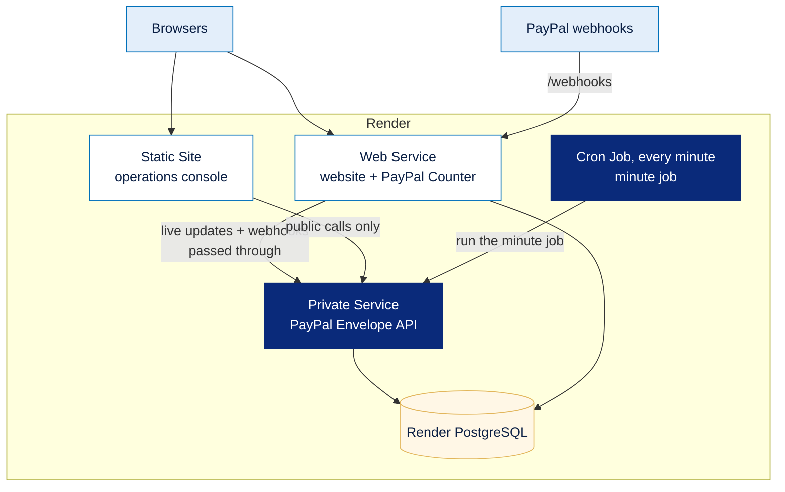

# Render in PayPal Envelope

[← Back to the main README](../../README.md)

PayPal Envelope is a few small Node.js services plus a PostgreSQL database, with one strict rule: **only the website is public**. **Render** offers each piece the shape it needs (a web service, a private service, a cron job, a static site and managed PostgreSQL) from the same Git repository, with environment variables per service. The project's layout maps onto Render one-to-one, with no containers or infrastructure code.

This guide explains the layout, how to deploy it, and what we would add next.

---

## Contents

1. [The services](#1-the-services)
2. [Deploying, step by step](#2-deploying-step-by-step)
3. [Choices that make it easy to host](#3-choices-that-make-it-easy-to-host)
4. [What we would add next](#4-what-we-would-add-next)
5. [Why it isn't in the current build](#5-why-it-isnt-in-the-current-build)

---

## 1. The services

| Service | Render type | Start command | What it does |
| :--- | :--- | :--- | :--- |
| Website (people and PayPal Counter) | **Web Service**, the only public address | `npm run site:start` | Serves the pages, handles logins and every password check, and passes only live updates and PayPal webhooks through to the API. Refuses the live channel to shop logins. Rebuilds the Bryntum bundle on start if needed. `/health` reports whether both the website and the API are up. |
| PayPal Envelope API | **Private Service** (or a Web Service) | `npm run api:start` | Envelope routes, PayPal webhooks, live updates and the minute job. Needs no public address, because webhooks reach it through the website. |
| Minute job | **Cron Job**, `* * * * *` | `npm run start -w apps/sweeper` | Calls the API's background job once and exits. The API does the work, so its live updates still reach browsers. Set `BACKGROUND_JOBS=off` on the API when this runs. |
| Operations console | **Static Site** | `npm run web:build` | The React build. It uses the generated SDK and holds no private key. |
| Database | **Render PostgreSQL** | `npm run db:deploy` on build | Prisma migrations. The client drops idle connections after a minute and waits up to 30 seconds for a new one, which suits a database that may sleep. |

---

## 2. Deploying, step by step

1. Create a **Render PostgreSQL** database and copy its internal address into `DATABASE_URL`.
2. Create the **API** as a Private Service. Build with `npm install && npm run db:deploy && npm run db:seed`, start with `npm run api:start`, and add the variables from `.env.example`.
3. Create the **website** as a Web Service. Start with `npm run site:start`. Point it at the API's internal address and set `SITE_URL` to its own public address.
4. Create the **Cron Job** (`* * * * *`, `npm run start -w apps/sweeper`) and set `BACKGROUND_JOBS=off` on the API.
5. Create a **Static Site** for the console (build `npm run web:build`, publish `apps/web/dist`).
6. Register PayPal webhooks against the public website: `npm run setup:webhooks -w packages/paypal -- https://<site>`, then add the printed ids to the API's variables.

---

## 3. Choices that make it easy to host

| Choice | Why it helps |
| :--- | :--- |
| One public service that passes on only two kinds of traffic | The API stays private and the attack surface stays small |
| The background job can be triggered over HTTP | A cron job can run it instead of a long-lived timer |
| Every background step claims its work before doing it | A cron job and the API timer, or two servers, never charge or run anything twice |
| Webhooks are the fast path, with the minute job and *Sync* as backup | A cold start or a missed webhook never loses money |
| Optional services fall back (Elastic, Channel3, Kernel, Zapier) | A deploy with fewer keys still works end to end |
| Saved PayPal accounts and alert recipients live in the database | The website and the API share them even on separate disks |

---

## 4. What we would add next

| # | Render feature | What it would give the project |
| :---: | :--- | :--- |
| 1 | **Blueprint** (`render.yaml`) with environment groups | One-click deploys of all five services, with shared secrets defined once |
| 2 | **Background Worker** | Agent runs and the minute job in their own process, so the API only answers requests |
| 3 | **Render Key Value** (Redis) | Live updates across several instances, a shared "agent is running" lock, shared email de-duplication and rate limits |
| 4 | **Data files moved into PostgreSQL**, or a persistent disk | Sign-ups, shop notes and cached PayPal reports survive a redeploy |
| 5 | **Private networking for every internal hop** | The API and database have no public address at all |
| 6 | **Preview environments** | A live copy of every pull request for reviewers |
| 7 | **A Docker service with Chrome** | The personal sandbox balance and automatic linking work on the server without Kernel |
| 8 | **Autoscaling and zero-downtime deploys** | Handle a rush of agent purchases |
| 9 | **High availability, point-in-time recovery and a read replica** | A ledger that never loses an entry, and shop reports read from a replica |
| 10 | **Separate cron jobs and one-off jobs** | The minute job, the nightly PayPal check and re-indexing each with their own schedule, logs and retries; migrations as one-off jobs |
| 11 | **Log streams and alerts** | A warning when payouts keep failing or the minute job stalls |
| 12 | **A custom domain with HTTPS** | A stable address for PayPal webhooks and email buttons |

---

## 5. Why it isn't in the current build

| # | Reason |
| :---: | :--- |
| 1 | The project needs more than 30 secrets (two PayPal apps, AI keys, licences, test passwords) that differ per teammate. We configured services by hand so no secret could end up in the repository under deadline pressure. |
| 2 | Workers are a paid instance type, and free web services sleep when idle, which also stops an in-process timer. The timer inside the API plus the cron job worked within our budget. |
| 3 | The "agent is running" map, email de-duplication and rate limits live in memory, which is correct with one instance. Moving them is a change we couldn't test properly in the time we had. |
| 4 | Render's disk resets on every deploy. A persistent disk needs a paid plan and rules out zero-downtime deploys, and moving four small stores into the database was cut for time. |
| 5 | Private services aren't on the free tier. The website already passes only two kinds of traffic to the API, which gave the same protection for the demo. |
| 6 | Each preview needs its own database, its own PayPal webhook registration and its own keys: too much setup per branch for a team of three. |
| 7 | Signing in to the PayPal sandbox with stored test passwords is a demo shortcut we chose not to harden for hosting, and browser images are large and slow to build. |
| 8 | It depends on #3: with in-memory locks, two instances could run the same agent twice, so we stayed on one instance on purpose. |
| 9 | These are paid tiers, and the sandbox ledger holds only test money. |
| 10 | Splitting the job needs locks that work across processes, which depends on #3. |
| 11 | We spent that time on the nightly PayPal check and on alerts that reach the envelope owner directly. |
| 12 | During development, Cloudflare quick tunnels needed no account setup and let each of us demo from our own laptop. |

**Other reasons, beyond time and money:**

- **Real money needs real approval.** Payouts, saved accounts and Invoicing need PayPal's production approval, and holding many people's money in one account would need licensing and a compliance review. We kept the project in the sandbox on purpose.
- **Licence keys reach the browser.** AG Grid and Bryntum keys are served to the page by design, so a long-running public site needs keys locked to its domain.
- **Free quotas run out.** A public link left open for judges could use up the free AI, Channel3 and Elastic quotas, which is why each of them has a fallback.

[← Back to the main README](../../README.md)
