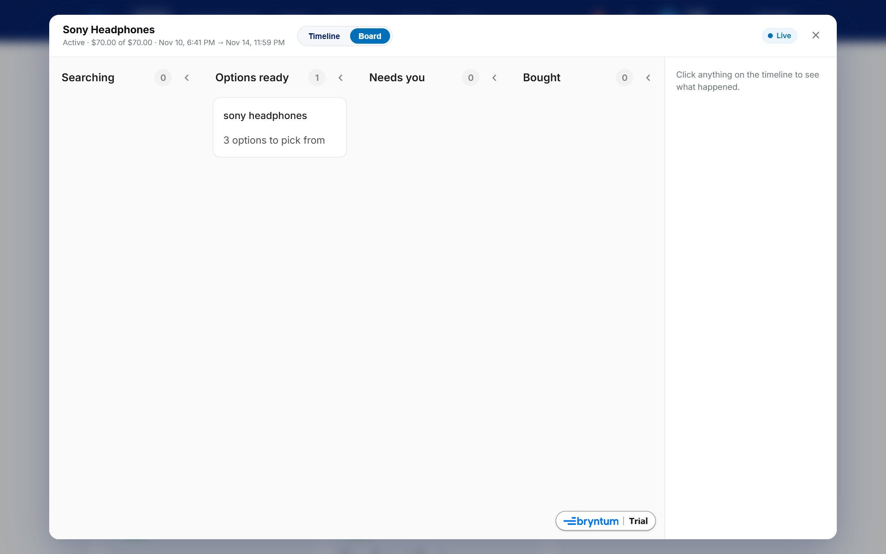
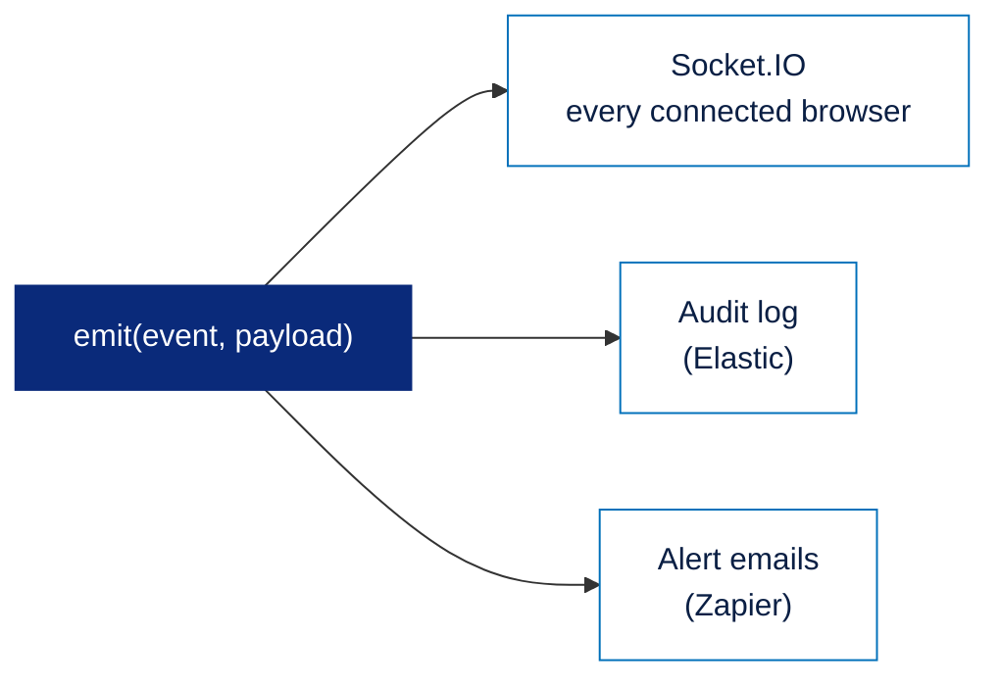

# Socket.IO in PayPal Envelope

[← Back to the main README](../../README.md)

When an agent is spending your money, you want to watch it work. **Socket.IO** sends every envelope change, and every step the agent takes, to the browser the moment it happens. Activity logs fill in live, balances update after a payment, and the timeline shows the agent's steps as it searches.



---

## Contents

1. [The events](#1-the-events)
2. [One signal, three listeners](#2-one-signal-three-listeners)
3. [On the website](#3-on-the-website)
4. [In the operations console](#4-in-the-operations-console)
5. [Through the public site, never to a shop](#5-through-the-public-site-never-to-a-shop)

---

## 1. The events

**What it is.** A small set of named messages the API sends whenever something changes.

**What it contains.** Each event is small: the envelope's id and what changed. Browsers then read the latest data through the API.

| Event | Sent when |
| :--- | :--- |
| Envelope updated | Anything about an envelope changes: funded, status, balance, the agent's schedule, the savings plan |
| Decision created | The rule engine decides, or the owner approves or rejects |
| Ledger updated | A payment is created or settled |
| Agent step | The agent finishes one action (search, compare, read a price, ask to buy), with what it found |
| Rules changed | A new version of the rules is saved |
| Options ready | The agent suggests options in *Ask me* mode |
| Savings failed | A savings payment is declined |
| Verification mismatch | The nightly check finds a difference with PayPal |

---

## 2. One signal, three listeners

**What it is.** One function in the API that sends each event everywhere it is needed.

**How it is made.**



```js
export function emit(event, payload) {
  io?.emit(event, payload);              // browsers
  for (const fn of listeners) fn(event, payload); // server-side listeners
}
```

The audit log and the alert emails subscribe with `onEvent`, so one call shows a decision on screen, records it and emails it. Neither listener can slow down a payment.

---

## 3. On the website

**What it contains.** A live activity log on each envelope, live envelope cards and balance, a live calendar and timeline, and the agent's steps during *Run now*.

**How it is made.**

- The page connects after login, through the website's own address.
- Envelope, decision, ledger and options events trigger **one** refresh 300 milliseconds later, so a burst of events causes a single reload. The refresh covers the envelope cards, the open envelope page, the PayPal balance, and the calendar and timeline if they're open.
- A ledger event also marks the PayPal balance as changed, so it is read again.
- Agent steps are added straight to the open envelope's activity log, and to the agent's lane on the timeline while *Run now* is active.

---

## 4. In the operations console

The console loads envelopes, decisions and the ledger, reloads them 250 milliseconds after any event, catches up after reconnecting, and keeps the last 200 agent steps for its *Agent activity* list. Its header shows **Live** or **Offline**.

---

## 5. Through the public site, never to a shop

**What it is.** Live updates reach browsers through the single public address, but never reach shops.

**How it is made.** The API is private, so the website passes live-update traffic through to it, including the WebSocket upgrade, which the website rebuilds by hand. That way live updates work through one public address on Render or behind a Cloudflare tunnel.

The live channel carries every customer's envelope events, so **shops are refused it**: a shop's login gets a "not for business" error, and its upgrade request is closed. PayPal Counter instead regularly checks a fingerprint of the shop's own payments (how many, the last change, the last PayPal sync) and reloads only when that fingerprint changes.

**Where it lives:** `apps/api/src/events.ts` (events and listeners), `apps/api/src/index.ts` (the server), `paypal-interface/server.ts` (the pass-through and the refusal for shops), `paypal-interface/app.js` (the website's listeners), `apps/web/src/live.ts` (the console's listeners).

[← Back to the main README](../../README.md)
