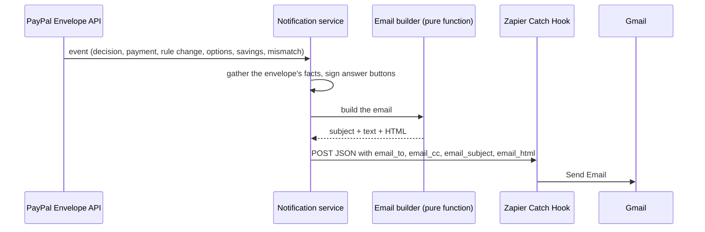

# Zapier in PayPal Envelope

[← Back to the main README](../../README.md)

An agent that spends your money should tell you what it is doing, and you should be able to answer without opening an app. The API writes every alert email itself (subject, plain text and HTML) and hands it to a **Zapier** webhook, which delivers it through Gmail. Because the content is built in our code, it can be tested, and the delivery channel (Gmail, Slack, SMS) can change without touching the project.

---

## Contents

1. [How an alert travels](#1-how-an-alert-travels)
2. [The 14 emails](#2-the-14-emails)
3. [Answering from the email](#3-answering-from-the-email)
4. [The confirm page](#4-the-confirm-page)
5. [Who receives each email](#5-who-receives-each-email)
6. [Sent once, never in the way](#6-sent-once-never-in-the-way)
7. [Setting up the Zap](#7-setting-up-the-zap)

---

## 1. How an alert travels

**What it is.** The path from something happening in an envelope to an email in the owner's inbox.

**How it is made.**



1. The API emits an event, for example *a decision was made* or *a payment completed*.
2. The notification service gathers the envelope's facts (name, owner, balance, rules, end date) and signs any answer buttons.
3. A **pure function** builds the email. Every subject starts with the envelope's name and a short id, so each envelope's mail is easy to tell apart: *"[Headphones · #H7K2P] Pick one: 3 options ready"*.
4. The email is posted as JSON to the Zapier *Catch Hook*, with the recipient, copies, subject, text and HTML as separate fields.
5. The Zap sends it with Gmail.

---

## 2. The 14 emails

**What it is.** One email for every moment that matters to the owner.

**What it contains.**

| Email | When | What it says |
| :--- | :--- | :--- |
| Your envelope is live | The first payment arrives | How much is set aside, until when, and the rules the agent must follow |
| Purchase made / Bill paid | A payment to a shop completes | The item, shop and price, a price check and other stores, a product photo, and what's left |
| Your approval is needed | A purchase needs the owner | Why, in plain words, with **Approve** and **Reject** buttons |
| Your options are ready | The agent suggests options | Each option with its price and price check, with **Pick 1 / 2 / 3** and **None of these** |
| A purchase was blocked | A rule blocked a purchase | Every reason, plus one line on how to allow it |
| Rules updated | The rules change | Only what changed, as before and after, and any money charged or refunded |
| Refund arrived | A lowered amount is refunded | The difference is back in PayPal |
| Envelope closed | The leftover is refunded | Dates, money in, each purchase, money returned, number of rule changes |
| Ends in 24 hours | An envelope enters its last day | What's left will come back automatically |
| A payment or refund failed | PayPal refused a payment | What PayPal said, and that the money is safe |
| Please check this payment | The nightly check found a difference | What PayPal says, and PayPal's reference |
| Savings payment made | Each savings payment | Saved so far, payment *n of m*, the next date |
| You reached your goal | The savings goal is met | Whether the agent now starts shopping |
| Savings payment failed / plan paused | A savings payment is declined | Retrying tomorrow, or paused after three tries |

**How it is made.** Each email is a `[label, value]` list of facts plus a headline, an introduction and a closing line, rendered twice: as plain text and as a single-column HTML layout that works in Gmail and on phones, coloured by tone (good news, waiting on you, a problem). All text from shops or the AI is HTML-escaped. The builder has 11 unit tests, covering subjects, recipients, escaping, rule-change tables, options and savings emails, and the answer buttons.

---

## 3. Answering from the email

**What it is.** Buttons in approval and option emails, so the owner can answer from their phone.

**What it contains.** One button per answer: *Approve $98.00* and *Reject*, or *Pick 1: $64.00 at Walmart*, *Pick 2*, *Pick 3* and *None of these*. They work once and expire after 24 hours.

**How it is used.** Tap a button. A confirm page opens; for Approve and Pick, enter your password.

**How it is made.** Each button is a link with a **signed token**: the action (approve or reject a purchase, pick option *n*, or none of these), the envelope and an expiry time, signed with HMAC-SHA256 using a key only the servers have. Signatures are compared in constant time.

```js
const body = Buffer.from(JSON.stringify({ ...action, e: now + ttlMs })).toString('base64url');
return `${body}.${createHmac('sha256', secret).update(`approval-link:${body}`).digest('base64url')}`;
```

A purchase or option set that was already handled can't be handled again, so a second tap says *Already answered*.

---

## 4. The confirm page

**What it is.** The page a button opens. **Opening it never acts by itself**, because mail apps and virus scanners open links on their own.

**What it contains.** What will happen (*"Buy option 2 for $98.00?"*), the item, shop and price, the envelope's remaining money, a password field when money will move, and a link to open the envelope.

**How it is used.** Check the details, enter your password and press the button. The page then says what happened: *"Paid with PayPal: $98.00 went to Target. Your rules were checked again before paying."*

**How it is made.** The website checks the token's signature and expiry, loads the envelope, and shows the page (`GET`). The action only happens when the form is sent (`POST`). Approve and Pick then check the password and ask the API, which runs the rule engine again before paying. If the purchase is now blocked, the page says why and nothing is charged.

---

## 5. Who receives each email

The recipient is chosen in this order:

1. The person who signed up on the site and created that envelope, so their alerts stay theirs even when someone else logs into the shared demo account.
2. The person who signed up and logged in last on the shared demo account.
3. The mapping in `ALERT_RECIPIENTS` (a sandbox email paired with a real inbox).
4. The first address in `ALERT_CC`.

Everyone in `ALERT_CC` gets a copy. Dates are shown in `ALERT_TIMEZONE`.

---

## 6. Sent once, never in the way

- The same event can arrive twice (for example a webhook and a sync), so each email has a key and is sent only once.
- Expected events are skipped: the owner's own approval or rejection, and agent runs stopped because the rules changed.
- *Ends in 24 hours* is sent when an envelope **crosses** the 24-hour mark between two checks, so restarting the server never sends it twice.
- Emails go out in the background with a 10-second timeout. If Zapier is down, the error is logged and payments carry on.
- Without `ZAPIER_HOOK_URL`, alerts are simply off.

---

## 7. Setting up the Zap

1. Create a Zap with **Webhooks by Zapier → Catch Hook** and put its URL in `ZAPIER_HOOK_URL`.
2. Trigger one alert, for example by creating and funding an envelope, so Zapier sees the fields.
3. Add **Gmail → Send Email**: To = `email_to`, CC = `email_cc`, Subject = `email_subject`, Body type HTML, Body = `email_html`.
4. Set `SITE_URL` to the website's public address, so links and buttons work from a phone.

| Variable | Purpose |
| :--- | :--- |
| `ZAPIER_HOOK_URL` | The Catch Hook address. Empty turns alerts off. |
| `ALERT_RECIPIENTS` | `sandbox-email=real-inbox` pairs, comma separated |
| `ALERT_CC` | Addresses that get a copy |
| `ALERT_TIMEZONE` | Time zone for dates |
| `SITE_URL` | Where links and buttons point |
| `INTERNAL_API_KEY` | Signs the answer buttons. Without it, emails have no buttons. |

**Where it lives:** `apps/api/src/services/notify.ts` (events, recipients, sending), `apps/api/src/services/emails.ts` (the 14 emails), `packages/policy/src/approval-links.ts` (signing the buttons), and the confirm pages in `paypal-interface/server.ts`.

[← Back to the main README](../../README.md)
